# 在线考试系统需求规格说明书

> 文档编号：EXAM-SRS-001　版本：v1.0　状态：已基线化（等待 G1 需求门禁评审）
> 编制角色：需求分析师（RA）　编制日期：2026-10-31　适用阶段：P1
> 唯一事实来源：`00-team/project-brief.md`（下文简称「基线」）。本文件与其冲突时以基线为准；若本文件对基线未覆盖处作出补充，均在 §7「约束与假设」中显式登记。

| 项 | 内容 |
|---|---|
| 项目名称 | 基于 React + Node.js 的在线考试系统（Design and Implementation of an Online Examination System Based on React and Node.js） |
| 文档用途 | 定义系统边界、角色、用例、功能需求与非功能需求，作为系统设计、编码实现、测试验证与论文撰写的共同依据 |
| 输入依据 | `00-team/project-brief.md`（基线规格书）、`00-team/agent-team.md`（团队编制与 RA Charter） |
| 下游消费者 | 系统架构师（SA）、后端开发者（BE）、前端开发者（FE）、测试工程师（QA）、论文撰写者（TW）、答辩助手（DA） |
| 交付规模 | 功能需求 38 条（FR-01 ~ FR-38）、非功能需求 18 条（NFR-01 ~ NFR-18）、用例 38 个（UC-01 ~ UC-38）、核心用例详细描述 11 个 |
| 编号规则 | 需求编号连续不跳号；用例编号与需求编号不要求一一对应，全部对应关系登记于 `需求追踪矩阵.md` |
| 追踪关系 | 每条 FR / NFR 均在追踪矩阵中登记「设计章节 + 接口/数据表 + 测试用例编号」，无孤立需求 |
| 明细附件 | `用例图.mmd`（可独立渲染的用例图源码）、`需求追踪矩阵.md`（56 行追踪表）、`调研摘要.md`（论文第 1、2 章素材） |

**目录**

1. 引言
2. 背景与现状调研
3. 利益相关者与角色分析
4. 用例分析
5. 功能需求
6. 非功能需求
7. 约束与假设
8. 需求优先级与迭代规划
9. 验收标准汇总
10. 附录：需求变更记录与自检清单

---

## 1 引言

### 1.1 编写目的

本文件面向「在线考试系统」毕业设计项目的全体下游角色，承担四项职责：

1. **固化范围**：以基线规格书为依据，把「建课 → 建题库 → 组卷 → 发布 → 学生答题 → 阅卷 → 成绩分析」的闭环拆解为可分配、可实现、可验证的需求条目，明确哪些功能在范围内、哪些明确不做。
2. **统一语言**：定义三类角色（管理员、教师、学生）及其权限边界、术语口径（尤其「答卷」「自动保存」「判分口径」），避免设计与开发阶段对同一词汇产生不同理解。
3. **提供可测试的验收基准**：每条功能需求都给出可被测试工程师直接转写为断言步骤的验收标准；每条非功能需求都给出可度量的指标与测量方法，杜绝「响应要快」「安全要好」这类无法验收的表述。
4. **建立追踪基线**：与 `需求追踪矩阵.md` 配套，形成「需求 → 设计章节 → 接口/数据表 → 测试用例」的双向链条，满足质量门禁 G1「三类角色 100% 功能覆盖，≥20 条需求且全部可追踪到设计与测试」。

本文件**不**承担技术选型论证与架构决策职责（属 SA）、不包含代码实现细节（属 BE / FE）、不包含测试执行记录（属 QA）。

### 1.2 项目背景

高校课程考核长期依赖纸质试卷与人工阅卷。一次常规期末考试涉及命题、审题、排版、印刷、保管、监考、收卷、批阅、登分、统计共十余个环节，周期通常以周计，且成绩数据在流转中反复手工转录。随着课程规模扩大与过程性评价（随堂测、单元测、期中测）的普及，纸质方式在**成本、时效、数据沉淀**三个维度上的矛盾愈发突出。

与此同时，市场上已存在大量在线教学与考试平台，但其定位多为「综合教学平台」：功能覆盖面广、模块耦合重、学习成本高，且相当比例以 SaaS 形式提供，学校与教师对数据的掌控力有限。对于一门课程、一个教学班规模的严肃考试场景，这类平台存在明显的「功能过剩与关键能力不足并存」问题——冗余模块很多，而「作答不丢、计时可信、判分口径透明、统计可解释」这些真正决定考试公平性的能力反而不够扎实。

本项目的定位因此明确为：**面向单门课程与单个教学班的、轻量自建、闭环完整、口径透明的在线考试系统**。技术上采用 React 18 前后端分离架构 + Node.js/Express 4 RESTful 服务 + MySQL 8.0 持久化，以「契约先行、接口可测、数据自主」为工程原则，在毕业设计周期内完成一个可演示、可验证、可复现的最小完整系统。

### 1.3 术语与缩略语

| 术语 / 缩写 | 全称或含义 | 在本系统中的确切含义 |
|---|---|---|
| SRS | Software Requirements Specification | 需求规格说明书，即本文件 |
| FR | Functional Requirement | 功能需求，编号 FR-01 ~ FR-38 |
| NFR | Non-Functional Requirement | 非功能需求，编号 NFR-01 ~ NFR-18 |
| UC | Use Case | 用例，编号 UC-01 ~ UC-38 |
| TC | Test Case | 测试用例，编号 TC-01 ~ TC-56，由测试工程师对齐扩展 |
| RBAC | Role-Based Access Control | 基于角色的访问控制，本系统角色为 admin / teacher / student |
| JWT | JSON Web Token | 无状态身份令牌，payload 含 `sub`、`username`、`role`，有效期 8 小时 |
| 组卷 | — | 从题库选择题目并设定每题分值、题序，生成一份试卷的过程 |
| 答卷（attempt） | — | 某学生对某场考试的一次作答记录；全系统实行「一人一卷」，`UNIQUE(exam_id, student_id)` |
| 自动保存 | — | 学生每次作答（选择或填写）即调用 `PUT /attempts/:id/answers` 将单题答案持久化到服务端 |
| 客观题 | — | 单选（single）、多选（multiple）、判断（judge）三种题型，可由程序自动判分 |
| 主观题 | — | 简答题（short），需教师人工给分并填写评语 |
| 判分口径 | — | 题目得分的判定规则。本系统规定：单选/判断精确匹配得满分；**多选少选、错选、多选均不得分**（零部分分）；简答不计自动分 |
| 考试窗口 | — | 考试允许作答的绝对时间区间 `[start_time, end_time]` |
| 答卷截止时间 | deadline_at | 服务端按 `min(started_at + duration_min, exam.end_time)` 计算并落库的唯一权威截止时间 |
| 剩余秒数 | remainingSeconds | 接口返回的 `deadline_at` 与服务器当前时间之差，前端只做展示，不做权威计时 |
| 草稿 / 发布 / 关闭 | draft / published / closed | 考试（exams）的三种状态；仅 draft 可编辑与删除，仅 published 可被学生开考 |
| 作答状态机 | — | 答卷状态 `in_progress → submitted → graded`，状态迁移单向前进，`submitted`/`graded` 后禁止写答案 |
| P95 | 95th Percentile | 响应时间分布的 95 分位值，用于性能验收 |
| TPS | Transactions Per Second | 每秒事务数，用于并发能力描述 |
| 幂等 | Idempotency | 同一操作重复执行不产生副作用与重复数据；本系统对「开考」「交卷」两个操作要求幂等 |

### 1.4 参考资料

**项目内部依据（唯一事实来源，优先级最高）**

1. `00-team/project-brief.md`：项目基线规格书，含角色权限矩阵（§3）、8 张数据表定义（§4）、36 个 REST 接口契约（§5）、质量门禁 G1~G7（§7）、种子数据（§8）、术语表（§9）。
2. `00-team/agent-team.md`：Agent Team 组建方案，含 RA 角色 Charter（§2）、交接协议（§3）、协作时序（§4）、风险与应对（§7）。

**外部参考标准（仅作文档组织方式的参照，不引入额外功能）**

3. GB/T 8567—2006《计算机软件文档编制规范》：本文件的章节组织参考其需求规格说明部分。
4. GB/T 25000.51—2016《系统与软件工程 系统与软件质量要求和评价（SQuaRE）》：非功能需求的质量特性分类（性能效率、信息安全、可靠性、易用性、可维护性、兼容性、可移植性）参照其术语体系。
5. ISO/IEC/IEEE 29148—2018《Systems and software engineering — Life cycle processes — Requirements engineering》：需求条目的「可验证性」与「无歧义性」判据参照其要求。

> 说明：本文件不引用具体学术文献编号。论文第 1、2 章所需的文献性表述与方法学背景集中在 `调研摘要.md` 中给出，由论文撰写者（TW）按 GB/T 7714 格式补全真实文献条目。

### 1.5 读者对象与阅读指引

| 读者 | 建议阅读章节 | 关注点 |
|---|---|---|
| 系统架构师 SA | §3、§4、§5、§6、§7 | 需求到模块的映射、非功能指标的设计约束、基线的 36 个接口是否覆盖全部需求 |
| 后端开发者 BE | §5（全部 FR 的验收标准）、§6（NFR-04~12、17、18） | 判分口径、状态机、错误码、越权规则、时间口径 |
| 前端开发者 FE | §4（核心用例主流程）、§5（FR-23~FR-31）、§6（NFR-03、09、10、13、15） | 倒计时展示口径、自动保存时机、断线恢复、答案不可见 |
| 测试工程师 QA | §5、§6、§9 | 验收标准可直接转写为测试步骤；NFR 的度量方法即测试方法 |
| 论文撰写者 TW | §1、§2、§3、§4、§8 | 需求分析章节的素材与图表演进逻辑 |
| 答辩助手 DA | §2.4、§8、§9 | 选题价值、差异化、迭代规划的讲述要点 |

---

## 2 背景与现状调研

### 2.1 传统纸质考试的痛点

| 序号 | 痛点 | 具体表现 | 对教学的影响 |
|---|---|---|---|
| P-01 | 制卷周期长、成本高 | 命题、审题、排版、印刷、装订、运输串行执行，任一环节返工即整体延期；临时增删题目几乎不可行 | 考试安排缺乏弹性，难以支撑高频的过程性评价 |
| P-02 | 泄题风险集中于物理流转 | 试卷在命题人、审题人、印刷点、保管室、考场之间多次交接，任一环节失守即整场失效，且事后难以定位责任环节 | 考试公信力受损，重考成本极高 |
| P-03 | 阅卷效率低且尺度不一 | 客观题靠人工逐份比对答案，主观题由不同教师批阅，评分尺度缺乏统一标定，且批改痕迹不可追溯 | 成绩公布延迟，评分争议缺少证据链 |
| P-04 | 成绩处理依赖人工二次转录 | 登分、核分、及格率与分数段统计需人工录入表格并反复核对，错误难以自查 | 统计结果可信度低，复核工作量大 |
| P-05 | 考试数据无法沉淀为教学资产 | 纸质答卷保存占用空间、检索困难，题目正确率、知识点薄弱项等诊断信息无法沉淀 | 教学改进缺乏数据支撑，试题质量无法迭代 |
| P-06 | 时空约束强 | 必须统一安排考场与时间，缺考、缓考、跨校区考试的组织成本高 | 特殊情况的补救机制代价大 |
| P-07 | 纸张消耗与归档压力 | 大批量印刷消耗纸张，答卷按规定需保存一定年限，占用库房并存在损毁风险 | 与绿色校园、档案数字化的方向相悖 |

### 2.2 现有在线考试平台的痛点

| 序号 | 痛点 | 具体表现 |
|---|---|---|
| Q-01 | 功能冗余导致操作路径过长 | 综合教学平台把直播、资源、签到、作业、讨论等模块捆绑在一起，教师完成「组卷并发布一场考试」往往需要穿越多层菜单，新用户学习成本高 |
| Q-02 | 数据主权与合规风险 | 多数商业平台以 SaaS 交付，师生数据存放于第三方；校内数据合规审查、二次开发与教学研究均受限 |
| Q-03 | 作答可靠性不足 | 部分产品的答案仅暂存于浏览器本地，网络抖动、误刷新或切换设备即导致已答内容丢失，且恢复后无明确提示 |
| Q-04 | 计时不可信 | 倒计时由客户端自行推算，刷新页面后可能重置；时钟可被本地修改，缺少以服务端截止时间为唯一权威的机制 |
| Q-05 | 判分口径不透明 | 多选题「少选是否给部分分」等关键规则未在产品中显式声明，成绩争议时缺少可查依据 |
| Q-06 | 统计维度偏浅 | 通常只提供总分、排名与及格率，缺少题目正确率、分数段分布等教学诊断数据；导出格式固定，难以二次分析 |
| Q-07 | 定制与毕设适配性差 | 闭源系统不可改造；开源系统（如 Moodle）技术栈陈旧、代码体量大、插件机制复杂，难以在毕业设计周期内完整掌握并做实质性改造 |
| Q-08 | 部署与运维门槛错配 | 面向万人规模的平台部署链路重（依赖缓存、消息队列、对象存储），单门课程场景下属于明显的过度设计 |

### 2.3 国内外研究与应用现状

以下 7 条为概述性研判，用于支撑选题论证，不绑定具体文献编号；论文撰写时应补充可查证的真实文献并按 GB/T 7714 著录。

1. **考试测量理论的工程化落地**。经典测量理论（CTT）与项目反应理论（IRT）为题库建设、难度标定与试卷等值提供了理论基础。工程实践中，这一理论体系主要体现为「题目元数据化」：为每道题维护题型、分值、难度系数、知识点标签，使组卷从「凭经验挑题」转变为「按约束条件选题」，并使后续的题目质量分析（正确率、区分度）成为可能。本系统的 `questions` 表设置 `difficulty`（1~5）与 `knowledge_point` 字段，正是这一思路的轻量实现。

2. **计算机化考试（CBT）与自适应测验（CAT）**。国外大规模标准化考试较早完成从纸笔到机考的迁移，并在自适应测验方向形成较成熟的选题与能力估计方法；国内则以固定试卷的规模化机考为主，重点是并发承载与考务流程的电子化。二者的共同结论是：机考的价值不仅是「省纸」，更在于把「计时、判分、统计」从人工环节转为可审计的确定性流程。

3. **开源学习管理系统的测验模块**。Moodle、Canvas 等平台以「测验（Quiz）」模块提供题库、随机组卷、自动判分与成绩簿，插件生态完善、教育场景覆盖广。但其架构偏重（插件钩子多、数据模型宽），二次开发门槛高；且其设计面向「课程过程性评价」，对严肃考试所需的「一人一卷、服务端权威计时、答卷状态机」缺少现成约束，需大量定制。

4. **国内智慧教学平台的普及路径**。以超星学习通、雨课堂、学堂在线为代表的平台，在高校课堂互动、随堂练习、资源分发场景渗透率较高。其优势在于与教学资源、课堂互动的深度耦合以及移动端体验；相对薄弱之处在于严肃考试的流程管控（如答卷恢复的确定性、判分规则的显式声明）与数据自主可控，且功能面广导致单点操作的路径较长。

5. **Web 考试系统的架构演进**。技术形态上，考试系统经历了「JSP/ASP 服务端渲染单体 → 前后端分离（SPA + RESTful API）→ 容器化与服务拆分」的演进。演进动因主要是集中开考带来的瞬时并发：开考瞬间大量学生同时请求试卷与创建答卷，形成明显的写入尖峰。主流应对手段包括无状态服务（令牌鉴权，便于水平扩展）、读写分离、连接池化与接口层的幂等设计。本系统选择前后端分离 + JWT 无状态鉴权，并以「开考幂等」应对该尖峰。

6. **考试公平性与防作弊的边界认知**。学界围绕身份核验、行为异常检测、题目乱序与等值组卷开展了大量研究；工程实践则普遍承认「纯软件手段无法彻底防作弊」。因此严肃系统的现实策略是**可审计的基础约束**：一人一卷（防止换号重考）、服务端计时（防止改本地时钟）、题目乱序（降低邻座抄袭收益）、操作留痕（便于事后追溯）。本系统在基线中明确不实现摄像头监考与人脸识别，仅落地上述基础约束，这一「明确的能力边界」本身即是需求分析的重要产出。

7. **自动判分与主观题评阅的定位**。客观题自动判分已完全工程化，其难点不在算法而在「判分口径的显式化」（例如多选题是否给部分分）。主观题评阅则经历了「关键词匹配 → 文本相似度 → 预训练语言模型辅助评分」的演进，但教育测量领域普遍要求人工复核，自动评分多定位为「辅助排序与预评分」而非「替代教师」。本系统据此把简答题严格划归人工阅卷，并在数据模型中以 `graded_by`、`graded_at`、`comment` 保留评分责任链。

8. **轻量化自建系统在教务场景的复苏**。随着 React/Vue 与 Node.js/Spring Boot 生态成熟，越来越多院系选择「小团队自建、单课程部署」的轻量系统，以缩短交付周期并保持数据自主。这类项目的共同工程特征是：契约先行（先定接口再并行开发）、自动化测试兜底（接口集成测试为主）、存储层可替换（便于无数据库环境下跑测试）。本项目的 Repository 双实现（mysql / memory）与「≥40 个测试用例、行覆盖率 ≥70%」的门禁，即是对这一工程范式的遵循。

### 2.4 本系统的定位与差异化

**定位**：面向「一门课程 + 一个教学班」规模的、可自建自运维的轻量级严肃考试系统，完整覆盖「建课 → 建题库 → 组卷 → 发布 → 答题 → 阅卷 → 统计」七步闭环，服务三类角色（管理员、教师、学生），不追求平台化与多租户能力。

**差异化（相对同类系统）**

| 差异点 | 具体主张 | 可验证的落点 |
|---|---|---|
| 闭环完整性 | 七步闭环在同一系统内完成，不依赖外部工具补齐任一环节 | 一条演示脚本可从零走到成绩分析，全程无手工改库 |
| 计时可信 | 以服务端 `deadline_at` 为唯一权威，客户端只做展示；刷新、换设备均不重置 | NFR-10：恢复后剩余时间与服务端偏差 ≤ 5 秒 |
| 作答不丢 | 每次作答即持久化，断线重连后逐题恢复 | NFR-09：单题落库 ≤ 3 秒；NFR-10：已保存答案 100% 恢复 |
| 判分口径显式 | 多选题「少选/错选/多选均不得分」写入需求与测试用例，不留解释空间 | FR-29 验收标准 + 专项测试用例锁定 |
| 数据自主 | 自建 MySQL 8.0，无第三方 SaaS 依赖，题库与成绩数据完全在校内 | 部署形态为单机 Node 服务 + MySQL |
| 工程可验证 | 接口契约先行，Repository 双实现使测试无需真实数据库，质量门禁量化 | G3：用例 ≥ 40、行覆盖率 ≥ 70% |
| 边界诚实 | 明确不实现防作弊硬件、AI 判分、移动端与多租户，并在论文「不足与展望」中说明 | 与本文件 §7 约束条目一一对应 |

**明确不做（与基线 §2.3 一致）**：摄像头监考、切屏检测、人脸识别；移动端小程序、离线考试、多租户 SaaS、消息推送；AI 自动批改主观题；富文本与公式编辑（题干为纯文本 + 选项文本）。

---

## 3 利益相关者与角色分析

### 3.1 利益相关者清单

| 类别 | 利益相关者 | 与本系统的关系 | 关注的成果 |
|---|---|---|---|
| 直接用户 | 管理员（admin） | 系统数据的最终责任人，负责账号与权限治理 | 数据准确、权限可控、系统可稳定演示 |
| 直接用户 | 教师（teacher） | 考试的组织者与评判者，使用频次最高的内容生产者 | 组卷效率、阅卷效率、统计可解释性 |
| 直接用户 | 学生（student） | 考试的参与者，单位时间内压力最大的使用者 | 作答不丢、计时公平、成绩透明 |
| 间接相关 | 系统部署与运维者（校内信息中心/开发者本人） | 负责安装、备份与故障处置 | 部署简单、依赖少、日志可定位 |
| 间接相关 | 论文评阅教师与答辩评委 | 通过文档与演示判断工程质量 | 需求可追溯、指标可验证、边界诚实 |
| 间接相关 | 教务管理部门（假设性场景） | 成绩数据的最终使用方 | 成绩口径一致、可导出核对 |

### 3.2 管理员（admin）

| 维度 | 分析 |
|---|---|
| 角色描述 | 1 名，系统初始化的唯一入口账号（种子账号 `admin`），负责账号全生命周期、课程归属兜底、全局数据概览 |
| 核心目标 | ① 账号与角色准确无误，且能快速纠错（重置密码、禁用账号）；② 全局数据一屏可见（用户/课程/题库/考试/答卷六项计数）；③ 任何误操作可被系统约束拦截，不产生脏数据 |
| 痛点 | ① 手工批量建号易错，账号重复与角色错配难自查；② 删除课程/用户时不清楚是否被引用，容易造成孤儿数据；③ 缺少全局视角，无法快速判断「系统是否在正常运转」 |
| 关注点（质量属性） | 安全性（越权、口令存储）、可靠性（引用保护、事务）、可用性（列表检索与分页）、可审计性（评分留痕） |
| 典型场景 | 开学初批量导入师生账号 → 调整课程归属 → 考试周查看全局概览与各场次统计 → 处理密码遗忘工单 |
| 成功度量 | 新建一个账号 ≤ 30 秒、≤ 3 次跳转；越权请求 100% 被拦截（NFR-07）；删除被引用的课程 100% 返回 40901 |
| 权限边界 | 拥有全部功能权限；唯一不能做的是「以学生身份答题」（基线下 `/exams/:id/attempts` 仅 student） |

### 3.3 教师（teacher）

| 维度 | 分析 |
|---|---|
| 角色描述 | 1~N 名，每名教师负责若干门课程（`courses.teacher_id`），是其课程下题库、试卷、阅卷与统计的数据所有者 |
| 核心目标 | ① 把课程题目高效地沉淀进题库，避免重复录入；② 按约束灵活组卷（题型、分值、乱序），发布并精准指派到学生；③ 用最少的翻页完成主观题阅卷；④ 拿到可解释的教学诊断数据（平均分、及格率、分数段、题目正确率） |
| 痛点 | ① 逐题手工录入耗时长，批量导入格式不明确；② 组卷时分值合计易算错，及格线可能大于总分；③ 阅卷需在「题目—答案—评分框」间反复定位，一份答卷多次翻页；④ 统计口径（是否含未交卷、是否按百分制折算）不清导致结论失真 |
| 关注点（质量属性） | 效率（组卷与阅卷的操作步数）、正确性（判分口径、总分重算）、一致性（统计口径与需求一致）、隔离性（不得看到非本人课程数据） |
| 典型场景 | 建课 → 导入 30 道题 → 组一份 100 分的卷 → 发布并指派 2 个班 → 考后 1 小时内完成 40 份简答题阅卷 → 导出统计结论用于讲评 |
| 成功度量 | 100 题组卷服务端处理 < 1 秒（NFR-02）；单份答卷阅卷 ≤ 60 秒、无需返回列表页；统计字段与基线口径 100% 一致 |
| 权限边界 | 仅限本人课程；对他人课程的任何读写均返回 403/40301；不能管理用户 |

### 3.4 学生（student）

| 维度 | 分析 |
|---|---|
| 角色描述 | N 名，被教师指派到具体考试后方可作答；全系统「一人一卷」，不可重考 |
| 核心目标 | ① 顺利进入考试并看到完整试卷；② 作答过程零丢失，任何中断后能原样恢复；③ 计时公平、交卷确定性；④ 交卷后能看到逐题得分、正确答案、解析与教师评语 |
| 痛点 | ① 网络抖动或误刷新导致已答内容丢失；② 倒计时不准或刷新后重置，引发公平性质疑；③ 交卷后只知总分不知错在哪，无法复盘；④ 找不到本人历史成绩与及格情况 |
| 关注点（质量属性） | 可靠性（自动保存、断线恢复、超时兜底）、公平性（服务端计时、一人一卷）、透明性（解析、评语、及格判定）、易用性（移动端不要求，桌面端须清晰） |
| 典型场景 | 考前 5 分钟进入可考列表 → 开考 → 逐题作答（每次选择即时保存）→ 中途断网重连 → 恢复继续 → 交卷 → 查看客观题得分与解析 → 考后查看历史成绩 |
| 成功度量 | 已保存答案恢复率 100%、时间偏差 ≤ 5 秒（NFR-09/10）；交卷后 3 秒内看到客观题得分；任何接口响应中不出现 `answer`/`analysis`（NFR-08） |
| 权限边界 | 仅能访问被指派考试的试卷与本人答卷；不能访问题库、组卷、阅卷、他人成绩 |

### 3.5 角色—权限对照（与基线 §3 一致，作为权限验收的基准表）

| 功能 | 管理员 | 教师 | 学生 |
|---|:--:|:--:|:--:|
| 用户管理（增删改查、重置密码、禁用） | ✅ | ❌ | ❌ |
| 课程管理 | ✅ 全部 | ✅ 本人课程 | 👁 只读 |
| 题库管理 | ✅ 全部 | ✅ 本人课程 | ❌ |
| 组卷 / 发布 / 指派考生 | ✅ | ✅ 本人课程 | ❌ |
| 在线答题 / 交卷 | ❌ | ❌ | ✅ 被指派且进行中 |
| 阅卷（主观题打分） | ✅ | ✅ 本人课程 | ❌ |
| 成绩统计 | ✅ 全局 | ✅ 本人课程 | 👁 本人成绩 |
| 查看试题答案与解析 | ✅ | ✅ | 仅交卷后 |

> 权限实现要求：纵向（角色）× 横向（数据归属）双重校验，任一不满足必须返回 401/403 而非空数据；详见 NFR-07。

---

## 4 用例分析

### 4.1 用例图

用例图以 `graph LR` 风格绘制，三个参与者（actor）与 38 个用例分属 8 个功能域。为避免连线交叉，图中仅绘制各角色的**主要关联**；管理员对教师全部用例具备同等权限，完整权限以 §3.5 权限对照表为准。可独立渲染的源码见 `01-requirements/用例图.mmd`。

```mermaid
graph LR
    A(["管理员<br/>admin"])
    T(["教师<br/>teacher"])
    S(["学生<br/>student"])

    subgraph M1["① 用户与认证"]
        UC01(("UC-01<br/>登录系统"))
        UC02(("UC-02<br/>查看当前用户信息"))
        UC03(("UC-03<br/>查询用户列表"))
        UC04(("UC-04<br/>新增用户"))
        UC05(("UC-05<br/>修改用户信息"))
        UC06(("UC-06<br/>重置用户密码"))
        UC07(("UC-07<br/>启用/禁用用户"))
        UC08(("UC-08<br/>删除用户"))
    end

    subgraph M2["② 课程管理"]
        UC09(("UC-09<br/>浏览课程列表"))
        UC10(("UC-10<br/>创建课程"))
        UC11(("UC-11<br/>修改课程"))
        UC12(("UC-12<br/>删除课程"))
    end

    subgraph M3["③ 题库管理"]
        UC13(("UC-13<br/>查询与筛选题目"))
        UC14(("UC-14<br/>新增题目"))
        UC15(("UC-15<br/>修改题目"))
        UC16(("UC-16<br/>删除题目"))
        UC17(("UC-17<br/>批量导入题目"))
    end

    subgraph M4["④ 组卷"]
        UC18(("UC-18<br/>手动组卷"))
        UC19(("UC-19<br/>编辑草稿试卷"))
        UC20(("UC-20<br/>删除草稿试卷"))
        UC21(("UC-21<br/>查看试卷详情"))
    end

    subgraph M5["⑤ 考试发布与指派"]
        UC22(("UC-22<br/>查询考试列表"))
        UC23(("UC-23<br/>发布考试"))
        UC24(("UC-24<br/>指派考生"))
        UC25(("UC-25<br/>查看可考考试"))
        UC26(("UC-26<br/>获取考生试卷"))
        UC27(("UC-27<br/>开考"))
    end

    subgraph M6["⑥ 在线答题"]
        UC28(("UC-28<br/>答题与自动保存"))
        UC29(("UC-29<br/>恢复答卷"))
        UC30(("UC-30<br/>手动交卷"))
        UC31(("UC-31<br/>超时自动交卷"))
        UC32(("UC-32<br/>查看成绩与解析"))
    end

    subgraph M7["⑦ 阅卷"]
        UC33(("UC-33<br/>查看待阅列表"))
        UC34(("UC-34<br/>阅卷评分"))
    end

    subgraph M8["⑧ 统计"]
        UC35(("UC-35<br/>查看全局概览"))
        UC36(("UC-36<br/>查看考试统计列表"))
        UC37(("UC-37<br/>查看单场考试统计"))
        UC38(("UC-38<br/>查看学生个人成绩"))
    end

    A --- UC01
    A --- UC02
    A --- UC03
    A --- UC04
    A --- UC05
    A --- UC06
    A --- UC07
    A --- UC08
    A --- UC09
    A --- UC10
    A --- UC11
    A --- UC12
    A --- UC18
    A --- UC22
    A --- UC23
    A --- UC24
    A --- UC34
    A --- UC35
    A --- UC36
    A --- UC37

    T --- UC01
    T --- UC02
    T --- UC09
    T --- UC10
    T --- UC11
    T --- UC13
    T --- UC14
    T --- UC15
    T --- UC16
    T --- UC17
    T --- UC18
    T --- UC19
    T --- UC20
    T --- UC21
    T --- UC22
    T --- UC23
    T --- UC24
    T --- UC32
    T --- UC33
    T --- UC34
    T --- UC36
    T --- UC37
    T --- UC38

    S --- UC01
    S --- UC02
    S --- UC09
    S --- UC25
    S --- UC26
    S --- UC27
    S --- UC28
    S --- UC29
    S --- UC30
    S --- UC31
    S --- UC32
    S --- UC38
```

**图例说明**

- 圆角矩形 `(("…"))` 为用例，两端圆角矩形 `(["…"])` 为参与者；实线 `---` 表示参与者与用例的关联关系。
- 用例编号 UC-01 ~ UC-38 与 §4.2 用例清单一一对应，并通过 `需求追踪矩阵.md` 回溯到 FR / NFR 与测试用例。
- 图中未绘制 `<<include>>` / `<<extend>>` 关系，改以「主流程调用其他用例」的文字方式在 §4.3 描述（如 UC-27 开考在重复请求时复用原答卷、UC-29 恢复答卷在超时时触发 UC-31 自动交卷），以避免图形符号在不同渲染器上的兼容性差异。

### 4.2 用例清单

| 编号 | 用例名称 | 主参与者 | 关联需求 | 优先级 | 对应接口（基线 §5） |
|---|---|---|---|---|---|
| UC-01 | 登录系统 | 管理员/教师/学生 | FR-01、FR-02 | P0 | POST /api/auth/login |
| UC-02 | 查看当前用户信息 | 管理员/教师/学生 | FR-02 | P0 | GET /api/auth/me |
| UC-03 | 查询用户列表 | 管理员 | FR-03 | P0 | GET /api/users |
| UC-04 | 新增用户 | 管理员 | FR-04 | P0 | POST /api/users |
| UC-05 | 修改用户信息 | 管理员 | FR-05 | P0 | PUT /api/users/:id |
| UC-06 | 重置用户密码 | 管理员 | FR-05 | P0 | PUT /api/users/:id |
| UC-07 | 启用/禁用用户 | 管理员 | FR-05 | P0 | PUT /api/users/:id |
| UC-08 | 删除用户 | 管理员 | FR-06 | P2 | DELETE /api/users/:id |
| UC-09 | 浏览课程列表 | 管理员/教师/学生 | FR-07 | P0 | GET /api/courses |
| UC-10 | 创建课程 | 管理员/教师 | FR-08 | P0 | POST /api/courses |
| UC-11 | 修改课程 | 管理员/教师 | FR-09 | P1 | PUT /api/courses/:id |
| UC-12 | 删除课程 | 管理员 | FR-10 | P1 | DELETE /api/courses/:id |
| UC-13 | 查询与筛选题目 | 教师/管理员 | FR-11 | P0 | GET /api/questions |
| UC-14 | 新增题目 | 教师/管理员 | FR-12 | P0 | POST /api/questions |
| UC-15 | 修改题目 | 教师/管理员 | FR-13 | P1 | PUT /api/questions/:id |
| UC-16 | 删除题目 | 教师/管理员 | FR-14 | P1 | DELETE /api/questions/:id |
| UC-17 | 批量导入题目 | 教师/管理员 | FR-15 | P1 | POST /api/questions/import |
| UC-18 | 手动组卷 | 教师/管理员 | FR-16 | P0 | POST /api/exams |
| UC-19 | 编辑草稿试卷 | 教师/管理员 | FR-17 | P1 | PUT /api/exams/:id |
| UC-20 | 删除草稿试卷 | 教师/管理员 | FR-18 | P2 | DELETE /api/exams/:id |
| UC-21 | 查看试卷详情 | 教师/管理员 | FR-19 | P1 | GET /api/exams/:id |
| UC-22 | 查询考试列表 | 教师/管理员 | FR-20 | P0 | GET /api/exams |
| UC-23 | 发布考试 | 教师/管理员 | FR-21 | P0 | POST /api/exams/:id/publish |
| UC-24 | 指派考生 | 教师/管理员 | FR-22 | P0 | POST /api/exams/:id/assign |
| UC-25 | 查看可考考试 | 学生 | FR-23 | P0 | GET /api/exams/available |
| UC-26 | 获取考生试卷 | 学生 | FR-24 | P0 | GET /api/exams/:id/paper |
| UC-27 | 开考 | 学生 | FR-25 | P0 | POST /api/exams/:id/attempts |
| UC-28 | 答题与自动保存 | 学生 | FR-27 | P0 | PUT /api/attempts/:id/answers |
| UC-29 | 恢复答卷 | 学生 | FR-26、FR-30 | P0 | GET /api/attempts/:id |
| UC-30 | 手动交卷 | 学生 | FR-29 | P0 | POST /api/attempts/:id/submit |
| UC-31 | 超时自动交卷 | 学生（系统触发） | FR-30 | P0 | GET /api/attempts/:id、POST /api/attempts/:id/submit |
| UC-32 | 查看成绩与解析 | 学生/教师/管理员 | FR-31 | P0 | GET /api/attempts/:id/result |
| UC-33 | 查看待阅列表 | 教师/管理员 | FR-32 | P0 | GET /api/grading/pending |
| UC-34 | 阅卷评分 | 教师/管理员 | FR-33、FR-34 | P0 | GET /api/grading/:attemptId、POST /api/grading/:attemptId |
| UC-35 | 查看全局概览 | 管理员 | FR-35 | P1 | GET /api/stats/overview |
| UC-36 | 查看考试统计列表 | 教师/管理员 | FR-36 | P1 | GET /api/stats/exams |
| UC-37 | 查看单场考试统计 | 教师/管理员 | FR-37 | P0 | GET /api/stats/exams/:id |
| UC-38 | 查看学生个人成绩 | 学生/教师 | FR-38 | P1 | GET /api/stats/students/:id |

> 用例总数 38 个，覆盖全部 36 个 REST 接口（`PUT /api/attempts/:id/answers` 的写保护语义由 FR-28 单列需求、在 UC-28 的异常流中体现；`GET /api/exams/:id/paper` 与 `GET /api/attempts/:id` 的职责边界见 §4.3 UC-29）。

### 4.3 核心用例描述

以下 11 个用例为闭环链路的关键节点，含前置条件、主流程、异常流、后置条件与业务规则，可直接作为接口集成测试的设计依据。

#### UC-01 登录系统

| 项 | 内容 |
|---|---|
| 用例编号 / 名称 | UC-01 登录系统 |
| 参与者 | 管理员、教师、学生（主参与者）；无辅助参与者 |
| 优先级 / 频度 | P0 / 每次会话 1 次 |
| 关联需求 | FR-01、FR-02、NFR-04、NFR-05 |
| 前置条件 | 用户已由管理员创建且 `users.status = 1`；浏览器可访问系统；后端与数据库可用 |
| 触发事件 | 用户在登录页提交账号与口令 |
| 主流程 | 1) 用户输入 `username` 与 `password`，点击「登录」 2) 前端校验两项非空后调用 `POST /api/auth/login` 3) 后端按 `username` 查询 users，以 bcrypt 比对口令与 `password_hash` 4) 校验 `status = 1` 5) 签发 JWT（payload：`sub`、`username`、`role`，有效期 8h），返回 `{token, user:{id,username,realName,role,email}}` 6) 前端保存 token，按角色跳转工作台（admin→用户管理、teacher→考试列表、student→可考列表） |
| 异常流 | 2a) 字段为空 → 前端拦截并提示「请输入账号与密码」，不发起请求 3a) 账号不存在或口令错误 → HTTP 401 / code=40101，统一提示「账号或密码错误」（不区分二者，避免用户名枚举） 4a) `status = 0` → HTTP 401 / code=40101，提示「账号已被禁用，请联系管理员」 5a) 服务内部异常 → HTTP 500 / code=50001，不返回堆栈 6a) 令牌无法存储（无痕模式）→ 提示「当前浏览器环境不支持登录」 |
| 后置条件 | 成功：前端持有有效 JWT，`/api/auth/me` 可返回同一用户；失败：无任何数据变更 |
| 业务规则 | 口令永不明文落库、永不明文回传；任何响应体不得包含 `password` 或 `password_hash`；登录失败不做账号锁定计数 |
| 验收映射 | TC-01、TC-02、TC-42、TC-43 |

#### UC-18 手动组卷

| 项 | 内容 |
|---|---|
| 用例编号 / 名称 | UC-18 手动组卷 |
| 参与者 | 教师（主）、管理员（主） |
| 优先级 / 频度 | P0 / 每场考试 1 次 |
| 关联需求 | FR-16、FR-11、NFR-02 |
| 前置条件 | 已登录且角色为 teacher 或 admin；目标课程存在且归属本人（admin 无此限制）；该课程题库题目数 ≥ 1 |
| 触发事件 | 教师在组卷页点击「保存试卷」 |
| 主流程 | 1) 选择课程，系统调用 `GET /api/questions?courseId=&page=&pageSize=` 展示候选题 2) 按题型/难度/关键字筛选，勾选题目，逐题填写分值（默认取 `questions.score`） 3) 填写标题、说明、`startTime`、`endTime`、`durationMin`、`passScore`、`shuffle` 4) 前端实时汇总 Σ 分值为总分，并校验 `passScore ≤ 总分` 5) 提交 `POST /api/exams`，body 含 `questions:[{questionId, score}]` 6) 后端校验课程归属、题目均属该课程、`questionId` 不重复、`score > 0`、时间格式合法、`durationMin > 0` 7) 服务层计算 `total_score`，事务内写入 exams（`status = draft`）与 exam_questions（`sort_order` 按数组顺序 1..n） 8) 返回新考试 id，前端跳转试卷详情 |
| 异常流 | 2a) 未选任何题目 → 禁止提交，提示「请至少选择 1 道题」 4a) 及格线大于总分 → 阻止提交并高亮提示 6a) `questionId` 重复 → HTTP 400 / code=40001「同一题目不可重复加入试卷」 6b) 题目不属于该课程 → HTTP 400 / code=40001「存在不属于该课程的题目」 6c) 分值为 0、负数或超过两位小数 → HTTP 400 / code=40001 6d) 未登录/令牌失效 → 401 / 40101；角色不符 → 403 / 40301 |
| 后置条件 | exams 新增 1 条 draft 记录；exam_questions 新增 n 条；`total_score = Σ 各题分值`；考试尚不可被学生看见 |
| 业务规则 | 同卷不重复由数据库 `UNIQUE(exam_id, question_id)` 兜底；总分由服务端计算，不接受前端传入的 `totalScore`；草稿状态不校验及格线与时间先后（留到发布时校验） |
| 验收映射 | TC-16、TC-40 |

#### UC-23 发布考试

| 项 | 内容 |
|---|---|
| 用例编号 / 名称 | UC-23 发布考试 |
| 参与者 | 教师（主）、管理员（主） |
| 优先级 / 频度 | P0 / 每场考试 1 次 |
| 关联需求 | FR-21、FR-19 |
| 前置条件 | 考试存在且 `status = draft`；已组卷完成；操作者为该课程教师或管理员 |
| 触发事件 | 教师在试卷详情页点击「发布」并确认 |
| 主流程 | 1) 前端二次确认，提示「发布后不可再编辑题目」 2) 调用 `POST /api/exams/:id/publish` 3) 后端加载考试与题目，执行 4 项校验：题目数 ≥ 1；`total_score > 0`；`pass_score ≤ total_score`；`start_time < end_time` 4) 校验 `status = draft` 5) 以条件更新 `UPDATE ... WHERE id = ? AND status = 'draft'` 将状态置为 published 6) 返回 `{id, status: 'published'}` 7) 已被指派的学生在「可考列表」中看到该考试（受考试窗口约束） |
| 异常流 | 1a) 用户取消 → 用例终止，无写操作 3a) 任一校验不通过 → HTTP 400 / code=40001，`message` 指明具体项（如「及格线不得大于总分」），状态保持 draft 4a) 当前非 draft → HTTP 409 / code=40901「仅草稿状态的考试可发布」 4b) 考试不存在 → HTTP 404 / code=40401 5a) 并发两次发布 → 条件更新仅一次生效，第二次返回 40901 |
| 后置条件 | `exams.status = published`；未指派考生的考试仍对学生不可见（可见性由 exam_students 决定） |
| 业务规则 | 发布是不可逆状态迁移（published 不可回退 draft）；发布不自动指派考生，两个动作独立 |
| 验收映射 | TC-21 |

#### UC-24 指派考生

| 项 | 内容 |
|---|---|
| 用例编号 / 名称 | UC-24 指派考生 |
| 参与者 | 教师（主）、管理员（主） |
| 优先级 / 频度 | P0 / 每场考试 1~n 次 |
| 关联需求 | FR-22、FR-23 |
| 前置条件 | 考试存在且归属操作者课程；系统中存在 `role = student` 的启用账号 |
| 触发事件 | 教师在指派弹窗中提交学生名单 |
| 主流程 | 1) 打开指派弹窗，列表来自 `GET /api/users?role=student&keyword=&page=&pageSize=` 2) 勾选学生（支持关键字检索），提交 `POST /api/exams/:id/assign`，body `{studentIds:[...]}` 3) 后端校验权限与课程归属，逐个校验 id 对应账号存在且 `role = student` 4) 对 `studentIds` 去重 5) 事务内删除该 `exam_id` 既有 exam_students 记录，再批量插入新集合 6) 返回 `{assigned: n}` |
| 异常流 | 2a) 未勾选任何学生 → 前端提示「请选择考生」，不发起请求 3a) 含非学生账号（教师/管理员 id）→ HTTP 400 / code=40001「考生列表中存在非学生账号」 3b) 含不存在的 id → HTTP 400 / code=40001「存在无效的考生 id」 5a) 事务失败 → 回滚，原指派保持不变 5b) 传空数组 `[]` → 视为清空指派，返回 `{assigned: 0}`；已产生答卷的历史数据不受影响 |
| 后置条件 | exam_students 为该场考试的**完整新集合**（覆盖式语义）；学生端「可考列表」随之增减 |
| 业务规则 | 覆盖式指派；不做「增量追加」语义，避免歧义；`UNIQUE(exam_id, student_id)` 防重复 |
| 验收映射 | TC-22、TC-23 |

#### UC-27 开考

| 项 | 内容 |
|---|---|
| 用例编号 / 名称 | UC-27 开考 |
| 参与者 | 学生（主） |
| 优先级 / 频度 | P0 / 每场考试 1 次（可重复请求但只产生 1 份答卷） |
| 关联需求 | FR-25、FR-30、NFR-10、NFR-11、NFR-12 |
| 前置条件 | 学生已登录；存在该考试对其的指派记录；`exams.status = published`；服务端当前时间位于 `[start_time, end_time]` 内 |
| 触发事件 | 学生在可考列表点击「开始考试」并二次确认 |
| 主流程 | 1) 前端二次确认，提示「开始后计时不可暂停」 2) 调用 `POST /api/exams/:id/attempts` 3) 后端校验角色为 student、指派记录存在、考试已发布、当前时间在窗口内 4) 查询 `(exam_id, student_id)` 是否已有答卷：有则直接返回原答卷（幂等），无则创建 5) 计算 `deadline_at = min(now + duration_min, exam.end_time)` 并落库，`status = in_progress` 6) 返回 `{attemptId, deadlineAt, remainingSeconds}` 7) 前端跳转答题页 |
| 异常流 | 3a) 未被指派 → HTTP 403 / code=40301「你不在本场考试的考生名单中」 3b) 考试未发布 → HTTP 409 / code=40901「考试尚未发布」 3c) 早于 start_time 或晚于 end_time → HTTP 409 / code=40901「不在考试时间内」 4a) 重复点击或并发开考 → 依赖 `UNIQUE(exam_id, student_id)`，捕获唯一键冲突后返回已存在答卷；50 并发仅产生 1 条记录 5a) `deadline_at` 计算后已早于当前时间 → 立即按超时处理，返回 409 / code=40901「考试已结束」 7a) 答卷已 submitted/graded → 返回该答卷状态，前端跳转结果页而非答题页 |
| 后置条件 | 新增或复用 1 条 attempts 记录，`status = in_progress`，`deadline_at` 已确定并不可变更 |
| 业务规则 | 一人一卷；`deadline_at` 一经写入不再修改（即便教师随后修改 duration）；计时权威在服务端 |
| 验收映射 | TC-25、TC-49、TC-50 |

#### UC-28 答题与自动保存

| 项 | 内容 |
|---|---|
| 用例编号 / 名称 | UC-28 答题与自动保存 |
| 参与者 | 学生（主） |
| 优先级 / 频度 | P0 / 每题每次修改 1 次 |
| 关联需求 | FR-27、FR-28、NFR-08、NFR-09 |
| 前置条件 | 答卷存在且 `status = in_progress`；当前时间 < `deadline_at`；答题页已渲染题目（不含答案与解析） |
| 触发事件 | 学生对任一题目作出或修改作答 |
| 主流程 | 1) 答题页调用 `GET /api/exams/:id/paper`（或 `GET /api/attempts/:id`）渲染题干与选项，响应中无 `answer`、`analysis` 2) 启动倒计时，初值取 `remainingSeconds`，之后本地每秒递减并展示，旁注「以服务器时间为准」 3) 学生作答：单选/判断点击选项，多选勾选多项，简答输入文本 4) 前端对该题做 300ms 防抖后调用 `PUT /api/attempts/:id/answers`，body `{questionId, answer}` 5) 后端校验归属本人、`status = in_progress`、未超过 `deadline_at`、`questionId` 属于该卷、`answer` 结构符合题型 6) 按 `UNIQUE(attempt_id, question_id)` 做 upsert，返回保存结果与服务器时间 7) 前端将该题标记「已保存」，顶部显示最近保存时间 |
| 异常流 | 4a) 网络失败 → 保留本地作答，显示「保存失败，重试中」，指数退避重试 ≤ 3 次；仍失败则标记「未保存」并提示手动重试 5a) 答卷已交卷或已超时 → HTTP 409 / code=40901「本场考试已结束」，前端跳转结果页 5b) `answer` 结构非法（如多选题传字符串、单选传数组）→ HTTP 400 / code=40001 5c) `questionId` 不属于该答卷 → HTTP 400 / code=40001 5d) 非本人答卷 → HTTP 403 / code=40301 |
| 后置条件 | answers 表对应记录被创建或更新；已标记「已保存」的题目在刷新后可 100% 恢复 |
| 业务规则 | 单题单次保存（非整卷覆盖），降低冲突面；`answer` 允许为 `null`（表示清空该题作答）；服务端不回传正确答案 |
| 验收映射 | TC-27、TC-28、TC-46、TC-47 |

#### UC-29 恢复答卷（断线重连）

| 项 | 内容 |
|---|---|
| 用例编号 / 名称 | UC-29 恢复答卷 |
| 参与者 | 学生（主） |
| 优先级 / 频度 | P0 / 每次中断后 1 次 |
| 关联需求 | FR-26、FR-30、NFR-10 |
| 前置条件 | 该学生已有答卷；浏览器曾关闭、刷新、断网或切换标签页 |
| 触发事件 | 学生重新进入答题页 |
| 主流程 | 1) 前端调用 `GET /api/attempts/:id`（若只持有 examId，先经 `GET /api/exams/:id/paper` 取 `attempt.id`） 2) 后端校验归属与考试归属，加载答卷 3) 若 `now ≥ deadline_at` 且 `status = in_progress` → 触发 UC-31 自动交卷，返回 `status = submitted` 4) 未超时则返回题目、已保存答案、`remainingSeconds = deadline_at − now` 5) 前端按 `questionId` 回填答案、恢复倒计时、恢复「已保存」标记与未答题提示 |
| 异常流 | 2a) 答卷不属于本人 → HTTP 403 / code=40301 2b) 答卷不存在 → HTTP 404 / code=40401 3a) 已超时 → 前端提示「考试已结束，已自动交卷」并跳转结果页 4a) 服务端返回的 `remainingSeconds ≤ 0` → 前端立即置零并调用交卷 |
| 后置条件 | 前端视图与服务端状态一致；已保存答案恢复率 100%，剩余时间与服务端偏差 ≤ 5 秒 |
| 业务规则 | 剩余时间由服务端计算，前端不自行累加；恢复过程不产生新的答卷记录 |
| 验收映射 | TC-26、TC-48 |

#### UC-30 手动交卷

| 项 | 内容 |
|---|---|
| 用例编号 / 名称 | UC-30 手动交卷 |
| 参与者 | 学生（主） |
| 优先级 / 频度 | P0 / 每场考试 1 次 |
| 关联需求 | FR-29、NFR-11、NFR-12 |
| 前置条件 | 答卷存在且 `status = in_progress`；操作者为答卷本人 |
| 触发事件 | 学生点击「交卷」并确认 |
| 主流程 | 1) 前端二次确认，列出未作答题目数量 2) 调用 `POST /api/attempts/:id/submit` 3) 后端校验归属与状态 4) 客观题判分：single/judge 与 `questions.answer` 精确匹配得该题在卷分值；multiple 集合完全一致得满分，少选/错选/多选一律 0 分 5) 简答题不自动给分，`answers.score` 置 0 待人工 6) 汇总 `objective_score`、`subjective_score = 0`、`total_score = objective_score`；`status = submitted`，`submitted_at = now` 7) 若本卷含简答题 → `subjectivePending = true` 8) 返回 `{totalScore, objectiveScore, subjectivePending}` |
| 异常流 | 1a) 取消 → 终止，无写操作 3a) 已交卷 → 幂等返回上次结果，不重复判分 3b) 已超时 → 交由 UC-31 处理，以超时交卷结果为准 3c) 非本人 → HTTP 403 / code=40301 4a) 学生未作答的题目 → 按 0 分计，不视为错误状态 |
| 后置条件 | 答卷只读；统计口径计入该答卷（`submitted`）；若存在简答题，教师待阅列表出现该答卷 |
| 业务规则 | 判分以 `questions.answer` 与 `exam_questions.score` 为准；无简答题时 `subjectivePending = false`，状态仍为 submitted（由统计口径统一纳入） |
| 验收映射 | TC-29 |

#### UC-31 超时自动交卷

| 项 | 内容 |
|---|---|
| 用例编号 / 名称 | UC-31 超时自动交卷 |
| 参与者 | 学生（主，被动）；系统（触发方） |
| 优先级 / 频度 | P0 / 每场考试 0~1 次 |
| 关联需求 | FR-30、NFR-11 |
| 前置条件 | 答卷存在且 `status = in_progress`；服务端当前时间 ≥ `deadline_at` |
| 触发事件 | ① 前端倒计时归零后主动调用交卷；② 学生对超时答卷发起任意读/写请求；③ 教师或管理员查看该答卷 |
| 主流程 | 1) 服务端在处理任何涉及该答卷的请求时，先比较 `now` 与 `deadline_at` 2) 若已超时且 `status = in_progress` → 以已保存答案执行与 UC-30 相同的判分流程 3) `submitted_at` 记为 `deadline_at`（而非当前时间），确保成绩归属与考试窗口一致 4) 状态置 `submitted`，返回 `status = submitted` 5) 前端收到后提示「考试已结束，已自动交卷」并跳转结果页 |
| 异常流 | 2a) 并发两次触发（前端交卷与服务端兜底同时发生）→ 以 `UPDATE ... WHERE status = 'in_progress'` 条件更新保证仅一次生效，另一次直接读取已提交结果 1a) 服务器时钟回拨 → 以数据库时间或统一时钟源为准，不采用客户端时间 3a) 答卷无任何已保存答案 → 仍然交卷，客观题全部 0 分 |
| 后置条件 | 答卷进入 `submitted`，可查询结果；不再接受任何答案写入 |
| 业务规则 | 超时判定唯一依据是服务端时间与 `deadline_at`；客户端倒计时仅作展示；超时交卷对外表现与手动交卷一致（除 `submitted_at` 取值） |
| 验收映射 | TC-30、TC-49 |

#### UC-34 阅卷评分

| 项 | 内容 |
|---|---|
| 用例编号 / 名称 | UC-34 阅卷评分 |
| 参与者 | 教师（主）、管理员（主） |
| 优先级 / 频度 | P0 / 每份答卷 1 次 |
| 关联需求 | FR-32、FR-33、FR-34、NFR-12 |
| 前置条件 | 存在 `status = submitted` 且含简答题的答卷；操作者对该课程有阅卷权 |
| 触发事件 | 教师在阅卷页提交评分 |
| 主流程 | 1) `GET /api/grading/pending?examId=` 获取待阅列表（`attemptId`、学生姓名、交卷时间、待阅题数） 2) 选择一份答卷，`GET /api/grading/:attemptId` 获取题干、参考答案、学生作答、已给分 3) 教师逐题填写 `score` 与可选 `comment` 4) 提交 `POST /api/grading/:attemptId`，body `{items:[{questionId, score, comment?}]}` 5) 后端校验课程归属、`score ∈ [0, 该题在卷分值]`、`questionId` 属于该答卷 6) 事务内更新 `answers.score`、`comment`、`graded_by`、`graded_at` 7) 重算 `subjective_score` 与 `total_score = objective_score + subjective_score` 8) `status → graded`，返回重算后的总分 |
| 异常流 | 5a) 得分越界（负数或大于该题分值）→ HTTP 400 / code=40001「得分必须在 0 ~ 本题分值之间」 5b) 非本人课程 → HTTP 403 / code=40301 5c) `questionId` 不属于该答卷 → HTTP 400 / code=40001 6a) 答卷不存在 → HTTP 404 / code=40401 8a) 重复提交 → 覆盖式更新，结果一致（幂等） 8b) `items` 中未包含的简答题 → 保持原有得分（默认 0），本期不视为缺陷 |
| 后置条件 | 学生可在 `GET /api/attempts/:id/result` 看到逐题得分、正确答案、解析与评语；统计口径从 `submitted` 迁移到 `graded` 但不重复计数 |
| 业务规则 | 总分始终由服务端重算，不接受前端传入的 `totalScore`；评分留痕（`graded_by`、`graded_at`）不可为空；客观题得分在阅卷中不可修改 |
| 验收映射 | TC-32、TC-33、TC-34 |

#### UC-37 查看单场考试统计

| 项 | 内容 |
|---|---|
| 用例编号 / 名称 | UC-37 查看单场考试统计 |
| 参与者 | 教师（主）、管理员（主） |
| 优先级 / 频度 | P0 / 每场考试若干次 |
| 关联需求 | FR-37、NFR-02、NFR-07 |
| 前置条件 | 考试存在且归属操作者课程（admin 无限制）；该场考试已有答卷（无答卷也可查询，返回零值） |
| 触发事件 | 教师进入统计页并选择该场考试 |
| 主流程 | 1) 调用 `GET /api/stats/exams/:id` 2) 后端取该考试中 `status ∈ {submitted, graded}` 的答卷作为样本集 3) 计算 `count`、`avg`、`max`、`min`（基于 `total_score`，保留 2 位小数） 4) 计算 `passRate = 及格人数 / count`（百分数，保留 2 位） 5) 对每份答卷计算百分制得分 `total_score / exams.total_score × 100`，落入固定 5 段 `[0,60) [60,70) [70,80) [80,90) [90,100]` 并计数 6) 逐题计算 `accuracy = 该题平均得分 / 该题在卷分值`、`avgScore` 7) 返回结构化数据，前端渲染表格与分数段分布图 |
| 异常流 | 2a) 无已交卷答卷 → `count = 0`，`avg/max/min/passRate = 0`，`distribution` 五段均为 0，HTTP 200 且不报错 5a) 试卷 `total_score = 0` 的理论边界 → 百分制按 0 处理，归入 `[0,60)` 6a) 越权访问非本人课程 → HTTP 403 / code=40301 7a) 考试不存在 → HTTP 404 / code=40401 |
| 后置条件 | 只读，无数据变更 |
| 业务规则 | `count` 仅统计 `submitted` 与 `graded`，不含 `in_progress`；分数段固定 5 段且按百分制折算；`accuracy` 取值范围 0~1，保留 4 位小数 |
| 验收映射 | TC-37、TC-40 |

---

## 5 功能需求

**编号与组织规则**：功能需求按 8 个模块分组，编号 FR-01 ~ FR-38 连续不跳号。每条需求包含「需求名称、需求描述、优先级、验收标准」四项，验收标准均为可直接转写为测试步骤的可判定断言。优先级定义见 §8.1（P0 必做 / P1 应做 / P2 可做）。

### 5.1 模块一：用户与认证（FR-01 ~ FR-06）

| 编号 | 需求名称 | 需求描述 | 优先级 | 验收标准 |
|---|---|---|---|---|
| FR-01 | 账号口令登录 | 用户以 `username` + `password` 登录。后端按用户名查询 `users` 表，用 bcrypt 比对 `password_hash`，通过且 `status = 1` 时签发 JWT（payload `{sub, username, role}`，有效期 8h），返回 `{token, user:{id, username, realName, role, email}}` | P0 | 1) 种子账号 `admin` / `Admin@123` 登录返回 HTTP 200、`code=0`、`data.token` 非空、`data.user.role="admin"` 2) 口令错误返回 HTTP 401、`code=40101`，`message` 为中文 3) 响应 JSON 全文不含 `password`、`password_hash` 字段 4) 用返回的 token 调用 `GET /api/auth/me` 得到同一 `id` 5) 用户名不存在与口令错误返回相同的 `code` 与 `message`（不泄露账号是否存在） |
| FR-02 | 获取当前登录用户信息 | 登录用户通过 `GET /api/auth/me` 获取本人身份（`id`、`username`、`realName`、`role`、`email`），供前端刷新页面后恢复会话与执行路由守卫 | P0 | 1) 携带有效 token 返回 `code=0`，且 `data.id` 等于 token 的 `sub` 2) 缺少 `Authorization` 头 → HTTP 401 / `40101` 3) 伪造签名或已过期 token → HTTP 401 / `40101` 4) 用户被置为 `status=0` 后，其既有有效 token 再次请求返回 HTTP 401 / `40101`（服务端校验账号状态） |
| FR-03 | 用户列表查询 | 管理员按角色、关键字分页查询用户。支持 `role`、`keyword`（模糊匹配 `username` 或 `real_name`）、`page`、`pageSize`，返回 `{list, total, page, pageSize}`，列表项含 `id`、`username`、`realName`、`role`、`email`、`status`、`createdAt` | P0 | 1) admin 请求 `GET /api/users?page=1&pageSize=10` 返回 `code=0`，`data` 含 `list`、`total`、`page`、`pageSize` 四个字段 2) `role=student` 过滤后 `list` 中所有项 `role` 均为 `student` 3) `keyword=李` 能命中 `real_name` 含「李」的用户 4) teacher 或 student 调用返回 HTTP 403 / `40301` 5) `list` 任一项均不含 `password_hash` 6) `pageSize` 缺省 10、上限 100（超过按 100 处理），`page < 1` 按 1 处理，均不返回 500 |
| FR-04 | 新增用户 | 管理员创建账号，字段 `username`、`password`、`realName`、`role`、`email`。口令以 bcrypt（cost=10）散列后存 `password_hash` | P0 | 1) 创建成功返回 HTTP 200/201 与 `code=0`，新账号可立即登录 2) `username` 重复 → HTTP 409 / `40901` 3) 缺少 `username`、`password`、`realName`、`role` 任一 → HTTP 400 / `40001` 4) `role` 不属于 `admin`、`teacher`、`student` 三者之一 → HTTP 400 / `40001` 5) 入库 `password_hash` 以 `$2a$` 或 `$2b$` 开头且算法成本为 10 6) 创建后 `GET /api/users?keyword=<username>` 能检索到该用户 |
| FR-05 | 用户信息修改与口令重置 | 管理员可修改 `realName`、`email`、`status`，或传入 `password` 将口令重置为新值；四个字段可单独或组合提交 | P0 | 1) 仅传 `realName` 时只有该字段变化，`role`、`status`、`email` 保持原值 2) 重置口令后旧口令登录返回 `40101`，新口令登录成功 3) 置 `status=0` 后该账号登录返回 HTTP 401 / `40101`，改回 1 后恢复 4) 目标 id 不存在 → HTTP 404 / `40401` 5) 非 admin 调用 → HTTP 403 / `40301` 6) 修改响应与列表均不含 `password_hash` |
| FR-06 | 删除用户 | 管理员删除指定账号 | P2 | 1) 删除成功后 `GET /api/users` 列表不含该 id，用该账号登录返回 HTTP 401 / `40101` 2) 重复删除同一 id → HTTP 404 / `40401` 3) 删除不存在的 id → HTTP 404 / `40401` 4) 非 admin 调用 → HTTP 403 / `40301` |

### 5.2 模块二：课程管理（FR-07 ~ FR-10）

| 编号 | 需求名称 | 需求描述 | 优先级 | 验收标准 |
|---|---|---|---|---|
| FR-07 | 课程列表与角色范围过滤 | `GET /api/courses` 返回课程列表：管理员可见全部、教师仅见 `teacher_id = 本人` 的课程、学生可见全部（只读）。列表项含 `id`、`name`、`code`、`description`、`teacherId`、`createdAt` | P0 | 1) admin 可见全部种子课程（≥ 2 门） 2) teacher01 仅见 `teacherId` 为本人 id 的课程，不含其他教师课程 3) student 可见全部课程，但调用 `POST /api/courses` 返回 HTTP 403 / `40301` 4) 未登录访问 → HTTP 401 / `40101` 5) 返回项含 `id`、`name`、`code`、`teacherId`、`createdAt` 五个字段 |
| FR-08 | 创建课程 | 管理员或教师创建课程，字段 `name`、`code`、`description`、`teacherId`。教师创建时 `teacherId` 强制为本人，忽略请求体传入值 | P0 | 1) admin 显式指定 `teacherId` 创建成功，落库 `teacher_id` 与请求一致 2) teacher 在请求体传入他人 `teacherId` 时，落库 `teacher_id` 仍为本人 id 3) `code` 重复 → HTTP 409 / `40901` 4) 缺 `name` 或 `code` → HTTP 400 / `40001` 5) student 调用 → HTTP 403 / `40301` 6) 创建后 `GET /api/courses` 可见该课程 |
| FR-09 | 修改课程 | 管理员可修改任意课程；教师仅可修改本人课程的名称、简介与课程代码 | P1 | 1) admin 修改任意课程成功，`GET /api/courses` 立即反映新值 2) teacher 修改本人课程成功 3) teacher 修改他人课程 → HTTP 403 / `40301`，数据不变 4) 目标不存在 → HTTP 404 / `40401` 5) `code` 改为已存在的值 → HTTP 409 / `40901` |
| FR-10 | 删除课程与引用保护 | 仅管理员可删除课程；当课程下仍存在题目或考试时拒绝删除并返回状态冲突 | P1 | 1) 仅 admin 可调用，teacher 调用 → HTTP 403 / `40301` 2) 课程下存在题目或考试 → HTTP 409 / `40901`，且课程仍可查询到 3) 清空引用后删除成功，`GET /api/courses` 不含该课程 4) 删除不存在的 id → HTTP 404 / `40401` |

### 5.3 模块三：题库管理（FR-11 ~ FR-15）

| 编号 | 需求名称 | 需求描述 | 优先级 | 验收标准 |
|---|---|---|---|---|
| FR-11 | 题目查询与多条件筛选 | `GET /api/questions` 支持 `courseId`、`type`、`difficulty`、`keyword`、`page`、`pageSize` 组合筛选并分页返回；教师仅可查询本人课程的题目。列表项含题干、题型、选项、答案、分值、难度、知识点、解析 | P0 | 1) 返回结构含 `list`、`total`、`page`、`pageSize` 2) `courseId` 过滤后所有项 `courseId` 与参数一致 3) `type=single` 时所有项题型为 `single`；`difficulty=5` 时所有项难度为 5 4) `keyword` 模糊匹配 `stem` 5) teacher 传入非本人课程 `courseId` → HTTP 403 / `40301`，不返回任何该课程题目 6) student 调用 → HTTP 403 / `40301` 7) `pageSize` 缺省 10、上限 100 |
| FR-12 | 新增题目与答案校验 | `POST /api/questions` 创建四种题型的题目，按题型校验 `answer` 与 `options` 结构：single 为 `A~F` 单字母；multiple 为 ≥2 个不重复字母数组；judge 为 `"T"` 或 `"F"`；short 为非空字符串且 ≤500 字。single/multiple 的 `options` 必填 ≥2 项且 key 唯一；judge/short 忽略 `options` 并存为 `NULL` | P0 | 1) single 且 `answer="A"`、`options` 3 项 → 创建成功 2) single 且 `answer="G"` 或 `"AB"` → HTTP 400 / `40001` 3) multiple 且 `answer=["A","C"]` → 成功；`["A","A"]` 或 `["A"]` → HTTP 400 / `40001` 4) judge 且 `answer="T"` → 成功；`"TRUE"`、`"1"` → HTTP 400 / `40001` 5) short 且 `answer` 为 1~500 字非空字符串 → 成功；空串或超 500 字 → HTTP 400 / `40001` 6) single/multiple 的 `options` 缺失或仅 1 项或 key 重复 → HTTP 400 / `40001` 7) judge/short 传入 `options` 时落库为 `NULL` 8) `difficulty` 不在 1~5 或 `score ≤ 0` → HTTP 400 / `40001` 9) 创建后 `GET /api/questions?courseId=` 可见该题 10) student 调用 → HTTP 403 / `40301` |
| FR-13 | 修改题目 | `PUT /api/questions/:id` 修改题干、选项、答案、分值、难度、知识点、解析；校验规则与新增一致。试卷按引用取题，修改后立即作用于尚未交卷的考试 | P1 | 1) 修改 `stem`、`score`、`difficulty`、`analysis` 成功且 `GET /api/questions` 立即反映 2) 修改 `answer` 违反题型规则 → HTTP 400 / `40001`，原值保持不变 3) 不存在 → HTTP 404 / `40401` 4) 非本人课程题目 → HTTP 403 / `40301` 5) 已组卷题目修改题干后，`GET /api/exams/:id` 返回新题干且该题在卷分值不变 6) 已完成判分的答卷得分不因后续修改题目答案而变化 |
| FR-14 | 删除题目 | `DELETE /api/questions/:id` 删除题目；当题目已被任一场考试引用时拒绝删除 | P1 | 1) 删除成功后 `GET /api/questions?courseId=` 不含该题 2) 题目被任一考试引用 → HTTP 409 / `40901`，题目仍存在 3) 不存在 → HTTP 404 / `40401` 4) 非本人课程 → HTTP 403 / `40301` |
| FR-15 | 题目批量导入 | `POST /api/questions/import` 接收 `{courseId, questions:[...]}`，逐条按 FR-12 规则校验：合法条目入库，非法条目跳过并记录原因，返回 `{imported, failed:[{index, reason}]}` | P1 | 1) 返回体含 `imported`（整数）与 `failed`（数组），`failed` 项含 `index` 与中文 `reason` 2) 提交 10 条中 8 条合法 → `imported=8`、`failed` 长度 2、`index` 为原始数组下标（从 0 开始） 3) 8 条合法题目全部入库，2 条非法题目在库中不存在 4) 全部非法 → `imported=0`、`failed` 完整，HTTP 200 且 `code=0` 5) `questions` 非数组或为空数组 → HTTP 400 / `40001` 6) `courseId` 非本人课程 → HTTP 403 / `40301` |

### 5.4 模块四：组卷（FR-16 ~ FR-19）

| 编号 | 需求名称 | 需求描述 | 优先级 | 验收标准 |
|---|---|---|---|---|
| FR-16 | 手动组卷 | `POST /api/exams` 创建考试并同时确定试卷题目：请求含 `title`、`courseId`、`description`、`startTime`、`endTime`、`durationMin`、`passScore`、`shuffle` 与 `questions:[{questionId, score}]`。服务端计算 `total_score = Σ score`，写入 `exams`（`status=draft`）与 `exam_questions`（`sort_order` 按提交顺序 1..n） | P0 | 1) 合法请求返回 HTTP 200/201、`code=0`，新考试 `status="draft"` 2) `total_score` 等于请求中各题分值之和（如 2 题各 50 分 → 100.00） 3) `questions` 为空数组 → HTTP 400 / `40001` 4) `questionId` 重复 → HTTP 400 / `40001` 5) 存在不属于该课程的题目 → HTTP 400 / `40001` 6) 任一 `score ≤ 0` → HTTP 400 / `40001` 7) `exam_questions.sort_order` 依次为 1..n，与提交数组顺序一致 8) 创建后 `GET /api/exams?status=draft` 可查到 |
| FR-17 | 编辑草稿试卷 | `PUT /api/exams/:id` 仅对 `status=draft` 的考试生效，可修改基本信息与题目集合（整体替换），并重算总分 | P1 | 1) draft 状态修改标题、说明、窗口、时长、及格线、乱序开关均成功并立即反映 2) 整体替换题目集合后 `total_score` 重算，旧 `exam_questions` 记录全部移除，`sort_order` 重新从 1 编号 3) `status` 为 published 或 closed → HTTP 409 / `40901`，数据不变 4) 不存在 → HTTP 404 / `40401` 5) 非本人课程 → HTTP 403 / `40301` |
| FR-18 | 删除草稿试卷 | `DELETE /api/exams/:id` 仅删除 `status=draft` 的考试，并级联清理 `exam_questions` 与 `exam_students` | P2 | 1) draft 删除成功，`GET /api/exams` 不含该考试 2) published 或 closed → HTTP 409 / `40901` 3) 删除后对应 `exam_questions`、`exam_students` 无残留记录（无孤儿行） 4) 不存在 → HTTP 404 / `40401` |
| FR-19 | 试卷详情查看 | `GET /api/exams/:id` 返回考试基本信息、题目数组（含答案与解析）、指派人数 `assignedCount`，供教师复核与修改 | P1 | 1) 返回含 `id`、`title`、`courseId`、`startTime`、`endTime`、`durationMin`、`totalScore`、`passScore`、`shuffle`、`status`、`assignedCount` 2) 题目数组每项含 `stem`、`type`、`options`、`answer`、`analysis`、`score`、`sortOrder` 3) 不存在 → HTTP 404 / `40401` 4) teacher 查询非本人课程 → HTTP 403 / `40301`；admin 可查任意 5) student 调用 → HTTP 403 / `40301` |

### 5.5 模块五：考试（FR-20 ~ FR-25）

| 编号 | 需求名称 | 需求描述 | 优先级 | 验收标准 |
|---|---|---|---|---|
| FR-20 | 考试列表查询 | `GET /api/exams` 支持 `status`、`courseId` 过滤；教师仅见本人课程考试，管理员见全部 | P0 | 1) teacher01 的列表不含其他教师课程下的考试 2) admin 列表包含全部考试 3) `status=published` 过滤后所有项 `status` 均为 published 4) `courseId` 过滤后所有项 `courseId` 与参数一致 5) 返回项含 `id`、`title`、`courseId`、`startTime`、`endTime`、`durationMin`、`totalScore`、`passScore`、`status` 6) student 调用 → HTTP 403 / `40301` |
| FR-21 | 发布考试与发布前校验 | `POST /api/exams/:id/publish` 在发布前执行 4 项校验：有题目、总分 > 0、及格线 ≤ 总分、开始时间 < 结束时间；通过后将状态由 draft 置为 published | P0 | 1) 条件全部满足时返回 `code=0` 且 `status="published"` 2) 无题目时发布 → HTTP 400 / `40001`，状态仍为 draft 3) `pass_score > total_score` → HTTP 400 / `40001`，`message` 指出及格线问题 4) `start_time ≥ end_time` → HTTP 400 / `40001` 5) 已发布再次发布 → HTTP 409 / `40901` 6) 考试不存在 → HTTP 404 / `40401` 7) 发布后已指派学生在 `GET /api/exams/available` 中可见该考试（窗口内） |
| FR-22 | 指派考生（覆盖式） | `POST /api/exams/:id/assign` 接收 `{studentIds:[...]}`，以本次提交的名单**整体覆盖**该考试的原有指派；同名册自动去重 | P0 | 1) 首次指派 `[2,3]` 后 `GET /api/exams/:id` 的 `assignedCount=2` 2) 再次指派 `[3,4]` 后最终仅 3、4 可考，学生 2 的 `GET /api/exams/available` 不再包含该考试 3) `studentIds` 含非学生角色 id → HTTP 400 / `40001` 4) 含不存在的 id → HTTP 400 / `40001` 5) `studentIds=[3,3]` 去重后 `assignedCount=1` 6) 传空数组 `[]` → HTTP 200、指派清零，历史答卷不受影响 7) teacher 对非本人课程考试指派 → HTTP 403 / `40301` |
| FR-23 | 学生可考列表 | `GET /api/exams/available` 仅返回「已发布且本人被指派」的考试，并为每场返回该生的答卷状态 `attemptStatus` | P0 | 1) 仅返回 `status=published` 且 `exam_students` 含本人的考试 2) 未指派考试的 id 不出现在结果中 3) draft 或 closed 状态的考试不出现 4) 每项含 `attemptStatus`，取值属于 `{not_started, in_progress, submitted, graded}` 5) 未开考时 `attemptStatus="not_started"`，开考后变为 `in_progress` 6) teacher 调用 → HTTP 403 / `40301` |
| FR-24 | 考生试卷获取（答案不下发） | `GET /api/exams/:id/paper` 返回不含 `answer`、`analysis` 的试卷（题干、题型、选项、本题分值），若已开考则附带 `attempt` 对象 | P0 | 1) 响应 JSON 全文检索 `answer` 与 `analysis` 关键字 0 命中 2) 题目项含 `stem`、`type`、`options`、`score`（该题在卷分值） 3) 已开考时 `attempt` 含 `id`、`deadlineAt`、`status`、`answers`（已保存答案）；未开考时 `attempt` 为 `null` 4) 未被指派 → HTTP 403 / `40301` 5) 考试未发布 → HTTP 409 / `40901` 6) teacher 或 admin 调用 → HTTP 403 / `40301` |
| FR-25 | 开考（幂等创建答卷） | `POST /api/exams/:id/attempts` 为学生创建答卷：校验指派、发布状态与考试窗口，计算 `deadline_at = min(now + duration_min, end_time)` 并落库，返回 `{attemptId, deadlineAt, remainingSeconds}`；重复调用返回原答卷 | P0 | 1) 首次开考返回 `code=0` 与 `attemptId`、`deadlineAt`、`remainingSeconds`，`remainingSeconds` 与 `deadlineAt` 减当前时间的差不超过 2 秒 2) 再次调用返回同一 `attemptId`，`attempts` 表记录数不增加 3) 50 次并发开考后 `attempts` 表中该 `(exam_id, student_id)` 仍仅 1 条记录 4) 未被指派 → HTTP 403 / `40301` 5) 考试未发布 → HTTP 409 / `40901` 6) 当前时间早于 `start_time` 或晚于 `end_time` → HTTP 409 / `40901` 7) 考试时长跨越窗口时 `deadline_at` 取窗口结束时间（较小值） |

### 5.6 模块六：答题（FR-26 ~ FR-31）

| 编号 | 需求名称 | 需求描述 | 优先级 | 验收标准 |
|---|---|---|---|---|
| FR-26 | 答卷详情与断线恢复 | `GET /api/attempts/:id` 返回题目、已保存答案、剩余秒数与状态，用于刷新或重连后原样恢复作答现场 | P0 | 1) 返回含题目数组、`answers`（按 `questionId` 映射的已保存作答）、`remainingSeconds`、`status`、`deadlineAt` 2) 学生访问本人答卷，`remainingSeconds = max(0, deadline_at − 服务端当前时间)` 且为非负整数 3) 学生访问他人答卷 → HTTP 403 / `40301` 4) teacher 访问非本人课程答卷 → HTTP 403 / `40301` 5) 答卷不存在 → HTTP 404 / `40401` 6) 学生视角响应不含 `answer` 与 `analysis`（答案不下发） 7) 刷新页面后逐题答案全部回填，与服务端保存值一致 |
| FR-27 | 单题自动保存 | `PUT /api/attempts/:id/answers` 接收 `{questionId, answer}`，对单题作答做 upsert（存在则更新、不存在则插入）；`answer` 允许为 `null` 表示清空该题 | P0 | 1) 首次保存返回 `code=0`，`answers` 表新增 1 条记录 2) 同一题再次保存为更新，记录数不变、内容为新值 3) 保存 `answer=null` 后 `GET /api/attempts/:id` 中该题为空 4) `questionId` 不属于该答卷 → HTTP 400 / `40001` 5) `answer` 结构与题干题型不符（如单选传数组）→ HTTP 400 / `40001` 6) 非本人答卷 → HTTP 403 / `40301` 7) 保存成功后立即刷新页面，答案不丢失 |
| FR-28 | 答卷写保护 | 答卷进入 `submitted` 或 `graded` 状态后，禁止任何答案写入；越权与越时写操作必须被明确拒绝 | P0 | 1) 已交卷答卷调用 `PUT /api/attempts/:id/answers` → HTTP 409 / `40901`，`answers` 无变化 2) 超过 `deadline_at` 的答卷调用同一接口 → 先触发自动交卷再返回 HTTP 409 / `40901` 3) 非本人答卷写入 → HTTP 403 / `40301` 4) 角色非 student → HTTP 403 / `40301` 5) 连续 10 次越权写入尝试均被拒绝，且均不影响任何答卷数据 |
| FR-29 | 交卷与客观题自动判分 | `POST /api/attempts/:id/submit` 交卷并对客观题自动判分：单选/判断精确匹配得该题在卷满分；多选**集合完全一致**才得满分，少选、错选、多选一律 0 分；简答题不计分。汇总 `objective_score`、`subjective_score=0`、`total_score`，状态置 `submitted` | P0 | 1) 单选答对得该题满分，答错得 0 2) 判断答对得满分，答错得 0 3) 多选 `["A","C"]` 对应答案 `["A","C"]` 得满分；作答 `["A"]`（少选）得 0；作答 `["A","B","C"]`（多选）得 0；作答 `["C","A"]`（顺序不同、集合相同）得满分 4) 简答题 `answers.score` 保持 0，`subjective_score=0` 5) `total_score = objective_score + subjective_score` 6) 含简答题时返回 `subjectivePending=true`，不含时为 `false` 7) 未作答的题目按 0 分计，不导致接口报错 8) 重复调用交卷接口结果一致（总分不变、`submitted_at` 不变） 9) 提交后 `attempts.status="submitted"` 且 `submitted_at` 非空 |
| FR-30 | 超时自动交卷 | 以服务端 `deadline_at` 为唯一权威：到达截止时间后，任何涉及该答卷的请求均先触发自动交卷（按已保存答案判分），`submitted_at` 记为 `deadline_at` | P0 | 1) 将某答卷 `deadline_at` 置为过去时间后调用 `GET /api/attempts/:id` → 返回 `status="submitted"` 且 `submitted_at` 非空 2) 自动交卷后 `PUT /api/attempts/:id/answers` → HTTP 409 / `40901` 3) `submitted_at` 等于原 `deadline_at`（误差 ≤ 1 秒） 4) 自动交卷的判分结果与手动交卷一致（同答案同得分） 5) 并发两次触发（前端交卷 + 服务端兜底）仅产生 1 次状态迁移，总分唯一 6) 答卷无任何已保存答案时仍能交卷，客观题总分 0 |
| FR-31 | 成绩与逐题解析查看 | `GET /api/attempts/:id/result` 在交卷后返回逐题得分、正确答案、解析、教师评语、总分与是否及格 | P0 | 1) `status` 为 `submitted` 或 `graded` 时可查，返回含逐题 `score`、`correctAnswer`、`analysis`、`comment` 与总分 2) `status="in_progress"` → HTTP 409 / `40901`（尚未交卷不可看答案） 3) 学生查他人答卷 → HTTP 403 / `40301`；teacher 查非本人课程 → HTTP 403 / `40301`；admin 可查全部 4) 答卷不存在 → HTTP 404 / `40401` 5) 未作答题目返回 `answer=null`、`score=0` 6) 返回 `passed` 字段，判定规则为 `total_score ≥ pass_score` |

### 5.7 模块七：阅卷（FR-32 ~ FR-34）

| 编号 | 需求名称 | 需求描述 | 优先级 | 验收标准 |
|---|---|---|---|---|
| FR-32 | 待阅列表 | `GET /api/grading/pending?examId=` 返回待阅答卷摘要 `[{attemptId, studentName, submittedAt, pendingCount}]`，供教师逐份进入阅卷 | P0 | 1) 返回数组，每项含 `attemptId`、`studentName`、`submittedAt`、`pendingCount` 四个字段 2) 仅包含 `status="submitted"` 的答卷，不含 `in_progress` 与 `graded` 3) `pendingCount` 等于该答卷中尚未评分（`graded_at` 为空）的简答题数量 4) 传入 `examId` 时仅返回该场考试；不传时返回本人课程全部待阅 5) teacher 请求非本人课程 → HTTP 403 / `40301`；student 调用 → HTTP 403 / `40301` |
| FR-33 | 阅卷答卷详情 | `GET /api/grading/:attemptId` 返回题干、参考答案、学生作答、当前得分与已有评语，供教师判分 | P0 | 1) 返回含题目数组，每项含 `stem`、`type`、`correctAnswer`、`studentAnswer`、`maxScore`、`score`、`comment` 2) 学生姓名与交卷时间随答卷返回 3) 已 `graded` 的答卷仍可查看（用于复核） 4) 不存在 → HTTP 404 / `40401` 5) 非本人课程 → HTTP 403 / `40301` 6) student 调用 → HTTP 403 / `40301` |
| FR-34 | 主观题评分与总分重算 | `POST /api/grading/:attemptId` 接收 `{items:[{questionId, score, comment?}]}`，写入得分、评语、阅卷人与阅卷时间，重算 `subjective_score` 与 `total_score`，状态置 `graded` | P0 | 1) 提交后 `answers` 对应记录 `score`、`comment`、`graded_by`、`graded_at` 均被写入 2) `subjective_score = Σ 简答题得分`，`total_score = objective_score + subjective_score`，且与 `GET /api/attempts/:id/result` 返回一致 3) 提交后 `attempts.status="graded"` 4) `score` 为负数或大于该题在卷分值 → HTTP 400 / `40001`，且本次提交无任何部分写入（事务回滚） 5) 重复提交同一份结果 → 总分一致（幂等） 6) 非本人课程 → HTTP 403 / `40301`；student 调用 → HTTP 403 / `40301` 7) 阅卷后学生查看结果可见新增评语 |

### 5.8 模块八：统计（FR-35 ~ FR-38）

| 编号 | 需求名称 | 需求描述 | 优先级 | 验收标准 |
|---|---|---|---|---|
| FR-35 | 管理员全局概览 | `GET /api/stats/overview` 返回平台总量指标 `{userCount, teacherCount, studentCount, courseCount, questionCount, examCount, attemptCount}` | P1 | 1) admin 调用返回 7 个字段，取值均为非负整数 2) 新增 1 名学生后 `studentCount` 与 `userCount` 各增加 1 3) 各字段与实际表记录数一致（可用种子数据逐个核对） 4) teacher 或 student 调用 → HTTP 403 / `40301` |
| FR-36 | 考试统计列表 | `GET /api/stats/exams` 返回教师可见范围内的考试列表及各场次统计摘要（应交人数、已交人数、平均分、及格率） | P1 | 1) teacher 仅返回本人课程考试，admin 返回全部 2) 每项含 `examId`、`title`、`status`、`count`、`avg`、`passRate` 3) `count` 口径与 FR-37 一致（仅 `submitted` 与 `graded`） 4) 无答卷的考试返回 `count=0`、`avg=0`、`passRate=0`，不报错 5) student 调用 → HTTP 403 / `40301` |
| FR-37 | 单场考试统计分析 | `GET /api/stats/exams/:id` 返回 `{title, count, avg, max, min, passRate, distribution:[{label,count}], questions:[{questionId, stem, type, accuracy, avgScore}]}`；分数段固定 5 段并按百分制折算 | P0 | 1) 构造 10 份满分 100 的答卷，得分 55、60、65、70、75、80、85、90、95、100 → `distribution` 五段计数为 `[1,2,2,2,3]` 2) 同上数据 `avg=77.50`、`max=100.00`、`min=55.00` 3) `pass_score=60` 时 `passRate=90.00` 4) 另插入 1 份 `in_progress` 答卷后 `count` 仍为 10 5) `distribution` 各段 `count` 之和等于 `count` 6) `questions[].accuracy ∈ [0,1]` 且保留 4 位小数，`avgScore` 不超过该题在卷分值 7) 无答卷时 `count=0`，`avg/max/min/passRate` 均为 0，`distribution` 五段为 0，HTTP 200 8) teacher 查询非本人课程 → HTTP 403 / `40301`；考试不存在 → HTTP 404 / `40401` |
| FR-38 | 学生个人成绩统计 | `GET /api/stats/students/:id` 返回该生历次成绩列表与平均分；学生仅可查本人，教师可查本人课程学生 | P1 | 1) 返回含 `list`（考试标题、交卷时间、得分、试卷总分、是否及格）与 `avg` 2) 学生查本人 → 成功；查他人 → HTTP 403 / `40301` 3) teacher 查本人课程学生 → 成功；查非本人课程学生 → HTTP 403 / `40301` 4) 无成绩记录 → `list=[]`、`avg=0`，HTTP 200 5) 仅统计 `submitted` 与 `graded` 状态的答卷，`in_progress` 不计入 |

---

## 6 非功能需求

**编号规则**：NFR-01 ~ NFR-18 连续不跳号。每条均给出**类别、可度量指标与测量方法**，测量方法即测试方法，避免无法验收的定性表述。类别划分参照 GB/T 25000.51 的质量特性：性能效率、信息安全、可靠性、易用性、可维护性、兼容性、可扩展性、可观测性、本地化。

### 6.1 性能效率（NFR-01 ~ NFR-03）

| 编号 | 需求名称 | 需求描述 | 可度量指标与测量方法 | 优先级 |
|---|---|---|---|---|
| NFR-01 | 接口响应性能 | 在典型业务负载下，主要读写接口的响应时延满足交互要求 | 以 200 并发、持续 5 分钟压测混合读接口（`/auth/me`、`/courses`、`/questions`、`/exams/available`、`/attempts/:id`）：**P95 < 500ms、P99 < 1000ms、错误率 < 0.1%**；测量工具为 autocannon 或 k6，报告中需附原始输出 | P0 |
| NFR-02 | 计算类操作性能 | 组卷、判分、统计三类计算密集操作在典型数据量下的耗时受控 | ① 组卷 100 题（含校验与总分汇总）**服务端处理 < 1s**；② 单份 100 题答卷判分 **< 200ms**；③ 单场考试 1000 份答卷统计聚合 **< 1s**；测量方式为服务层单元计时（`console.time`/`process.hrtime`）并记录到测试报告 | P0 |
| NFR-03 | 前端加载与交互性能 | 桌面端页面在本地环境下的加载与交互响应满足可用性要求 | ① 登录页与列表页首屏可交互时间 **< 2s**（Chrome DevTools Performance，本地 3000 端口）；② 答题页选项点击到视觉反馈 **< 100ms**；③ 生产构建（`npm run build`）gzip 后主入口 JS **< 500KB** | P1 |

### 6.2 信息安全（NFR-04 ~ NFR-08）

| 编号 | 需求名称 | 需求描述 | 可度量指标与测量方法 | 优先级 |
|---|---|---|---|---|
| NFR-04 | 身份认证强度 | 采用无状态令牌鉴权，令牌内容与有效期受控，密钥不落代码仓库 | ① 算法 HS256，payload 含 `sub`、`username`、`role`，有效期 **8h（±1min 容差）**；② 签名密钥取自环境变量 `JWT_SECRET`，缺失时进程启动失败并报中文错误；③ 除 `POST /api/auth/login` 外全部接口需 `Authorization: Bearer`，缺失返回 401/40101；④ 代码仓库中检索硬编码密钥 **0 命中** | P0 |
| NFR-05 | 口令存储安全 | 口令只以强散列形式存储，永不回传、永不记录明文 | ① bcrypt cost=**10**，`password_hash` 长度 ≤ 100；② 全量接口响应 JSON 检索 `password`、`password_hash` **0 命中**（自动化扫描脚本 + 人工抽查）；③ 日志中检索测试口令明文 **0 命中** | P0 |
| NFR-06 | SQL 注入防护 | 所有数据库访问使用参数化查询，禁止字符串拼接 SQL | ① 代码审查：`db.query` 调用 100% 使用占位符，检索模板字符串拼接 SQL **0 命中**；② 注入用例集（≥ 10 条，含 `' OR 1=1 --`、`'; DROP TABLE users; --`、`%' UNION SELECT`）全部返回空结果或 400/40001，**不返回越权数据、不返回 500**；③ 相关表在用例执行后仍完整存在 | P0 |
| NFR-07 | 越权访问防护 | 纵向（角色）与横向（数据归属）双重校验，越权请求必须显式拒绝 | ① 越权用例集 **≥ 20 条**（纵向：学生调用管理接口、教师调用用户接口；横向：教师 A 访问教师 B 的课程/试卷/答卷/统计）；② 全部返回 HTTP 401 或 403 且 `code ∈ {40101, 40301}`，**通过率 100%**；③ 越权请求不得返回任何业务数据（响应 `data` 为空） | P0 |
| NFR-08 | 答案与解析保密 | 交卷前，任何学生可访问的响应都不得包含正确答案与解析 | ① 学生 token 访问 `GET /api/exams/:id/paper`、`GET /api/attempts/:id` 的响应全文检索 `answer`、`analysis` 关键字 **0 命中**；② 前端源码检索答案字段渲染逻辑 **0 命中**（不得有前端硬编码答案）；③ 交卷后 `GET /api/attempts/:id/result` 才返回答案，验证时序正确 | P0 |

### 6.3 可靠性与数据一致性（NFR-09 ~ NFR-12）

| 编号 | 需求名称 | 需求描述 | 可度量指标与测量方法 | 优先级 |
|---|---|---|---|---|
| NFR-09 | 自动保存可靠性 | 学生每次作答在 3 秒内完成服务端持久化；保存失败必须显式提示且不静默丢失 | ① 作答到落库 **≤ 3s**（本地环境实测均值 < 500ms，连续 50 次采样）；② 网络断开时前端显示「保存失败，重试中」，恢复后 **≤ 3 次重试内成功**；③ 模拟 10% 丢包场景，最终保存成功率 **≥ 99%**；④ 保存失败时页面明确标记该题为「未保存」 | P0 |
| NFR-10 | 断线恢复能力 | 刷新、关闭重开、切换标签页、短暂断网后，作答现场可完整恢复且计时不重置 | ① 已保存答案恢复率 **100%**（逐题比对服务端值与页面值）；② 恢复后剩余时间与服务端偏差 **≤ 5s**；③ 刷新 3 次后 `deadline_at` **不变**（不得重新计时）；④ 恢复过程不新增 `attempts` 记录 | P0 |
| NFR-11 | 超时交卷的确定性 | 超时交卷在无人工干预下必然发生，且具备幂等性 | ① 到达 `deadline_at` 后 **1 分钟内**任一请求均触发交卷（100% 触发率）；② 交卷接口重复调用 10 次，`attempts` 中该记录 `submitted_at` 与总分**保持不变**；③ 客户端时钟被人为调快/调慢 ±10 分钟，交卷时刻仍以服务端 `deadline_at` 为准 | P0 |
| NFR-12 | 事务一致性与并发安全 | 开考、交卷、阅卷等多表写操作在事务内完成；同一学生对同一考试仅存在一份答卷 | ① 开考（写 `attempts`）、交卷（写 `attempts` + 批量写 `answers`）、阅卷（写 `answers` + `attempts`）均在事务内，失败时**无部分写入**；② 50 并发开考后 `(exam_id, student_id)` 唯一记录数 **= 1**；③ 并发交卷 10 次后 `total_score` **唯一且确定** | P0 |

### 6.4 易用性与可维护性（NFR-13 ~ NFR-14）

| 编号 | 需求名称 | 需求描述 | 可度量指标与测量方法 | 优先级 |
|---|---|---|---|---|
| NFR-13 | 易用性 | 三类角色的核心任务路径短、提示清晰、状态完备 | ① 学生「登录 → 开考 → 交卷」全程跳转 **≤ 5 步**；教师「组卷 → 发布 → 指派」**≤ 6 步**；管理员「新增账号」**≤ 3 步**；② 全部错误提示为中文且指向具体字段或原因（抽查 20 条错误提示，**0 条**为英文或纯错误码）；③ 列表页具备加载态、空态、错误态三种状态（逐页检查） | P1 |
| NFR-14 | 可维护性 | 代码分层清晰、可测试、覆盖率达门禁要求 | ① 目录分层为 `routes / controllers / services / repositories`，**无跨层直接调用**（如 controller 不直接执行 SQL）；② 单个源文件 **≤ 400 行**；③ `npm test` **用例 ≥ 40 且全绿**，行覆盖率 **≥ 70%**（`npm run test:coverage` 原始输出为准）；④ `MYSQL_DRIVER=memory` 时全部测试无需真实数据库即可运行 | P0 |

### 6.5 兼容性、可扩展性、可观测性与本地化（NFR-15 ~ NFR-18）

| 编号 | 需求名称 | 需求描述 | 可度量指标与测量方法 | 优先级 |
|---|---|---|---|---|
| NFR-15 | 浏览器与分辨率兼容 | 在主流桌面浏览器与常见分辨率下功能完整可用 | ① Chrome 与 Edge 最新两个大版本，共 4 个浏览器版本组合；② 分辨率 1920×1080 与 1366×768；③ 上述组合下登录、答题、交卷、阅卷、统计五条主链路**全部通过**，浏览器控制台 **0 条 JS 报错**；④ 不要求移动端适配（与基线范围一致） | P1 |
| NFR-16 | 可扩展性 | 新增题型或水平扩容时不需要改动调用方与数据访问实现 | ① 新增一种题型仅需扩展「答案校验 + 判分策略」两处，接口签名与前端题库表单契约不变；② 后端为无状态（JWT 不落服务端会话），可水平扩展至 **≥ 2 个实例**且无需会话共享；③ 数据访问经 Repository 接口抽象，新增存储实现不修改 service 层代码 | P2 |
| NFR-17 | 可观测性 | 每个请求可被唯一标识与追踪，错误可定位且不泄露内部细节 | ① 每个请求生成 `requestId`（UUID）并在响应头回写；② 错误日志含 `requestId`、业务码、HTTP 路径、耗时；③ HTTP 500 响应体仅含 `{code:50001, message:"服务器内部错误"}`，**不含堆栈与 SQL 语句**（构造 5 次异常触发验证） | P1 |
| NFR-18 | 时间与本地化规范 | 时间口径统一、时区明确、中文无乱码 | ① 全部接口时间字段格式为 `YYYY-MM-DD HH:mm:ss`，抽查全部含时间字段的接口 **100% 符合**；② 服务端时区固定 `Asia/Shanghai`，所有超时判定基于服务端时间，**不接收客户端时间参数**；③ 数据库 `utf8mb4`，中文题干、姓名、评语在页面与导出中 **0 乱码**；④ 接口 `Content-Type` 均为 `application/json; charset=utf-8` | P1 |

### 6.6 非功能需求与功能需求的关系

- NFR-04 ~ NFR-07 是 FR-01、FR-02、FR-03 等鉴权类需求的**约束条件**，测试时与功能用例合并执行（同一用例断言功能正确性与安全性）。
- NFR-08 是 FR-24、FR-26 的**否定性约束**（「不得出现」），必须单独设计断言。
- NFR-09 ~ NFR-12 是 FR-27、FR-30 的**可靠性约束**，需构造异常场景（断网、丢包、时钟偏移、并发）验证。
- NFR-01 ~ NFR-03 为**纯度量型**需求，需独立压测脚本与性能数据支撑，不通过功能用例验证。

---

## 7 约束与假设

### 7.1 约束（Constraint，不可协商的边界）

| 编号 | 约束类别 | 内容 | 对需求的影响 |
|---|---|---|---|
| C-01 | 技术栈 | 前端 React 18 + Vite 5 + React Router 6 + Axios + 原生 CSS（不引入 UI 组件库）；后端 Node.js 20+ + Express 4 + JWT + bcryptjs；数据库 MySQL 8.0（`utf8mb4`，InnoDB）；后端不使用 ORM，使用 `mysql2/promise` 参数化查询 | 需求的实现方式被限定；「不得引入 UI 组件库」意味着表格、弹窗、倒计时等交互组件需自研，NFR-13 的易用性要求需靠自研组件达成 |
| C-02 | 部署形态 | 单机部署：Node 服务监听 3000 端口，前端 Vite 构建产物静态托管，MySQL 本机；测试环境使用内存仓储（`MYSQL_DRIVER=memory`），不依赖真实数据库 | NFR-16 的「可水平扩展」仅作架构约束，不作为部署验收项 |
| C-03 | 浏览器范围 | 仅支持 Chrome 与 Edge 最新两个大版本（桌面端）；不支持 IE、移动端浏览器、小程序 | NFR-15 的兼容矩阵限定为 4 个浏览器版本组合 × 2 种分辨率 |
| C-04 | 数据规模 | 单场考试考生 ≤ 200 人；单课程题目 ≤ 2000 道；单场试卷题目 ≤ 100 道；系统总用户 ≤ 5000 | NFR-01、NFR-02 的压测数据量按此上界设计 |
| C-05 | 工期与人力 | 毕业设计周期内完成，7 个 Agent 角色按 P1~P4 阶段并行推进，以文件产物交接 | 采用 P0/P1/P2 分级，P2 需求在时间不足时可裁剪（见 §8.3） |
| C-06 | 资源 | 无商业云资源与短信/邮件服务；不采购第三方监考服务 | 不实现消息推送、验证码、邮件找回密码等依赖外部服务的功能 |
| C-07 | 合规与隐私 | 演示数据均为虚构（张老师、李小明等），不使用真实学生个人信息 | 需求中不设计数据脱敏、审计日志导出等合规功能 |
| C-08 | 论文一致性 | 论文、PPT 中陈述的功能必须与已实现代码一致 | 任何未实现的需求不得在论文中描述为已实现，须移入「不足与展望」 |

### 7.2 假设（Assumption，基线未覆盖处的显式补充）

以下条目为基线规格书未明确、但需求与测试必须具备唯一解释的地方。每条均给出本文件的裁定，供 SA/BE/QA 直接采纳；如需变更须在 `00-team/协作日志.md` 提变更单。

| 编号 | 假设内容 | 本文件的裁定 | 涉及需求 |
|---|---|---|---|
| A-01 | 考生考试期间的网络环境 | 默认可短暂中断（≤ 1 分钟），允许刷新与重连；不要求离线作答能力，断网期间作答保存在浏览器内存并在恢复后重试提交 | NFR-09、NFR-10 |
| A-02 | 服务器时钟可信度 | 服务器通过 NTP 保持时钟准确，误差 ≤ 1 秒；所有超时判定以其为唯一权威，不接收客户端时间 | NFR-11、NFR-18、FR-30 |
| A-03 | 课程列表等接口的响应字段范围 | 基线未穷举响应字段，允许在返回项中附加展示字段（如教师姓名 `teacherName`），但不得减少必需字段 | FR-07、FR-19、FR-32 |
| A-04 | 题库删除的引用保护 | 基线仅明确「课程有题目/考试时删除返回 40901」，未规定题目删除的约束；本文件裁定：题目被任一场考试引用时禁止删除并返回 40901 | FR-14 |
| A-05 | 指派接口传空数组的语义 | 基线定义「覆盖式指派」但未定义空集合；本文件裁定：空数组表示清空该场考试的全部指派，返回 `{assigned: 0}`，历史答卷不受影响 | FR-22 |
| A-06 | 禁用用户的令牌失效时机 | JWT 本身无状态，若不校验账号状态，禁用无法即时生效；本文件裁定：鉴权中间件每次请求校验 `users.status`，禁用后既有令牌立即返回 40101 | FR-02、NFR-04 |
| A-07 | 阅卷接口未提交题目的处理 | `POST /grading/:attemptId` 仅对 `items` 中出现的题目写入得分，未出现的简答题保持原值（默认 0 分），不视为接口错误 | FR-34 |
| A-08 | 无简答题答卷的结束状态 | 交卷后若无简答题需人工评分，状态仍为 `submitted`（不自动跳 `graded`），由统计口径统一纳入 `submitted` 与 `graded` | FR-29、FR-37 |
| A-09 | 组卷后修改题目的生效范围 | `exam_questions` 仅存储分值，题干与答案实时引用 `questions` 表；因此修改题目会影响尚未交卷或尚未发布的试卷，但不影响已判分答卷的既有得分 | FR-13 |
| A-10 | 分页参数的容错语义 | `pageSize` 缺省 10、上限 100（超出按 100），`page < 1` 按 1 处理；不做参数错误拒绝，避免翻页抖动导致 400 | FR-03、FR-11 |
| A-11 | 分值精度 | 分数为 `DECIMAL(6,2)`，接口接受最多两位小数；超过两位小数视为参数错误（40001），不做四舍五入 | FR-16、FR-34 |
| A-12 | 统计样本的口径 | `count` 仅统计 `submitted` 与 `graded`；`in_progress` 与未开考不计入任何统计分母 | FR-37、FR-38 |

### 7.3 明确的非目标（Out of Scope，与基线 §2.3 对齐）

| 非目标 | 说明 | 论文中的处理 |
|---|---|---|
| 防作弊（摄像头、切屏检测、人脸识别） | 不实现，仅通过一人一卷、服务端计时、题目乱序、操作留痕实现基础约束 | 「不足与展望」中说明技术边界 |
| 移动端与小程序 | 不做响应式适配与独立客户端，仅保证桌面端可用 | 同上 |
| 离线考试 | 不支持断网期间完整作答与联网后批量同步 | 同上 |
| 多租户 SaaS | 单校单实例，不做租户隔离与计费 | 同上 |
| 消息推送与邮件通知 | 考试提醒、成绩通知均通过页面展示，不发送外部消息 | 同上 |
| AI 自动批改主观题 | 简答题严格人工阅卷，不做任何自动评分 | 可列为展望方向 |
| 富文本与公式编辑 | 题干为纯文本 + 选项文本，不支持 LaTeX/MathML | 同上 |

---

## 8 需求优先级与迭代规划

### 8.1 优先级定义

| 级别 | 含义 | 判定标准 | 缺失后果 |
|---|---|---|---|
| P0 | 必做 | 七步闭环的必经环节、安全底线或门禁硬指标；缺失即无法演示与验收 | 不交付即判定 G1 不通过 |
| P1 | 应做 | 提升完整度与教学质量的功能；缺失时闭环仍可跑通，但需在论文中说明裁剪 | 若裁剪须在「不足与展望」登记 |
| P2 | 可做 | 便利性功能或架构性约束；资源充足时实现 | 可裁剪，不影响验收 |

### 8.2 分布统计

| 类别 | P0 | P1 | P2 | 合计 |
|---|---:|---:|---:|---:|
| 功能需求 FR | 26 | 10 | 2 | **38** |
| 非功能需求 NFR | 12 | 5 | 1 | **18** |
| 合计 | **38** | **15** | **3** | **56** |

**FR 明细**

- **P0（26 条）**：FR-01、FR-02、FR-03、FR-04、FR-05、FR-07、FR-08、FR-11、FR-12、FR-16、FR-20、FR-21、FR-22、FR-23、FR-24、FR-25、FR-26、FR-27、FR-28、FR-29、FR-30、FR-31、FR-32、FR-33、FR-34、FR-37
- **P1（10 条）**：FR-09、FR-10、FR-13、FR-14、FR-15、FR-17、FR-19、FR-35、FR-36、FR-38
- **P2（2 条）**：FR-06、FR-18

**NFR 明细**

- **P0（12 条）**：NFR-01、NFR-02、NFR-04、NFR-05、NFR-06、NFR-07、NFR-08、NFR-09、NFR-10、NFR-11、NFR-12、NFR-14
- **P1（5 条）**：NFR-03、NFR-13、NFR-15、NFR-17、NFR-18
- **P2（1 条）**：NFR-16

### 8.3 迭代规划

| 里程碑 | 主题 | 范围 | 交付判据 | 下游依赖 |
|---|---|---|---|---|
| M1（P0） | 打通七步闭环主链路 | FR-01~FR-05、FR-07、FR-08、FR-11、FR-12、FR-16、FR-20~FR-34、FR-37；NFR-01、NFR-02、NFR-04~NFR-12、NFR-14 | 一条演示脚本可从「空库」走到「成绩分析」；三类角色各有可用工作台；`npm test` 全绿、覆盖率 ≥ 70% | SA 设计与 API 契约必须先冻结 |
| M2（P1） | 补全完整度与教学质量 | FR-09、FR-10、FR-13~FR-15、FR-17、FR-19、FR-35、FR-36、FR-38；NFR-03、NFR-13、NFR-15、NFR-17、NFR-18 | 教师可维护题库与草稿试卷、批量导入、查看统计；管理员可看全局概览；浏览器兼容矩阵通过 | M1 完成后增量开发 |
| M3（P2） | 打磨与架构性约束 | FR-06、FR-18；NFR-16 | 用户与草稿试卷可删除；题型扩展点验证（新增一种题型的改动点 ≤ 2 处） | 视剩余工期决定是否执行 |

### 8.4 里程碑与需求的对应检查

| 检查项 | 结论 |
|---|---|
| 每个 P0 需求是否都在 M1 中 | 是，26 条 FR 与 12 条 NFR 全部列入 M1 |
| M1 是否覆盖七步闭环的每一步 | 是：建课（FR-08）→ 建题库（FR-11、FR-12）→ 组卷（FR-16）→ 发布与指派（FR-20~FR-22）→ 答题（FR-23~FR-30）→ 阅卷（FR-32~FR-34）→ 统计（FR-37） |
| 是否存在无里程碑归属的需求 | 否，56 条需求全部有归属 |
| 是否存在依赖 P2 才能完成的 P0 | 否，P0 需求不依赖 FR-06、FR-18、NFR-16 |

---

## 9 验收标准汇总

### 9.1 需求文档层面的验收（对应质量门禁 G1）

| 验收项 | 标准 | 本文件实测 |
|---|---|---|
| 需求数量 | ≥ 20 条 | FR 38 条 + NFR 18 条 = **56 条**，达标 |
| 用例数量 | ≥ 25 个 | UC **38 个**，达标 |
| 核心用例详细描述 | ≥ 8 个，含前置/主流程/异常流/后置 | **11 个**（UC-01、UC-18、UC-23、UC-24、UC-27、UC-28、UC-29、UC-30、UC-31、UC-34、UC-37），达标 |
| 三类角色功能覆盖 | 100% | 管理员 20 个主要用例、教师 23 个、学生 12 个，权限对照见 §3.5，覆盖 100% |
| 需求可追踪 | 全部需求可追踪到设计与测试 | 56/56 已登记于 `需求追踪矩阵.md`，无孤立需求 |
| 编号连续性 | 无跳号 | FR-01~FR-38、NFR-01~NFR-18、UC-01~UC-38 连续 |
| 表述完整性 | 无未决占位表述，每条需求均有确定结论 | 全文已自检，0 命中（见 §10.2） |

### 9.2 端到端演示验收脚本（七步闭环）

任一场演示必须一次性通过以下 7 步，任一步失败即判定需求实现不完整：

| 步骤 | 操作 | 期望结果 | 涉及需求 |
|---|---|---|---|
| S1 | 用 `admin` 登录，查看用户列表并新建 1 名学生 | 登录成功、列表分页正确、新账号可登录 | FR-01、FR-03、FR-04 |
| S2 | 用 `teacher01` 登录，进入本人课程，新建 1 道单选题与 1 道简答题 | 题目创建成功且答案校验生效 | FR-07、FR-12 |
| S3 | 组一份含上述两题的试卷（客观题 60 分 + 主观题 40 分），发布并指派 `student01` | 总分自动汇总为 100，发布后状态为 published，指派生效 | FR-16、FR-21、FR-22 |
| S4 | 用 `student01` 登录，看到该考试并开考，查看试卷 | 试卷中无答案与解析，倒计时正常 | FR-23、FR-24、FR-25 |
| S5 | 作答客观题与主观题，刷新页面，再交卷 | 刷新后答案全部恢复；交卷后立即得到客观题得分 | FR-26、FR-27、FR-29 |
| S6 | 用 `teacher01` 进入待阅列表，为简答题打分并提交 | 总分重算为客观分 + 主观分，状态变为 graded | FR-32、FR-33、FR-34 |
| S7 | 学生在结果页查看逐题得分与解析，教师查看该场统计 | 解析与评语可见；统计的 avg、passRate、distribution 与手算一致 | FR-31、FR-37 |

### 9.3 权限验收清单（与基线 §3 逐项对照）

| 权限点 | 正向用例 | 反向用例 | 期望 |
|---|---|---|---|
| 用户管理仅管理员 | admin 调用 `POST /api/users` 成功 | teacher/student 调用同接口 | 403 / 40301 |
| 课程：教师仅本人 | teacher01 修改本人课程成功 | teacher01 修改 teacher02 的课程 | 403 / 40301 |
| 题库：教师仅本人课程 | teacher01 查询本人课程题目成功 | teacher01 查询 teacher02 课程题目 | 403 / 40301 |
| 答题仅学生 | student01 开考成功 | teacher 调用 `POST /api/exams/:id/attempts` | 403 / 40301 |
| 答卷仅本人 | student01 查看本人答卷成功 | student01 查看 student02 的答卷 | 403 / 40301 |
| 答案解析仅交卷后 | 交卷后 `GET /api/attempts/:id/result` 返回答案 | 考试进行中访问同一接口 | 409 / 40901 |
| 统计范围 | admin 查看全局概览成功 | teacher 调用 `GET /api/stats/overview` | 403 / 40301 |

### 9.4 追溯性验收

1. `需求追踪矩阵.md` 中 56 行数据，每行的「接口/数据表」列必须为基线 §5 的真实路径或 §4 的真实表名，不得出现虚构接口。
2. 每条需求的「测试用例编号」列必须非空，且编号格式为 `TC-xx`（两段以上用连字符扩展，如 `TC-16`）。
3. 覆盖率统计需同时给出「需求 → 设计」与「需求 → 测试」两个维度，均须达到 100%。
4. 反向检查：基线 §5 的 36 个接口必须每个至少被一条需求引用，不得出现「有接口无需求」或「有需求无接口」。

### 9.5 不通过判据（出现任一项即判定需求阶段不合格）

1. 存在「实现不了就删需求」的痕迹：需求描述与实际接口契约不一致。
2. 验收标准中出现无法判定的表述（如「界面美观」「响应较快」「体验良好」）。
3. 越权、答案泄露、超时交卷三类安全/可靠性需求缺失或无法度量。
4. 需求编号跳号，或追踪矩阵存在空单元格。
5. 引入了基线之外的接口或数据表。

---

## 10 附录

### 10.1 需求变更记录

| 变更号 | 日期 | 变更内容 | 原因 | 影响范围 | 状态 |
|---|---|---|---|---|---|
| CR-001 | 2026-10-31 | 首次建立 FR-01~FR-38、NFR-01~NFR-18、UC-01~UC-38 | 基线 v1.0 发布后的需求分析产出 | 全文档 | 已生效（待 G1 评审） |

> 后续任何需求增删改，须先在本表登记变更号，再同步修改 `需求追踪矩阵.md`，并在 `00-team/协作日志.md` 记录；涉及接口变更的必须由 SA 复核。

### 10.2 自检清单（编制完成时逐项核对）

| 序号 | 检查项 | 结果 |
|---|---|---|
| 1 | FR 编号 FR-01~FR-38 连续无跳号 | 通过 |
| 2 | NFR 编号 NFR-01~NFR-18 连续无跳号 | 通过 |
| 3 | UC 编号 UC-01~UC-38 连续无跳号，用例图与清单一致 | 通过 |
| 4 | 每条 FR 具备「描述 + 优先级 + 可测试验收标准」 | 通过（38/38） |
| 5 | 每条 NFR 具备「可度量指标 + 测量方法」 | 通过（18/18） |
| 6 | 全文无未决占位表述（每条需求均有确定裁定） | 通过 |
| 7 | 接口路径与基线 §5 逐字一致（含 `:id` 占位符） | 通过 |
| 8 | 数据表名与基线 §4 逐字一致（8 张表） | 通过 |
| 9 | 未引入基线之外的功能与接口 | 通过 |
| 10 | 与 `需求追踪矩阵.md` 的 56 行一一对应 | 通过 |
| 11 | 错误码仅使用基线 §5.1 定义的 6 个业务码 | 通过 |
| 12 | 时间格式统一为 `YYYY-MM-DD HH:mm:ss` | 通过 |

### 10.3 文档间引用关系

| 文件 | 作用 | 与本文件的关系 |
|---|---|---|
| `00-team/project-brief.md` | 基线规格书 | 本文件的上位依据，冲突时以其为准 |
| `01-requirements/用例图.mmd` | 用例图源码 | 与 §4.1 图形完全一致，可独立渲染 |
| `01-requirements/需求追踪矩阵.md` | 需求—设计—接口—测试追踪表 | 覆盖本文件全部 56 条需求 |
| `01-requirements/调研摘要.md` | 背景调研要点 | 本文件 §2 的展开版，供论文第 1、2 章使用 |
| `02-design/系统设计说明书.md` | 系统设计 | 下游产物，须逐条响应本文件需求 |
| `04-testing/测试计划与用例.md` | 测试计划与用例 | 下游产物，TC 编号需与本文件追踪矩阵对齐 |

---

**编制**：需求分析师（RA）　**版本**：v1.0　**日期**：2026-10-31　**状态**：待 G1 门禁评审
