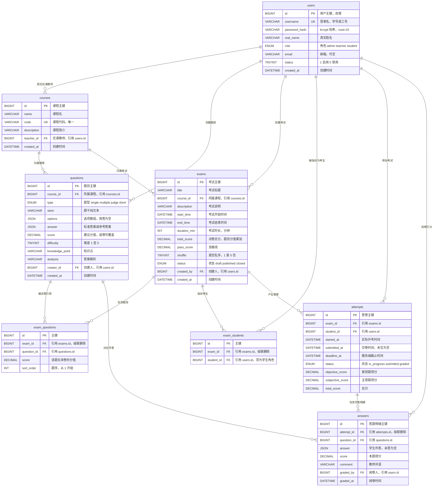

# 在线考试系统 数据库设计

| 项 | 内容 |
|---|---|
| 文档编号 | SA-DB-001 |
| 项目名称 | 基于 React + Node.js 的在线考试系统设计与实现 |
| 编制角色 | 系统架构师（SA） |
| 版本 | v1.0 |
| 上游输入 | `00-team/project-brief.md` 第 4 节「数据模型」 |
| 下游消费者 | 后端开发者（BE）、测试工程师（QA）、论文撰写者（TW） |
| 配套文件 | `系统设计说明书.md` 第 5 节、`er.mmd` |

> **基线一致性**：本文件严格按基线第 4 节实现 8 张表，**字段零增删、类型零改动**。仅做两类「不改变契约」的补充：① 为基线中标注为可空的列显式补 `DEFAULT NULL`，为主键与时间列补 `NOT NULL`；② 按第 5 节索引设计新增 9 个二级索引（不新增字段）。所有差异在第 8 节逐条登记。

---

## 1 设计概述

### 1.1 基础约定

| 项 | 约定 |
|---|---|
| 数据库 | `exam_system` |
| 版本 | MySQL 8.0+ |
| 存储引擎 | InnoDB（支持事务、行锁、外键） |
| 字符集 / 排序规则 | `utf8mb4` / `utf8mb4_general_ci`（支持中文与 emoji） |
| 主键 | `BIGINT UNSIGNED AUTO_INCREMENT` |
| 时间类型 | `DATETIME`（不用 `TIMESTAMP`，避免 2038 与隐式时区转换） |
| 布尔 | `TINYINT(1)`，1 真 / 0 假 |
| 分数与金额 | `DECIMAL(6,2)`，范围 0.00 ~ 9999.99 |
| 变长结构 | `JSON`（选项、答案），MySQL 8 原生二进制 JSON |
| 命名 | 表名与列名全小写下划线（snake_case）；索引 `idx_` 前缀、唯一索引 `uk_`、外键 `fk_` |
| 时区 | 连接参数 `timezone: '+08:00'`，`dateStrings: true`，全链路时间为 `YYYY-MM-DD HH:mm:ss` 字符串 |
| 外键动作 | 从属明细（试卷题目、指派、答题明细）随父级 `ON DELETE CASCADE`；被引用主数据（用户、课程、题目、考试）`ON DELETE RESTRICT` |

### 1.2 表清单与建表顺序

| 序号 | 表名 | 中文名 | 作用 | 依赖 |
|---|---|---|---|---|
| 1 | `users` | 用户表 | 三类角色账号与密码 | — |
| 2 | `courses` | 课程表 | 课程与任课教师 | users |
| 3 | `questions` | 题库表 | 四种题型题目与标准答案 | courses, users |
| 4 | `exams` | 考试表 | 考试窗口、时长、总分、状态 | courses, users |
| 5 | `exam_questions` | 试卷题目表 | 组卷结果（题序与本卷分值） | exams, questions |
| 6 | `exam_students` | 考生指派表 | 谁可以参加哪场考试 | exams, users |
| 7 | `attempts` | 答卷表 | 一次作答记录（一人一卷） | exams, users |
| 8 | `answers` | 答题明细表 | 逐题作答、得分、评语 | attempts, questions, users |

建表顺序必须与上表一致（外键依赖）；删表顺序相反。

---

## 2 完整 DDL

```sql
-- ============================================================
-- 在线考试系统 数据库定义脚本（MySQL 8.0）
-- 字符集 utf8mb4 / utf8mb4_general_ci，引擎 InnoDB
-- 执行方式：mysql -u root -p < schema.sql
-- ============================================================

DROP DATABASE IF EXISTS exam_system;
CREATE DATABASE exam_system
  DEFAULT CHARACTER SET utf8mb4
  DEFAULT COLLATE utf8mb4_general_ci;
USE exam_system;

SET NAMES utf8mb4;

-- ------------------------------------------------------------
-- 1. users 用户表
-- ------------------------------------------------------------
CREATE TABLE users (
  id            BIGINT UNSIGNED NOT NULL AUTO_INCREMENT COMMENT '主键',
  username      VARCHAR(50)     NOT NULL                 COMMENT '登录名（学号/工号），全局唯一',
  password_hash VARCHAR(100)    NOT NULL                 COMMENT 'bcrypt 哈希，cost=10，形如 $2a$10$...',
  real_name     VARCHAR(50)     NOT NULL                 COMMENT '真实姓名',
  role          ENUM('admin','teacher','student') NOT NULL COMMENT '角色：管理员/教师/学生',
  email         VARCHAR(100)    DEFAULT NULL             COMMENT '邮箱，可空',
  status        TINYINT(1)      NOT NULL DEFAULT 1       COMMENT '账号状态：1 启用 / 0 禁用',
  created_at    DATETIME        NOT NULL DEFAULT CURRENT_TIMESTAMP COMMENT '创建时间',
  PRIMARY KEY (id),
  UNIQUE KEY uk_users_username (username),
  KEY idx_users_role_status (role, status)
) ENGINE=InnoDB DEFAULT CHARSET=utf8mb4 COLLATE=utf8mb4_general_ci COMMENT='用户表：管理员/教师/学生';

-- ------------------------------------------------------------
-- 2. courses 课程表
-- ------------------------------------------------------------
CREATE TABLE courses (
  id          BIGINT UNSIGNED NOT NULL AUTO_INCREMENT COMMENT '主键',
  name        VARCHAR(100)    NOT NULL                 COMMENT '课程名',
  code        VARCHAR(30)     NOT NULL                 COMMENT '课程代码，全局唯一',
  description VARCHAR(500)    DEFAULT NULL             COMMENT '课程简介',
  teacher_id  BIGINT UNSIGNED NOT NULL                 COMMENT '任课教师，引用 users.id',
  created_at  DATETIME        NOT NULL DEFAULT CURRENT_TIMESTAMP COMMENT '创建时间',
  PRIMARY KEY (id),
  UNIQUE KEY uk_courses_code (code),
  KEY idx_courses_teacher (teacher_id),
  CONSTRAINT fk_courses_teacher FOREIGN KEY (teacher_id) REFERENCES users (id)
    ON DELETE RESTRICT ON UPDATE RESTRICT
) ENGINE=InnoDB DEFAULT CHARSET=utf8mb4 COLLATE=utf8mb4_general_ci COMMENT='课程表';

-- ------------------------------------------------------------
-- 3. questions 题库表
-- ------------------------------------------------------------
CREATE TABLE questions (
  id              BIGINT UNSIGNED NOT NULL AUTO_INCREMENT COMMENT '主键',
  course_id       BIGINT UNSIGNED NOT NULL                 COMMENT '所属课程，引用 courses.id',
  type            ENUM('single','multiple','judge','short') NOT NULL COMMENT '题型：单选/多选/判断/简答',
  stem            VARCHAR(1000)   NOT NULL                 COMMENT '题干（纯文本）',
  options         JSON            DEFAULT NULL             COMMENT '选项：[{"key":"A","text":"..."}]；简答为 NULL',
  answer          JSON            NOT NULL                 COMMENT '标准答案：single "A"；multiple ["A","C"]；judge "T"/"F"；short 参考答案文本',
  score           DECIMAL(6,2)    NOT NULL                 COMMENT '建议分值（组卷时可覆盖）',
  difficulty      TINYINT         NOT NULL DEFAULT 3       COMMENT '难度 1~5，默认 3',
  knowledge_point VARCHAR(100)    DEFAULT NULL             COMMENT '知识点',
  analysis        VARCHAR(1000)   DEFAULT NULL             COMMENT '答案解析',
  creator_id      BIGINT UNSIGNED DEFAULT NULL             COMMENT '创建人，引用 users.id',
  created_at      DATETIME        NOT NULL DEFAULT CURRENT_TIMESTAMP COMMENT '创建时间',
  PRIMARY KEY (id),
  KEY idx_questions_course_type (course_id, type),
  KEY idx_questions_course_difficulty (course_id, difficulty),
  KEY idx_questions_creator (creator_id),
  CONSTRAINT fk_questions_course FOREIGN KEY (course_id) REFERENCES courses (id)
    ON DELETE RESTRICT ON UPDATE RESTRICT,
  CONSTRAINT fk_questions_creator FOREIGN KEY (creator_id) REFERENCES users (id)
    ON DELETE SET NULL ON UPDATE RESTRICT,
  CONSTRAINT ck_questions_score CHECK (score > 0),
  CONSTRAINT ck_questions_difficulty CHECK (difficulty BETWEEN 1 AND 5)
) ENGINE=InnoDB DEFAULT CHARSET=utf8mb4 COLLATE=utf8mb4_general_ci COMMENT='题库表';

-- ------------------------------------------------------------
-- 4. exams 考试表
-- ------------------------------------------------------------
CREATE TABLE exams (
  id           BIGINT UNSIGNED NOT NULL AUTO_INCREMENT COMMENT '主键',
  title        VARCHAR(150)    NOT NULL                 COMMENT '考试标题',
  course_id    BIGINT UNSIGNED NOT NULL                 COMMENT '所属课程，引用 courses.id',
  description  VARCHAR(500)    DEFAULT NULL             COMMENT '考试说明',
  start_time   DATETIME        NOT NULL                 COMMENT '考试开始时间',
  end_time     DATETIME        NOT NULL                 COMMENT '考试结束时间',
  duration_min INT             NOT NULL                 COMMENT '考试时长（分钟）',
  total_score  DECIMAL(6,2)    NOT NULL                 COMMENT '试卷总分（= SUM(exam_questions.score)）',
  pass_score   DECIMAL(6,2)    NOT NULL                 COMMENT '及格线',
  shuffle      TINYINT(1)      NOT NULL DEFAULT 0       COMMENT '是否乱序：1 是 / 0 否（按 attempt 固定种子）',
  status       ENUM('draft','published','closed') NOT NULL DEFAULT 'draft' COMMENT '状态：草稿/已发布/已关闭',
  created_by   BIGINT UNSIGNED NOT NULL                 COMMENT '创建人，引用 users.id',
  created_at   DATETIME        NOT NULL DEFAULT CURRENT_TIMESTAMP COMMENT '创建时间',
  PRIMARY KEY (id),
  KEY idx_exams_course_status (course_id, status),
  KEY idx_exams_status_window (status, start_time),
  KEY idx_exams_created_by (created_by),
  CONSTRAINT fk_exams_course FOREIGN KEY (course_id) REFERENCES courses (id)
    ON DELETE RESTRICT ON UPDATE RESTRICT,
  CONSTRAINT fk_exams_creator FOREIGN KEY (created_by) REFERENCES users (id)
    ON DELETE RESTRICT ON UPDATE RESTRICT,
  CONSTRAINT ck_exams_window CHECK (start_time < end_time),
  CONSTRAINT ck_exams_duration CHECK (duration_min > 0),
  CONSTRAINT ck_exams_score CHECK (total_score >= 0 AND pass_score >= 0)
) ENGINE=InnoDB DEFAULT CHARSET=utf8mb4 COLLATE=utf8mb4_general_ci COMMENT='考试表';

-- ------------------------------------------------------------
-- 5. exam_questions 试卷题目表
-- ------------------------------------------------------------
CREATE TABLE exam_questions (
  id          BIGINT UNSIGNED NOT NULL AUTO_INCREMENT COMMENT '主键',
  exam_id     BIGINT UNSIGNED NOT NULL                 COMMENT '考试，引用 exams.id，随考试级联删除',
  question_id BIGINT UNSIGNED NOT NULL                 COMMENT '题目，引用 questions.id',
  score       DECIMAL(6,2)    NOT NULL                 COMMENT '该题在本卷的分值（覆盖 questions.score）',
  sort_order  INT             NOT NULL                 COMMENT '题序，从 1 开始',
  PRIMARY KEY (id),
  UNIQUE KEY uk_exam_questions (exam_id, question_id),
  KEY idx_exam_questions_order (exam_id, sort_order),
  KEY idx_exam_questions_question (question_id),
  CONSTRAINT fk_eq_exam FOREIGN KEY (exam_id) REFERENCES exams (id)
    ON DELETE CASCADE ON UPDATE RESTRICT,
  CONSTRAINT fk_eq_question FOREIGN KEY (question_id) REFERENCES questions (id)
    ON DELETE RESTRICT ON UPDATE RESTRICT,
  CONSTRAINT ck_eq_score CHECK (score > 0),
  CONSTRAINT ck_eq_sort CHECK (sort_order > 0)
) ENGINE=InnoDB DEFAULT CHARSET=utf8mb4 COLLATE=utf8mb4_general_ci COMMENT='试卷题目表：组卷结果';

-- ------------------------------------------------------------
-- 6. exam_students 考生指派表
-- ------------------------------------------------------------
CREATE TABLE exam_students (
  id         BIGINT UNSIGNED NOT NULL AUTO_INCREMENT COMMENT '主键',
  exam_id    BIGINT UNSIGNED NOT NULL                 COMMENT '考试，引用 exams.id，随考试级联删除',
  student_id BIGINT UNSIGNED NOT NULL                 COMMENT '学生，引用 users.id（须 role=student）',
  PRIMARY KEY (id),
  UNIQUE KEY uk_exam_students (exam_id, student_id),
  KEY idx_exam_students_student (student_id),
  CONSTRAINT fk_es_exam FOREIGN KEY (exam_id) REFERENCES exams (id)
    ON DELETE CASCADE ON UPDATE RESTRICT,
  CONSTRAINT fk_es_student FOREIGN KEY (student_id) REFERENCES users (id)
    ON DELETE RESTRICT ON UPDATE RESTRICT
) ENGINE=InnoDB DEFAULT CHARSET=utf8mb4 COLLATE=utf8mb4_general_ci COMMENT='考生指派表';

-- ------------------------------------------------------------
-- 7. attempts 答卷（考试记录）表
-- ------------------------------------------------------------
CREATE TABLE attempts (
  id               BIGINT UNSIGNED NOT NULL AUTO_INCREMENT COMMENT '主键',
  exam_id          BIGINT UNSIGNED NOT NULL                 COMMENT '考试，引用 exams.id',
  student_id       BIGINT UNSIGNED NOT NULL                 COMMENT '学生，引用 users.id',
  started_at       DATETIME        NOT NULL                 COMMENT '实际开考时间（服务端时间）',
  submitted_at     DATETIME        DEFAULT NULL             COMMENT '交卷时间，未交为空',
  deadline_at      DATETIME        NOT NULL                 COMMENT '服务端截止时间 = min(started_at + duration_min, exam.end_time)',
  status           ENUM('in_progress','submitted','graded') NOT NULL DEFAULT 'in_progress' COMMENT '状态：作答中/已交卷/已阅卷',
  objective_score  DECIMAL(6,2)    NOT NULL DEFAULT 0.00    COMMENT '客观题得分（冗余，可由 answers 重算）',
  subjective_score DECIMAL(6,2)    NOT NULL DEFAULT 0.00    COMMENT '主观题得分（冗余，可由 answers 重算）',
  total_score      DECIMAL(6,2)    NOT NULL DEFAULT 0.00    COMMENT '总分 = objective_score + subjective_score',
  PRIMARY KEY (id),
  UNIQUE KEY uk_attempts_exam_student (exam_id, student_id),
  KEY idx_attempts_exam_status (exam_id, status),
  KEY idx_attempts_student_submitted (student_id, submitted_at),
  KEY idx_attempts_status_deadline (status, deadline_at),
  CONSTRAINT fk_attempts_exam FOREIGN KEY (exam_id) REFERENCES exams (id)
    ON DELETE RESTRICT ON UPDATE RESTRICT,
  CONSTRAINT fk_attempts_student FOREIGN KEY (student_id) REFERENCES users (id)
    ON DELETE RESTRICT ON UPDATE RESTRICT
) ENGINE=InnoDB DEFAULT CHARSET=utf8mb4 COLLATE=utf8mb4_general_ci COMMENT='答卷表：一人一卷';

-- ------------------------------------------------------------
-- 8. answers 答题明细表
-- ------------------------------------------------------------
CREATE TABLE answers (
  id          BIGINT UNSIGNED NOT NULL AUTO_INCREMENT COMMENT '主键',
  attempt_id  BIGINT UNSIGNED NOT NULL                 COMMENT '答卷，引用 attempts.id，随答卷级联删除',
  question_id BIGINT UNSIGNED NOT NULL                 COMMENT '题目，引用 questions.id',
  answer      JSON            DEFAULT NULL             COMMENT '学生作答，形状与题型一致；未答为 NULL',
  score       DECIMAL(6,2)    NOT NULL DEFAULT 0.00    COMMENT '本题得分',
  comment     VARCHAR(500)    DEFAULT NULL             COMMENT '教师评语（主观题）',
  graded_by   BIGINT UNSIGNED DEFAULT NULL             COMMENT '阅卷人，引用 users.id',
  graded_at   DATETIME        DEFAULT NULL             COMMENT '阅卷时间，NULL 表示未评阅（待阅判定依据）',
  PRIMARY KEY (id),
  UNIQUE KEY uk_answers_attempt_question (attempt_id, question_id),
  KEY idx_answers_attempt_ungraded (attempt_id, graded_at),
  KEY idx_answers_question (question_id),
  KEY idx_answers_graded_by (graded_by),
  CONSTRAINT fk_answers_attempt FOREIGN KEY (attempt_id) REFERENCES attempts (id)
    ON DELETE CASCADE ON UPDATE RESTRICT,
  CONSTRAINT fk_answers_question FOREIGN KEY (question_id) REFERENCES questions (id)
    ON DELETE RESTRICT ON UPDATE RESTRICT,
  CONSTRAINT fk_answers_grader FOREIGN KEY (graded_by) REFERENCES users (id)
    ON DELETE SET NULL ON UPDATE RESTRICT
) ENGINE=InnoDB DEFAULT CHARSET=utf8mb4 COLLATE=utf8mb4_general_ci COMMENT='答题明细表';
```

### 2.1 DDL 说明要点

1. **为什么给 `exams.course_id` 加 `NOT NULL`**：基线未标注可空，但「考试必须属于一门课程」是教师可见范围的判定依据，可空会导致归属校验出现分支。同类处理：`exams.created_by`、`attempts` 各列、`exam_questions` 各列。
2. **CHECK 约束**：MySQL 8.0.16 起真正生效。`ck_questions_score` 等是数据库层的最后一道防线，与 service 校验并存（service 负责返回 40001，CHECK 负责防绕过）。
3. **外键动作的选择**：`exam_questions`、`exam_students`、`answers` 是组合明细，父级删除后无独立意义，故 `CASCADE`；`questions` 被试卷引用的情形下删除会破坏历史成绩，故 `RESTRICT`，由 `QuestionService` 先查引用再返回 40901，避免把外键错误暴露成 50001。
4. **`answers.answer` 允许 NULL**：开考时批量插入占位行（NULL 表示未作答），使「取答卷」只需一次 LEFT JOIN，不必处理缺行；判分时 NULL 计 0 分。
5. **`attempts` 三个分数字段带 `DEFAULT 0.00`**：开考即初始化，避免统计时处理 NULL 参与 `AVG` 拉低均值的问题。

---

## 3 字段说明

### 3.1 users 用户表

| 字段 | 类型 | 可空 | 默认 | 键/约束 | 说明 |
|---|---|:--:|---|---|---|
| id | BIGINT UNSIGNED | 否 | AUTO_INCREMENT | PK | 主键 |
| username | VARCHAR(50) | 否 | — | UNIQUE | 登录名（学号/工号），3~50 字符 |
| password_hash | VARCHAR(100) | 否 | — | — | bcrypt 哈希，cost=10，60 字符 |
| real_name | VARCHAR(50) | 否 | — | — | 真实姓名，列表与阅卷页展示 |
| role | ENUM | 否 | — | — | `admin` / `teacher` / `student`，决定 RBAC |
| email | VARCHAR(100) | 是 | NULL | — | 邮箱，仅展示 |
| status | TINYINT(1) | 否 | 1 | — | 1 启用 / 0 禁用；禁用后登录返回 40301，令牌回查失败返回 40101 |
| created_at | DATETIME | 否 | CURRENT_TIMESTAMP | — | 创建时间 |

### 3.2 courses 课程表

| 字段 | 类型 | 可空 | 默认 | 键/约束 | 说明 |
|---|---|:--:|---|---|---|
| id | BIGINT UNSIGNED | 否 | AUTO_INCREMENT | PK | 主键 |
| name | VARCHAR(100) | 否 | — | — | 课程名 |
| code | VARCHAR(30) | 否 | — | UNIQUE | 课程代码，重复返回 40901 |
| description | VARCHAR(500) | 是 | NULL | — | 课程简介 |
| teacher_id | BIGINT UNSIGNED | 否 | — | FK→users.id | 任课教师；teacher 创建课程时强制为自己 |
| created_at | DATETIME | 否 | CURRENT_TIMESTAMP | — | 创建时间 |

### 3.3 questions 题库表

| 字段 | 类型 | 可空 | 默认 | 键/约束 | 说明 |
|---|---|:--:|---|---|---|
| id | BIGINT UNSIGNED | 否 | AUTO_INCREMENT | PK | 主键 |
| course_id | BIGINT UNSIGNED | 否 | — | FK→courses.id | 所属课程，决定教师可见范围 |
| type | ENUM | 否 | — | — | `single` / `multiple` / `judge` / `short` |
| stem | VARCHAR(1000) | 否 | — | — | 题干纯文本（不支持富文本与公式） |
| options | JSON | 是 | NULL | — | single/multiple 必填 ≥2 项，元素 `{"key":"A","text":"..."}`，key 唯一且在 A~F；judge/short 忽略 |
| answer | JSON | 否 | — | — | single `"A"`；multiple `["A","C"]`；judge `"T"`/`"F"`；short 非空字符串 ≤500 字 |
| score | DECIMAL(6,2) | 否 | — | CHECK > 0 | 建议分值，组卷可覆盖 |
| difficulty | TINYINT | 否 | 3 | CHECK 1~5 | 难度，1 最易 5 最难 |
| knowledge_point | VARCHAR(100) | 是 | NULL | — | 知识点，供分析 |
| analysis | VARCHAR(1000) | 是 | NULL | — | 解析，仅交卷后返回 |
| creator_id | BIGINT UNSIGNED | 是 | NULL | FK→users.id | 创建人，用户删除时置 NULL |
| created_at | DATETIME | 否 | CURRENT_TIMESTAMP | — | 创建时间 |

### 3.4 exams 考试表

| 字段 | 类型 | 可空 | 默认 | 键/约束 | 说明 |
|---|---|:--:|---|---|---|
| id | BIGINT UNSIGNED | 否 | AUTO_INCREMENT | PK | 主键 |
| title | VARCHAR(150) | 否 | — | — | 考试标题 |
| course_id | BIGINT UNSIGNED | 否 | — | FK→courses.id | 所属课程 |
| description | VARCHAR(500) | 是 | NULL | — | 考试说明 |
| start_time | DATETIME | 否 | — | CHECK < end_time | 考试窗口开始 |
| end_time | DATETIME | 否 | — | — | 考试窗口结束；`deadline_at` 取此值与「开考 + 时长」的较小者 |
| duration_min | INT | 否 | — | CHECK > 0 | 时长（分钟） |
| total_score | DECIMAL(6,2) | 否 | — | CHECK ≥ 0 | 试卷总分，由 `SUM(exam_questions.score)` 在事务内重算 |
| pass_score | DECIMAL(6,2) | 否 | — | — | 及格线，发布时校验 ≤ total_score |
| shuffle | TINYINT(1) | 否 | 0 | — | 乱序开关，按 `attempt.id` 作种子，保证同一答卷顺序稳定 |
| status | ENUM | 否 | `draft` | — | `draft` → `published` → `closed`；仅 draft 可改可删 |
| created_by | BIGINT UNSIGNED | 否 | — | FK→users.id | 创建人 |
| created_at | DATETIME | 否 | CURRENT_TIMESTAMP | — | 创建时间 |

### 3.5 exam_questions 试卷题目表

| 字段 | 类型 | 可空 | 默认 | 键/约束 | 说明 |
|---|---|:--:|---|---|---|
| id | BIGINT UNSIGNED | 否 | AUTO_INCREMENT | PK | 主键 |
| exam_id | BIGINT UNSIGNED | 否 | — | FK→exams.id CASCADE | 所属考试 |
| question_id | BIGINT UNSIGNED | 否 | — | FK→questions.id RESTRICT | 题目 |
| score | DECIMAL(6,2) | 否 | — | CHECK > 0 | 本卷分值，判分与统计的分母 |
| sort_order | INT | 否 | — | CHECK > 0 | 题序，1 起；前端按此排序展示 |
| — | — | — | — | UNIQUE(exam_id, question_id) | 同卷不重复选题 |

### 3.6 exam_students 考生指派表

| 字段 | 类型 | 可空 | 默认 | 键/约束 | 说明 |
|---|---|:--:|---|---|---|
| id | BIGINT UNSIGNED | 否 | AUTO_INCREMENT | PK | 主键 |
| exam_id | BIGINT UNSIGNED | 否 | — | FK→exams.id CASCADE | 考试 |
| student_id | BIGINT UNSIGNED | 否 | — | FK→users.id RESTRICT | 学生；写入前校验 `role='student'` |
| — | — | — | — | UNIQUE(exam_id, student_id) | 同一学生同一考试只指派一次 |

### 3.7 attempts 答卷表

| 字段 | 类型 | 可空 | 默认 | 键/约束 | 说明 |
|---|---|:--:|---|---|---|
| id | BIGINT UNSIGNED | 否 | AUTO_INCREMENT | PK | 主键 |
| exam_id | BIGINT UNSIGNED | 否 | — | FK→exams.id | 考试 |
| student_id | BIGINT UNSIGNED | 否 | — | FK→users.id | 学生 |
| started_at | DATETIME | 否 | — | — | 开考时间，服务端写入，不接受客户端传入 |
| submitted_at | DATETIME | 是 | NULL | — | 交卷时间（手动或自动交卷） |
| deadline_at | DATETIME | 否 | — | — | `min(started_at + duration_min, exam.end_time)`，开考时一次算定 |
| status | ENUM | 否 | `in_progress` | — | `in_progress` → `submitted` → `graded`；单向 |
| objective_score | DECIMAL(6,2) | 否 | 0.00 | — | 客观题得分（冗余） |
| subjective_score | DECIMAL(6,2) | 否 | 0.00 | — | 主观题得分（冗余） |
| total_score | DECIMAL(6,2) | 否 | 0.00 | — | 总分（冗余） |
| — | — | — | — | UNIQUE(exam_id, student_id) | 一人一卷 |

### 3.8 answers 答题明细表

| 字段 | 类型 | 可空 | 默认 | 键/约束 | 说明 |
|---|---|:--:|---|---|---|
| id | BIGINT UNSIGNED | 否 | AUTO_INCREMENT | PK | 主键 |
| attempt_id | BIGINT UNSIGNED | 否 | — | FK→attempts.id CASCADE | 所属答卷 |
| question_id | BIGINT UNSIGNED | 否 | — | FK→questions.id RESTRICT | 题目 |
| answer | JSON | 是 | NULL | — | 学生作答；形状与 `questions.answer` 一致；NULL = 未作答 |
| score | DECIMAL(6,2) | 否 | 0.00 | — | 本题得分；客观题由判分写入，主观题由阅卷写入 |
| comment | VARCHAR(500) | 是 | NULL | — | 教师评语，仅主观题 |
| graded_by | BIGINT UNSIGNED | 是 | NULL | FK→users.id SET NULL | 阅卷人 |
| graded_at | DATETIME | 是 | NULL | — | 阅卷时间；`NULL` 即「待阅」，是待阅列表的唯一判据 |
| — | — | — | — | UNIQUE(attempt_id, question_id) | 一次答卷中每题一行，自动保存 upsert 依赖此键 |

---

## 4 ER 关系说明

ER 图见 `er.mmd`（8 实体、14 条关系），下图为同一份源文件的内嵌版本：



图 5-1　在线考试系统 ER 图（8 实体）

### 4.1 关系明细

| 编号 | 主实体 | 从实体 | 基数 | 外键 | 语义 | 删除动作 |
|---|---|---|---|---|---|---|
| R1 | users | courses | 1 : N | `courses.teacher_id` | 一名教师可任多门课程；一门课程只有一位任课教师 | RESTRICT |
| R2 | courses | questions | 1 : N | `questions.course_id` | 题库按课程组织 | RESTRICT |
| R3 | users | questions | 1 : N | `questions.creator_id` | 题目创建人（审计） | SET NULL |
| R4 | courses | exams | 1 : N | `exams.course_id` | 考试归属课程 | RESTRICT |
| R5 | users | exams | 1 : N | `exams.created_by` | 考试创建人 | RESTRICT |
| R6 | exams ↔ questions | exam_questions | M : N | `exam_id`, `question_id` | 组卷：一场考试选哪些题、各多少分、什么顺序 | exam 侧 CASCADE，question 侧 RESTRICT |
| R7 | exams ↔ users | exam_students | M : N | `exam_id`, `student_id` | 指派：哪些学生可参加 | exam 侧 CASCADE，user 侧 RESTRICT |
| R8 | exams | attempts | 1 : N | `attempts.exam_id` | 一场考试产生多份答卷；每名学生至多一份（唯一键） | RESTRICT |
| R9 | users | attempts | 1 : N | `attempts.student_id` | 一名学生参加多场考试 | RESTRICT |
| R10 | attempts | answers | 1 : N | `answers.attempt_id` | 一份答卷含多题作答 | CASCADE |
| R11 | questions | answers | 1 : N | `answers.question_id` | 一道题出现在多份答卷中（题目正确率的数据基础） | RESTRICT |
| R12 | users | answers | 1 : N | `answers.graded_by` | 阅卷人（审计） | SET NULL |
| R13 | （派生） | — | 1 : 1 | `attempts(exam_id, student_id)` 唯一 | 一人一卷 | — |
| R14 | （派生） | — | — | `exam_questions(exam_id, question_id)` 唯一 | 同卷不重复 | — |

### 4.2 关系带来的业务约束

| 约束 | 由什么保证 | 违反时的接口行为 |
|---|---|---|
| 只有被指派的学生能参加考试 | R7 + `ExamService.startAttempt` 校验 | 40301 |
| 一份答卷的题目必属于该场试卷 | R6 + `AnswerService` 校验 `exam_questions` | 40001 |
| 题目修改后历史成绩依据不变 | R6 的 `exam_questions.score` 与快照语义 | 已发布试卷的题目禁止改答案，40901 |
| 删除考试必须连带清理明细 | R6 / R7 / R10 的 CASCADE | 仅 draft 可删，40901 |
| 删除课程前须清空题库与考试 | R2 / R4 的 RESTRICT | 40901 |
| 删除用户前须确认无引用 | R1/R5/R8/R9 的 RESTRICT | 40901 |

### 4.3 主外键数据类型一致性

外键列与被引用列的类型、符号、字符集必须完全一致，否则 InnoDB 建表报 `errno 150`。本设计统一使用 `BIGINT UNSIGNED`，这也是基线选型的好处之一。

---

## 5 索引清单与查询场景

共 31 个索引对象（8 个主键 + 6 个唯一键 + 17 个二级索引），其中基线要求的是主键、唯一键与外键列，其余 17 个为查询优化补充（见第 8 节 D1）。

| 表 | 索引名 | 类型 | 列 | 支撑查询 | 选择理由 |
|---|---|---|---|---|---|
| users | PRIMARY | 聚簇 | id | 按 ID 取用户、外键检查 | — |
| users | uk_users_username | 唯一 | username | 登录、用户名查重 | 登录热路径 |
| users | idx_users_role_status | 二级 | role, status | 用户列表按角色筛选、角色计数 | 前缀 `role` 选择性好 |
| courses | PRIMARY | 聚簇 | id | 按 ID 取课程 | — |
| courses | uk_courses_code | 唯一 | code | 课程代码查重 | 业务唯一 |
| courses | idx_courses_teacher | 二级 | teacher_id | 教师「本人课程」、外键检查 | 教师端列表主查询 |
| questions | PRIMARY | 聚簇 | id | 按 ID 取题 | — |
| questions | idx_questions_course_type | 二级 | course_id, type | 题库列表按课程 + 题型、组卷选题 | 复合避免回表前二次过滤 |
| questions | idx_questions_course_difficulty | 二级 | course_id, difficulty | 难度筛选 | 共享首列，可复用于仅按课程 |
| questions | idx_questions_creator | 二级 | creator_id | 外键检查 | InnoDB 要求 |
| exams | PRIMARY | 聚簇 | id | 按 ID 取考试 | — |
| exams | idx_exams_course_status | 二级 | course_id, status | 教师考试列表按课程 + 状态 | 主查询 |
| exams | idx_exams_status_window | 二级 | status, start_time | 学生可参加列表按发布态 + 时间窗 | 覆盖排序 |
| exams | idx_exams_created_by | 二级 | created_by | 外键检查 | — |
| exam_questions | PRIMARY | 聚簇 | id | — | — |
| exam_questions | uk_exam_questions | 唯一 | exam_id, question_id | 同卷不重复、按卷取题 | 业务约束 |
| exam_questions | idx_exam_questions_order | 二级 | exam_id, sort_order | 按题序取卷 | 消除 filesort |
| exam_questions | idx_exam_questions_question | 二级 | question_id | 题目被引用检查 | 改/删题前置 |
| exam_students | PRIMARY | 聚簇 | id | — | — |
| exam_students | uk_exam_students | 唯一 | exam_id, student_id | 指派去重、开考资格 | 业务约束 |
| exam_students | idx_exam_students_student | 二级 | student_id | 学生可参加列表 | 反查主查询 |
| attempts | PRIMARY | 聚簇 | id | 按 ID 取答卷 | — |
| attempts | uk_attempts_exam_student | 唯一 | exam_id, student_id | 一人一卷、开考幂等 | 业务约束 + 并发兜底 |
| attempts | idx_attempts_exam_status | 二级 | exam_id, status | 场次统计、待阅、count 口径 | 统计按考试聚合 |
| attempts | idx_attempts_student_submitted | 二级 | student_id, submitted_at | 学生历次成绩倒序 | 覆盖排序 |
| attempts | idx_attempts_status_deadline | 二级 | status, deadline_at | 超时扫描 | 范围扫描 |
| answers | PRIMARY | 聚簇 | id | — | — |
| answers | uk_answers_attempt_question | 唯一 | attempt_id, question_id | 自动保存 upsert、逐题判分 | **幂等关键** |
| answers | idx_answers_attempt_ungraded | 二级 | attempt_id, graded_at | 待阅数量统计 | 子查询命中 |
| answers | idx_answers_question | 二级 | question_id | 题目正确率 | 按题聚合 |
| answers | idx_answers_graded_by | 二级 | graded_by | 外键检查 | — |

---

## 6 典型查询 SQL

以下 10 条覆盖了系统全部热点查询与统计聚合，均可在 `EXPLAIN` 下命中第 5 节的索引。

### Q1 登录：按用户名取用户（含密码哈希）

```sql
SELECT id, username, password_hash, real_name, role, email, status, created_at
FROM users
WHERE username = ?;
-- 命中 uk_users_username，1 行
```

### Q2 题库分页：按课程 + 题型 + 难度筛选

```sql
-- ① 总数（走 idx_questions_course_type 覆盖索引）
SELECT COUNT(*) AS total
FROM questions
WHERE course_id = ?
  AND (? IS NULL OR type = ?)
  AND (? IS NULL OR difficulty = ?)
  AND (? IS NULL OR stem LIKE CONCAT('%', ?, '%'));

-- ② 当页数据
SELECT id, course_id, type, stem, options, answer, score, difficulty,
       knowledge_point, analysis, creator_id, created_at
FROM questions
WHERE course_id = ?
  AND (? IS NULL OR type = ?)
  AND (? IS NULL OR difficulty = ?)
ORDER BY id DESC
LIMIT ? OFFSET ?;
-- 命中 idx_questions_course_type；keyword 模糊匹配为全表过滤（千级数据可接受，见权衡 T5）
```

### Q3 学生可参加考试列表（带本人答卷状态）

```sql
SELECT e.id, e.title, e.course_id, c.name AS course_name,
       e.start_time, e.end_time, e.duration_min,
       e.total_score, e.pass_score, e.status,
       a.id AS attempt_id, a.status AS attempt_status,
       a.deadline_at, a.total_score AS my_score
FROM exam_students es
JOIN exams e    ON e.id = es.exam_id AND e.status = 'published'
JOIN courses c  ON c.id = e.course_id
LEFT JOIN attempts a ON a.exam_id = e.id AND a.student_id = es.student_id
WHERE es.student_id = ?
ORDER BY e.start_time DESC;
-- 命中 idx_exam_students_student、uk_attempts_exam_student、PRIMARY
```

### Q4 取试卷（组卷结果 + 题目，按题序）

```sql
SELECT eq.question_id, eq.sort_order, eq.score AS full_score,
       q.type, q.stem, q.options, q.difficulty, q.knowledge_point,
       q.answer, q.analysis
FROM exam_questions eq
JOIN questions q ON q.id = eq.question_id
WHERE eq.exam_id = ?
ORDER BY eq.sort_order ASC;
-- 命中 idx_exam_questions_order 提供有序结果，JOIN 走 questions 主键
-- 注意：学生端调用时必须剔除 answer 与 analysis（在 DTO 层裁剪，不在 SQL 层裁剪，
--       以便教师端复用同一条查询）
```

### Q5 开考幂等：查已有答卷

```sql
SELECT id, status, started_at, deadline_at, submitted_at
FROM attempts
WHERE exam_id = ? AND student_id = ?;
-- 命中 uk_attempts_exam_student，0 行或 1 行
```

### Q6 待阅列表：统计每份答卷的待评简答题数

```sql
SELECT a.id            AS attempt_id,
       u.real_name     AS student_name,
       a.submitted_at,
       COUNT(CASE WHEN q.type = 'short' AND an.graded_at IS NULL THEN 1 END) AS pending_count
FROM attempts a
JOIN users u        ON u.id = a.student_id
LEFT JOIN answers an ON an.attempt_id = a.id
LEFT JOIN questions q ON q.id = an.question_id
WHERE a.exam_id = ?
  AND a.status IN ('submitted', 'graded')
GROUP BY a.id, u.real_name, a.submitted_at
HAVING pending_count > 0
ORDER BY a.submitted_at ASC;
-- 命中 idx_attempts_exam_status、uk_answers_attempt_question
-- 口径：pending_count 只计「题型为 short 且 graded_at 为 NULL」的作答行，
--       客观题虽 graded_at 也为 NULL，但被 q.type 条件排除，不会误计入
```

### Q7 场次统计摘要（count / avg / max / min / passRate）

```sql
SELECT e.id                                   AS exam_id,
       e.title,
       e.total_score                          AS full_score,
       COUNT(a.id)                            AS cnt,
       ROUND(AVG(a.total_score), 2)           AS avg_score,
       MAX(a.total_score)                     AS max_score,
       MIN(a.total_score)                     AS min_score,
       ROUND(SUM(a.total_score >= e.pass_score) / COUNT(a.id) * 100, 2) AS pass_rate
FROM exams e
LEFT JOIN attempts a ON a.exam_id = e.id AND a.status IN ('submitted', 'graded')
WHERE e.id = ?
GROUP BY e.id, e.title, e.total_score, e.pass_score;
-- 口径：count 只统计 submitted 与 graded；pass_rate 分母同 count
-- 命中 idx_attempts_exam_status
```

### Q8 五段分数分布（百分制折算）

```sql
SELECT
  SUM(CASE WHEN p <  60 THEN 1 ELSE 0 END) AS '[0,60)',
  SUM(CASE WHEN p >= 60 AND p < 70 THEN 1 ELSE 0 END) AS '[60,70)',
  SUM(CASE WHEN p >= 70 AND p < 80 THEN 1 ELSE 0 END) AS '[70,80)',
  SUM(CASE WHEN p >= 80 AND p < 90 THEN 1 ELSE 0 END) AS '[80,90)',
  SUM(CASE WHEN p >= 90 THEN 1 ELSE 0 END) AS '[90,100]'
FROM (
  SELECT ROUND(a.total_score / NULLIF(e.total_score, 0) * 100, 2) AS p
  FROM attempts a
  JOIN exams e ON e.id = a.exam_id
  WHERE a.exam_id = ?
    AND a.status IN ('submitted', 'graded')
) t;
-- 应用层据此拼装 distribution: [{label,count}]，固定 5 段，顺序与基线一致
```

### Q9 题目正确率与平均得分（按题聚合）

```sql
SELECT eq.question_id,
       q.stem,
       q.type,
       eq.score                                        AS full_score,
       COUNT(an.id)                                    AS answered,
       ROUND(AVG(an.score), 2)                         AS avg_score,
       ROUND(AVG(an.score) / NULLIF(eq.score, 0) * 100, 2) AS accuracy
FROM exam_questions eq
JOIN questions q      ON q.id = eq.question_id
LEFT JOIN attempts a  ON a.exam_id = eq.exam_id AND a.status IN ('submitted', 'graded')
LEFT JOIN answers an  ON an.attempt_id = a.id AND an.question_id = eq.question_id
WHERE eq.exam_id = ?
GROUP BY eq.question_id, q.stem, q.type, eq.score, eq.sort_order
ORDER BY eq.sort_order;
-- accuracy = 平均得分 / 本卷满分 × 100；客观题等价于正确率（全对得满分，否则 0 分）
-- 命中 idx_exam_questions_order、uk_answers_attempt_question、idx_answers_question
```

### Q10 学生历次成绩与平均分

```sql
SELECT a.id AS attempt_id, a.exam_id, e.title AS exam_title,
       e.total_score AS full_score, e.pass_score,
       a.total_score, a.objective_score, a.subjective_score,
       a.status, a.submitted_at
FROM attempts a
JOIN exams e ON e.id = a.exam_id
WHERE a.student_id = ?
  AND a.status IN ('submitted', 'graded')
ORDER BY a.submitted_at DESC;

-- 平均分（同一学生，仅统计已交卷）
SELECT ROUND(AVG(a.total_score), 2) AS avg_score, COUNT(*) AS cnt
FROM attempts a
WHERE a.student_id = ? AND a.status IN ('submitted', 'graded');
-- 命中 idx_attempts_student_submitted
```

### Q11 全局概览计数

```sql
SELECT
  (SELECT COUNT(*) FROM users)                                      AS user_count,
  (SELECT COUNT(*) FROM users WHERE role = 'teacher')               AS teacher_count,
  (SELECT COUNT(*) FROM users WHERE role = 'student')               AS student_count,
  (SELECT COUNT(*) FROM courses)                                    AS course_count,
  (SELECT COUNT(*) FROM questions)                                  AS question_count,
  (SELECT COUNT(*) FROM exams)                                      AS exam_count,
  (SELECT COUNT(*) FROM attempts)                                   AS attempt_count;
-- 均由聚簇索引或 idx_users_role_status 完成，7 个标量子查询一次往返
```

### Q12 交卷判分：批量写回得分 + 汇总

```sql
-- ① 批量写回（多值插入覆盖，一条语句处理整卷，依赖唯一键幂等）
INSERT INTO answers (attempt_id, question_id, score)
VALUES (?, ?, ?), (?, ?, ?), (?, ?, ?)
ON DUPLICATE KEY UPDATE score = VALUES(score);

-- ② 汇总三项得分（按题型区分客观/主观）
SELECT
  COALESCE(SUM(CASE WHEN q.type = 'short' THEN an.score ELSE 0 END), 0) AS subjective_score,
  COALESCE(SUM(CASE WHEN q.type <> 'short' THEN an.score ELSE 0 END), 0) AS objective_score
FROM answers an
JOIN questions q ON q.id = an.question_id
WHERE an.attempt_id = ?;

-- ③ 落库并做状态收口（影响行数 0 表示已被并发请求交卷）
UPDATE attempts
SET submitted_at     = ?,
    status           = 'submitted',
    objective_score  = ?,
    subjective_score = ?,
    total_score      = ? + ?
WHERE id = ? AND status = 'in_progress';
```

---

## 7 事务脚本

### 7.1 交卷判分事务

```sql
START TRANSACTION;

-- 1) 锁答卷行，读状态（第二个并发事务在此等待）
SELECT id, status, deadline_at FROM attempts WHERE id = ? AND student_id = ? FOR UPDATE;

-- 2) 读本卷题目与标准答案（应用层逐题比较，多选要求集合完全相等）
SELECT eq.question_id, eq.score AS full_score, q.type, q.answer
FROM exam_questions eq
JOIN questions q ON q.id = eq.question_id
WHERE eq.exam_id = ?;

-- 3) 读学生作答
SELECT question_id, answer FROM answers WHERE attempt_id = ?;

-- 4) 批量写回客观题得分（Q12 ①）
INSERT INTO answers (attempt_id, question_id, score) VALUES ... 
ON DUPLICATE KEY UPDATE score = VALUES(score);

-- 5) 汇总客观分与主观分（Q12 ②）
SELECT ... FROM answers ...;

-- 6) 状态收口：只有 in_progress 能被改为 submitted
UPDATE attempts SET submitted_at = ?, status = 'submitted',
       objective_score = ?, subjective_score = ?, total_score = ?
WHERE id = ? AND status = 'in_progress';

-- 7) 检查影响行数；为 0 则 ROLLBACK 并读取既有结果返回（幂等）
COMMIT;
```

**隔离级别**：默认 `REPEATABLE READ`。`FOR UPDATE` 提供的行锁足以覆盖「同答卷双交卷」，无需提升到 `SERIALIZABLE`。

### 7.2 阅卷汇总事务

```sql
START TRANSACTION;

SELECT id, status FROM attempts WHERE id = ? FOR UPDATE;

-- 逐题打分（每条都由唯一键定位；graded_at 记录评阅时间）
UPDATE answers
SET score = ?, comment = ?, graded_by = ?, graded_at = NOW()
WHERE attempt_id = ? AND question_id = ? AND question_id IN (
  SELECT question_id FROM exam_questions WHERE exam_id = ? -- 校验属于本卷
);

-- 重算（不在原分数上累加）
SELECT
  COALESCE(SUM(CASE WHEN q.type = 'short' THEN an.score ELSE 0 END), 0) AS subjective_score,
  COALESCE(SUM(an.score), 0)                                             AS total_score
FROM answers an
JOIN questions q ON q.id = an.question_id
WHERE an.attempt_id = ?;

UPDATE attempts
SET subjective_score = ?, total_score = ?, status = 'graded'
WHERE id = ?;

COMMIT;
```

**关键点**：`total_score` 由 `SUM(answers.score)` 重算而非累加，因此教师反复修改同一题分数不会造成漂移；`subjective_score` 只累加 `short` 题型的得分。

### 7.3 组卷 / 改卷事务

```sql
START TRANSACTION;
SELECT id, status FROM exams WHERE id = ? FOR UPDATE;   -- 锁考试行

DELETE FROM exam_questions WHERE exam_id = ?;
INSERT INTO exam_questions (exam_id, question_id, score, sort_order)
VALUES (?, ?, ?, ?), (?, ?, ?, ?);                      -- 批量

UPDATE exams
SET title = ?, start_time = ?, end_time = ?, duration_min = ?,
    pass_score = ?, shuffle = ?,
    total_score = (SELECT COALESCE(SUM(score), 0) FROM exam_questions WHERE exam_id = ?)
WHERE id = ? AND status = 'draft';
COMMIT;
```

**注意**：MySQL 不允许在 `UPDATE` 的子查询中引用同一张被更新的表（`exams`），但子查询引用的是 `exam_questions`，因此合法；若需同时限制状态，可先 `SELECT ... FOR UPDATE` 校验再更新。

### 7.4 指派事务（覆盖式）

```sql
START TRANSACTION;
DELETE FROM exam_students WHERE exam_id = ?;
INSERT INTO exam_students (exam_id, student_id) VALUES (?, ?), (?, ?);
COMMIT;
-- 唯一键 uk_exam_students 兜底，重复提交结果一致
```

---

## 8 与基线的差异登记

| 编号 | 差异 | 类型 | 原因 | 是否影响接口契约 |
|---|---|---|---|---|
| D1 | 17 个二级索引：`idx_users_role_status`、`idx_courses_teacher`、`idx_questions_course_type`、`idx_questions_course_difficulty`、`idx_questions_creator`、`idx_exams_course_status`、`idx_exams_status_window`、`idx_exams_created_by`、`idx_exam_questions_order`、`idx_exam_questions_question`、`idx_exam_students_student`、`idx_attempts_exam_status`、`idx_attempts_student_submitted`、`idx_attempts_status_deadline`、`idx_answers_attempt_ungraded`、`idx_answers_question`、`idx_answers_graded_by` | 性能补充 | 基线只列出主键、唯一键与外键，未涉及查询索引；索引不改变逻辑结构 | 否 |
| D2 | 主键、时间列、业务必填列显式 `NOT NULL` | 约束强化 | 基线表格以「约束」列描述，部分列未写 NOT NULL 但业务上不可空 | 否 |
| D3 | 增加 `CHECK` 约束（分数 > 0、难度 1~5、时间窗、时长 > 0） | 约束强化 | 数据库层最后防线，防绕过 API 写入脏数据 | 否（越界仍由 service 返回 40001） |
| D4 | `questions.options` 显式 `DEFAULT NULL`；`answers.answer` 允许 NULL | 明确语义 | 开考时插入占位行，NULL 表示未作答 | 否（响应中输出 `null`） |
| D5 | 字段零增删、类型零改动 | — | 严格遵守基线第 4 节 | 否 |

> 说明：D1 列出的 17 个二级索引与第 5 节逐表清单、`系统设计说明书` 第 5.2 节完全一致（其中 4 个为复合索引），不重复计数；基线要求的 PK / UNIQUE / FK 索引未计入该 17 个之内。

## 9 数据维护

### 9.1 从 `answers` 重算答卷得分（修复脚本）

```sql
-- 校验：找出 attempts 冗余分与明细不一致的记录
SELECT a.id, a.total_score,
       COALESCE(SUM(an.score), 0) AS real_total
FROM attempts a
LEFT JOIN answers an ON an.attempt_id = a.id
WHERE a.status <> 'in_progress'
GROUP BY a.id, a.total_score
HAVING a.total_score <> real_total;

-- 修复：按明细重算三项得分
UPDATE attempts a
JOIN (
  SELECT an.attempt_id,
         SUM(CASE WHEN q.type = 'short' THEN an.score ELSE 0 END) AS subj,
         SUM(CASE WHEN q.type <> 'short' THEN an.score ELSE 0 END) AS obj
  FROM answers an
  JOIN questions q ON q.id = an.question_id
  GROUP BY an.attempt_id
) t ON t.attempt_id = a.id
SET a.subjective_score = t.subj,
    a.objective_score  = t.obj,
    a.total_score      = t.subj + t.obj;
```

### 9.2 备份与恢复

```bash
# 每日全量备份（保留 7 天）
mysqldump -u exam -p --single-transaction --routines --triggers exam_system \
  > /var/backups/exam_system_$(date +%F).sql
# 恢复
mysql -u exam -p exam_system < /var/backups/exam_system_2026-10-31.sql
```

`--single-transaction` 保证 InnoDB 一致性快照，不锁表，可在业务运行期备份。

### 9.3 初始化与种子数据

1. 执行 `schema.sql`（建库 + 8 表）。
2. 执行 `node server/src/db/seed.js`：写入 1 管理员（`admin` / `Admin@123`）、1 教师（`teacher01` / `Teach@123`）、2 学生（`student01` / `Stu@123`、`student02`）、2 门课程、每门 ≥8 题（四种题型齐全）、2 场考试（1 场已发布并指派 2 名学生、1 场草稿）、1 份已交卷待阅答卷。密码统一由 `bcrypt.hash(pwd, 10)` 生成，脚本内不出现明文哈希。
3. 校验查询：

```sql
SELECT role, COUNT(*) FROM users GROUP BY role;
SELECT type, COUNT(*) FROM questions GROUP BY type;
SELECT status, COUNT(*) FROM exams GROUP BY status;
SELECT status, COUNT(*) FROM attempts GROUP BY status;
```

### 9.4 环境一致性检查

```sql
SELECT @@character_set_database, @@collation_database, @@time_zone, @@transaction_isolation;
-- 期望：utf8mb4 / utf8mb4_general_ci / +08:00 / REPEATABLE-READ

SHOW TABLE STATUS FROM exam_system WHERE Engine <> 'InnoDB';  -- 期望：空
```
