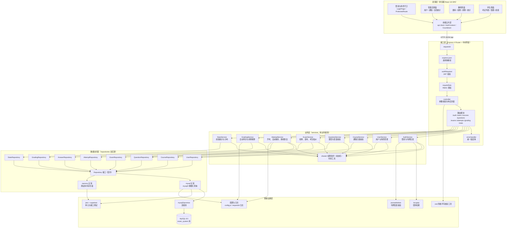
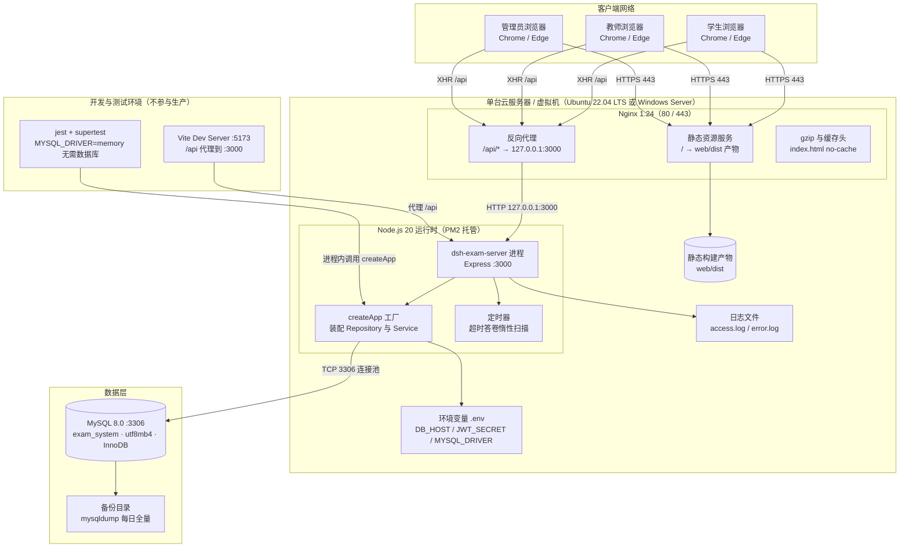
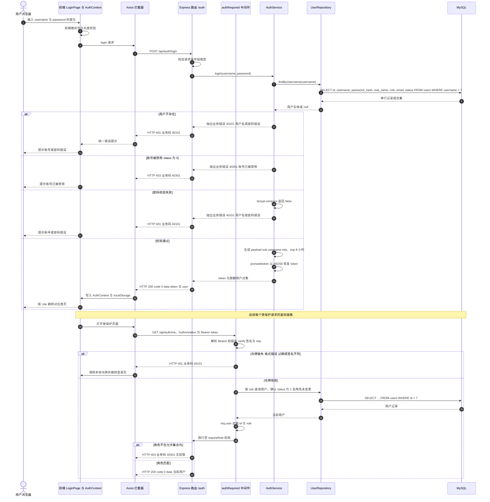
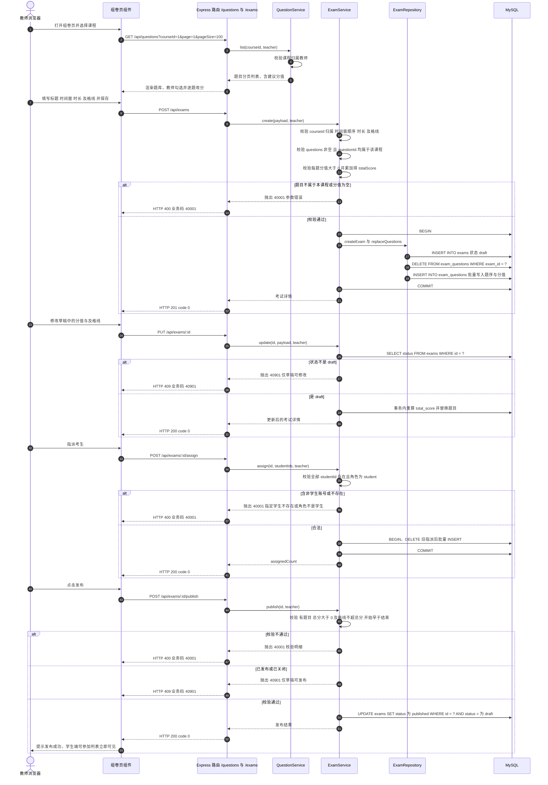
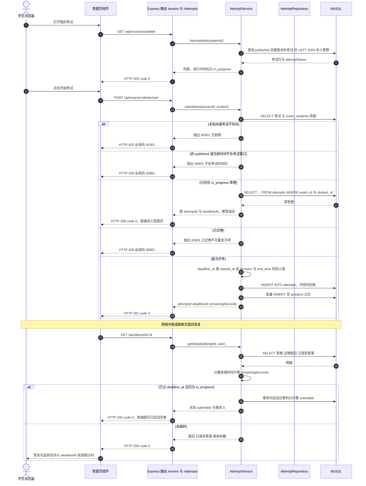
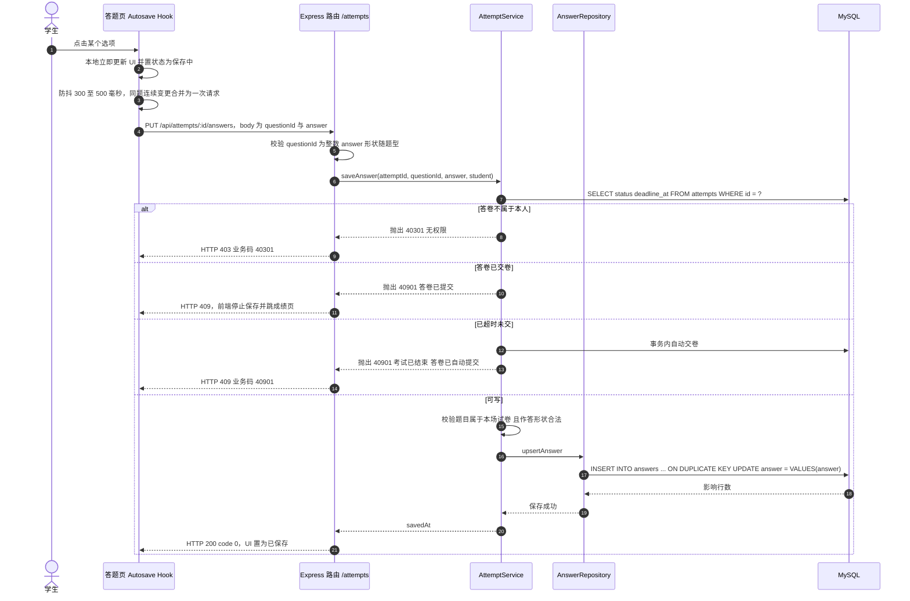
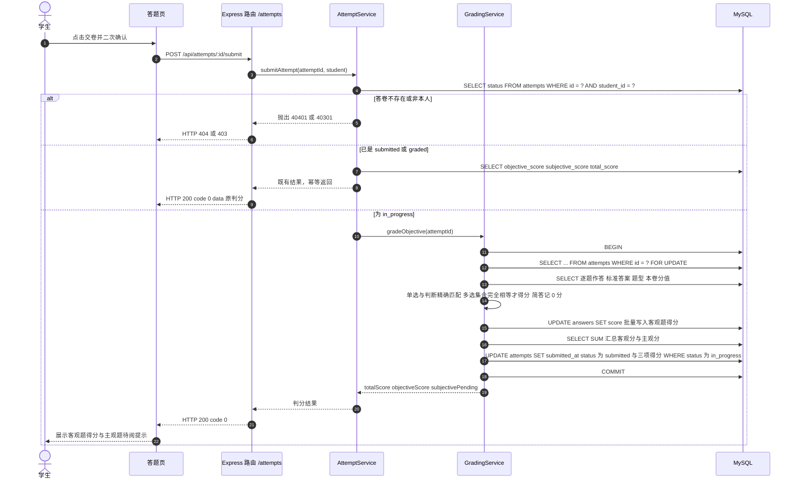
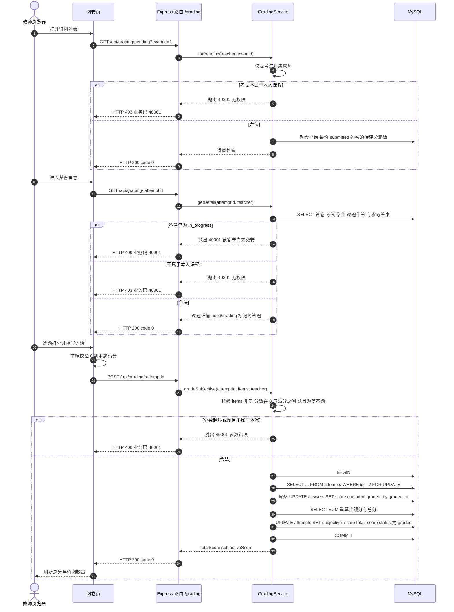

# 在线考试系统 系统设计说明书

| 项 | 内容 |
|---|---|
| 文档编号 | SA-DD-001 |
| 项目名称 | 基于 React + Node.js 的在线考试系统设计与实现 |
| 编制角色 | 系统架构师（SA） |
| 阶段 | P1（与需求分析师并行） |
| 版本 | v1.0 |
| 上游输入 | `00-team/project-brief.md`（唯一事实来源）、`00-team/agent-team.md`（角色 Charter） |
| 下游消费者 | 前端开发者（FE）、后端开发者（BE）、测试工程师（QA）、论文撰写者（TW） |
| 配套产物 | `数据库设计.md`、`API契约.md`、`architecture.mmd`、`deploy.mmd`、`er.mmd`、`sequence-login.mmd`、`sequence-exam.mmd`、`sequence-grade.mmd` |

> **基线优先声明**：本文档的一切设计决策都不改变 `project-brief.md` 定义的角色权限、8 张表字段、36 个 REST 接口的路径/方法/字段名/错误码。凡基线未明确的细节（如响应体中的联表字段、被引用题目的可修改性、分页上限），本文档在「设计约定」中显式给出，并在第 11 节登记为权衡项，不视为对基线的增删。若基线后续变更，以基线为准并同步修订本文档。

---

## 1 设计目标与原则

### 1.1 设计目标

| 编号 | 目标 | 可度量指标 | 对应质量门禁 |
|---|---|---|---|
| D1 | 完整支撑「建课 → 建题库 → 组卷 → 发布 → 答题 → 阅卷 → 统计」业务闭环 | 三类角色在权限矩阵内的功能 100% 有接口与页面承接 | G1 / G2 |
| D2 | 接口契约稳定、前后端可并行开发 | 接口清单与基线一致率 100%，无未登记接口 | G2 |
| D3 | 答题过程不丢数据 | 每次选项变更即持久化；断线重连后答案与剩余时间可恢复 | G3 |
| D4 | 成绩计算口径唯一、可复核 | 判分与统计口径集中在 service 层，同一口径仅一处实现 | G3 / G5 |
| D5 | 无数据库也能跑通全部接口测试 | `MYSQL_DRIVER=memory` 时 `npm test` 全绿，用例 ≥ 40、行覆盖率 ≥ 70% | G3 |
| D6 | 默认安全 | 未授权请求 100% 被 401/403 拦截；交卷前任何响应不含 `answer`/`analysis` | G5 |
| D7 | 单机可部署、可演示 | 单台 2C4G 服务器承载 100 人同时在线答题 | G7 |

### 1.2 设计原则

**原则一：高内聚低耦合。** 以「一个模块只对一类资源负责」切分，模块内部按 `路由 → 控制器 → 服务 → 仓储` 单向调用，禁止反向依赖与跨模块直接访问他人仓储。落地措施：`routes/` 只做装配，`controllers/` 只做参数校验与响应封装，`services/` 只做业务规则与状态机，`repositories/` 只做数据存取；跨模块协作（如交卷时调用判分）通过 service 之间的显式方法调用完成，不通过共享可变状态。可验证证据：`services/` 目录内无 `req`/`res` 对象引用（无 HTTP 耦合），`repositories/` 内无业务判断分支。

**原则二：契约先行。** 先冻结 `API契约.md` 与 `数据库设计.md`，前后端以文档而非代码对齐。落地措施：每条接口在契约中给出请求/响应示例与错误码；BE 的集成测试按契约字段断言（`supertest` 断言 `body.code`、`body.data` 的具体字段），FE 的 `api/*.js` 只依赖契约中的字段名。可验证证据：契约中的 36 条接口在实现中一一对应，测试用例中断言字段名与契约同名。

**原则三：可测试性。** 业务逻辑与传输层、存储层解耦，使 90% 的规则可在无网络、无数据库的条件下被测试。落地措施：`createApp(deps)` 工厂注入仓储与时钟；仓储双实现（mysql / memory）；判分、统计等纯函数独立成模块；时间通过 `clock` 注入而非直接 `Date.now()`。可验证证据：`tests/` 中不出现真实 MySQL 连接与真实网络端口。

**原则四：安全默认。** 默认拒绝，显式放行。落地措施：路由默认要求登录，`requireRole` 显式声明角色；响应 DTO 采用白名单字段拼装（不直接返回数据库行）；考试试卷在交卷前裁剪 `answer`/`analysis`；所有 SQL 参数化。可验证证据：越权用例（学生访问教师接口、教师访问他人课程）返回 40301。

**原则五：服务端权威。** 一切与「时间、分数、状态」相关的判定以服务端为准：`deadlineAt` 由服务端计算，剩余秒数由服务端下发，前端倒计时仅作展示；前端传来的分数、状态一律忽略或校验。

### 1.3 设计约束（来自基线，不可协商）

| 约束 | 内容 |
|---|---|
| C1 | 前端 React 18 + Vite 5 + React Router 6 + Axios + 原生 CSS，不引入 UI 组件库 |
| C2 | 后端 Node.js 20+ + Express 4 + JWT + bcryptjs，手写 zod 风格校验，不引入 ORM |
| C3 | 数据库 MySQL 8.0，`utf8mb4_general_ci`，InnoDB；8 张表字段与类型按基线第 4 节 |
| C4 | 令牌 payload 固定 `{sub, username, role}`，有效期 8h；业务码固定 6 个 |
| C5 | 时间统一 `YYYY-MM-DD HH:mm:ss`；分页统一 `{list,total,page,pageSize}` |
| C6 | 一人一卷：`attempts` 上 `UNIQUE(exam_id, student_id)`；同卷同题不重复：`UNIQUE(exam_id, question_id)` |

---

## 2 技术选型与论证

### 2.1 选型方法与评价维度

采用**加权打分法**：对每个决策点列出 2~3 个真实可行的备选方案，按 6 个维度打分（1~5 分，5 分最优），加权求和后取最高者，并补充「不可量化理由」。权重来源于本项目的实际约束（个人毕业设计、单机部署、8 周工期、需可演示、需写论文论证）。

| 维度 | 权重 | 含义 |
|---|---|---|
| 与基线契合度 | 30% | 是否满足 C1/C2/C3 的硬约束 |
| 学习与实现成本 | 20% | 在工期内被个人完整掌握并写清楚的难度 |
| 生态与文档 | 15% | 中文资料、报错可检索性、社区活跃度 |
| 性能与并发 | 15% | 100 人同时答题场景下的余量 |
| 可测试性 | 10% | 是否便于做无库集成测试与覆盖率统计 |
| 长期可维护性 | 10% | 结构约束、类型安全、升级路径 |

**计分公式**：`加权总分 = Σ(维度得分 × 权重)`，满分 5.00。下文各对比表的「加权总分」行均由该表得分列按此公式计算所得，可逐行复核（例：React = 5×0.30 + 3×0.20 + 5×0.15 + 5×0.15 + 4×0.10 + 5×0.10 = 4.50）。

### 2.2 前端框架：React vs Vue

| 维度（权重） | React 18 | Vue 3 | 说明 |
|---|---|---|---|
| 与基线契合度（30%） | 5 | 4 | 基线 C1 指定 React 18；Vue 需变更基线 |
| 学习与实现成本（20%） | 3 | 5 | Vue 模板语法对新手更直观；React 需理解 Hooks 闭包与依赖数组 |
| 生态与文档（15%） | 5 | 5 | 二者中文资料均充分 |
| 性能与并发（15%） | 5 | 4 | 答题页高频状态更新（倒计时每秒、选项即时反馈），React 的批处理与并发特性更可控 |
| 可测试性（10%） | 4 | 4 | 均需额外测试库，本项目以前端构建校验为主 |
| 长期可维护性（10%） | 5 | 4 | React 的「JS 即视图」在复杂表单（组卷、阅卷）中复用度更高 |
| **加权总分** | **4.50** | **4.35** | React 略高，且基线已锁定，综合最优 |

**结论：React 18。**

**理由：**（1）基线已锁定，变更成本高于收益；（2）本系统前端最复杂的两个页面——组卷页（动态增删题目、逐题改分）与答题页（倒计时、自动保存、断线恢复）——都是「状态驱动的表单」，React 的 `useState/useReducer + useEffect` 对这类派生状态与副作用的表达更直接，且 `useEffect` 清理函数天然适配倒计时与防抖定时器的销毁；（3）不引入 UI 组件库意味着需要自行封装 Table/Modal/Countdown，React 的函数组件 + 自定义 Hook 能让「倒计时」「自动保存」各收敛为一个可复用 Hook（`useCountdown`、`useAutosave`），符合高内聚原则。

### 2.3 构建工具：Vite 5 vs Webpack 5

| 维度（权重） | Vite 5 | Webpack 5 |
|---|---|---|
| 与基线契合度（30%） | 5 | 2 |
| 学习与实现成本（20%） | 5 | 2 |
| 生态与文档（15%） | 4 | 5 |
| 性能与并发（15%） | 5 | 3 |
| 可测试性（10%） | 4 | 4 |
| 长期可维护性（10%） | 4 | 5 |
| **加权总分** | **4.65** | **3.10** |

**结论：Vite 5。**

**理由：**（1）开发期基于原生 ESM 的按需编译，冷启动 < 1s，修改答题页样式后热更新在 100ms 级，而 Webpack 在同等依赖下冷启动约 5~10s，对「边演示边改」的毕业设计场景收益明显；（2）配置极简，`vite.config.js` 仅需 `server.proxy` 把 `/api` 代理到 `localhost:3000`，避免开发期 CORS 配置，也避免在生产构建中残留代理逻辑；（3）产物为静态文件，交由 Nginx 托管，与第 4 节部署架构一致。Webpack 的优势（复杂 loader 链、老项目兼容）在本项目中无用武之地。

### 2.4 后端框架：Express 4 vs NestJS vs Koa

| 维度（权重） | Express 4 | NestJS 10 | Koa 2 |
|---|---|---|---|
| 与基线契合度（30%） | 5 | 2 | 3 |
| 学习与实现成本（20%） | 5 | 2 | 4 |
| 生态与文档（15%） | 5 | 4 | 4 |
| 性能与并发（15%） | 4 | 3 | 5 |
| 可测试性（10%） | 4 | 5 | 4 |
| 长期可维护性（10%） | 3 | 5 | 3 |
| **加权总分** | **4.55** | **3.05** | **3.75** |

**结论：Express 4。**

**理由：**（1）基线 C2 指定 Express 4；（2）NestJS 的装饰器 + 模块 + 依赖注入容器虽然结构规整、可测试性最佳，但引入 `reflect-metadata`、装饰器编译、`@nestjs/*` 十余个包，对「8 周内个人完成并能在论文中逐行讲清」的目标是负收益，且其 DI 容器与本项目要求的 `createApp(deps)` 手动装配是两套体系，会造成概念冗余；（3）Koa 的洋葱模型更优雅、性能略优，但社区中间件（特别是 `supertest` 配合、错误处理范式）与 Express 不完全等价，且基线已定；（4）Express 的「中间件数组 + `(req,res,next)`」模型足够表达本项目的 `requestId → json → auth → role → controller → errorHandler` 链，分层靠目录约定而非框架强制，配合第 3 节的依赖规则即可保证结构不腐化。

### 2.5 数据库：MySQL 8.0 vs PostgreSQL 16 vs MongoDB 7

| 维度（权重） | MySQL 8.0 | PostgreSQL 16 | MongoDB 7 |
|---|---|---|---|
| 与基线契合度（30%） | 5 | 2 | 2 |
| 学习与实现成本（20%） | 5 | 3 | 3 |
| 生态与文档（15%） | 5 | 4 | 4 |
| 性能与并发（15%） | 4 | 4 | 3 |
| 可测试性（10%） | 4 | 4 | 3 |
| 长期可维护性（10%） | 4 | 5 | 3 |
| **加权总分** | **4.65** | **3.30** | **2.85** |

**结论：MySQL 8.0（InnoDB，`utf8mb4_general_ci`）。**

**理由：**（1）本系统的数据是**强关系型**的：考试—试卷题目—答卷—答题明细构成四级引用链，且「一人一卷」「同卷同题唯一」必须靠唯一约束保证，关系型数据库的声明式约束能力是正确性的一部分，文档型数据库需要应用层自行保证，风险高；（2）MySQL 8.0 原生支持 `JSON` 类型与 `JSON_EXTRACT`，恰好满足基线对 `questions.options`、`questions.answer`、`answers.answer` 三个「形状随题型变化」字段的需求，做到「结构用列、变长用 JSON」的折中；（3）国内教学与运维资料最丰富，`mysqldump` 备份、`EXPLAIN` 调优、字符集问题排查的资料可检索性最好；（4）PostgreSQL 在 JSONB、窗口函数、部分索引上更强，但本项目统计口径简单（五段分布 + 平均/最值/及格率），聚合用 `CASE WHEN + GROUP BY` 已足够，用不到 PG 的高级能力；（5）MongoDB 的 `$lookup` 多表关联与事务支持均弱于关系库，且 8 张表的关系无法自然表达。

### 2.6 鉴权方案：JWT（无状态令牌）vs Session（服务端会话）

| 维度（权重） | JWT | Session + Cookie |
|---|---|---|
| 与基线契合度（30%） | 5 | 2 |
| 学习与实现成本（20%） | 4 | 4 |
| 生态与文档（15%） | 5 | 5 |
| 性能与并发（15%） | 5 | 3 |
| 可测试性（10%） | 5 | 3 |
| 长期可维护性（10%） | 3 | 4 |
| **加权总分** | **4.60** | **3.30** |

**结论：JWT（HS256，`Authorization: Bearer`）。**

**理由：**（1）基线 C4 固定了 payload 与 8h 有效期；（2）前后端分离部署下，前端为 Vite 产物静态托管，跨端口/跨域场景用 `Cookie + SameSite` 需要额外的 CORS 凭证配置，而 Bearer 令牌与 Axios 拦截器配合只需一行 `config.headers.Authorization`；（3）令牌自带 `role`，便于前端做路由守卫的首屏渲染，无需额外请求；（4）无状态使 Node 进程可横向扩展（第 4.4 节），无需引入 Redis 存会话。**代价**：令牌无法即时吊销（用户被禁用后旧令牌在 8h 内仍有效），因此本项目在 `authRequired` 中增加一次 `users` 表回查，校验 `status=1` 且 `role` 未被改动——这是「安全默认」优先于「纯无状态」的一处有意折中，代价是每个受保护请求多一次主键查询（走聚簇索引，成本可忽略），已记入第 11 节权衡 T2。

### 2.7 测试框架：Jest + Supertest vs Mocha + Chai + Supertest vs Vitest

| 维度（权重） | Jest + Supertest | Mocha + Chai | Vitest |
|---|---|---|---|
| 与基线契合度（30%） | 5 | 3 | 2 |
| 学习与实现成本（20%） | 5 | 3 | 4 |
| 生态与文档（15%） | 5 | 4 | 4 |
| 性能与并发（15%） | 3 | 4 | 5 |
| 可测试性（10%） | 5 | 4 | 5 |
| 长期可维护性（10%） | 4 | 3 | 4 |
| **加权总分** | **4.60** | **3.40** | **3.65** |

**结论：Jest 29 + Supertest 6（内置 `coverage` 统计）。**

**理由：**（1）基线要求 `npm test` 与 `npm run test:coverage` 两个脚本、行覆盖率 ≥70%，Jest 自带覆盖率与 `jest.config` 的 `collectCoverageFrom`，零额外配置；（2）Supertest 直接对 `createApp(deps)` 返回的 Express 实例发请求，无需 `listen` 占端口，天然契合「无数据库、无网络」的测试约束；（3）Vitest 更快且与 Vite 共用配置，但后端不经过 Vite 构建，收益有限，且覆盖率插件需额外安装；（4）Mocha 需自行组合 Chai/Sinon/nyc，配置面更大，对毕业设计属于不必要的复杂度。

### 2.8 数据访问方式：mysql2 参数化查询 vs ORM（Sequelize / Prisma）

| 维度（权重） | mysql2/promise | Sequelize | Prisma |
|---|---|---|---|
| 与基线契合度（30%） | 5 | 2 | 2 |
| 学习与实现成本（20%） | 4 | 3 | 4 |
| 生态与文档（15%） | 4 | 4 | 4 |
| 性能与并发（15%） | 5 | 3 | 3 |
| 可测试性（10%） | 4 | 4 | 3 |
| 长期可维护性（10%） | 3 | 5 | 5 |
| **加权总分** | **4.35** | **3.15** | **3.25** |

**结论：`mysql2/promise` 连接池 + 手写参数化 SQL；仓储接口 + 双实现。**

**理由：**（1）基线明确「不引入 ORM」，且要求 `MYSQL_DRIVER=memory` 时装配内存实现；（2）本项目的统计接口需要 `CASE WHEN` 分桶、`LEFT JOIN` 聚合、`SUM/AVG/MAX/MIN` 组合，用 ORM 表达要么退化为 `sequelize.query` 原生 SQL（失去 ORM 意义），要么写多个查询在应用层拼装（多次往返、口径分散）；（3）参数化查询由 `pool.query(sql, params)` 完成，占位符 `?` 由驱动转义，从机制上杜绝拼接注入；（4）手写 SQL 让「索引设计 → 执行计划 → 查询语句」在论文中可被完整串讲，这是设计说明书的论证价值所在。ORM 的类型安全与迁移能力在本项目（表结构固定、无演进需求）中收益有限。

### 2.9 选型汇总

| 决策点 | 结论 | 一句话理由 | 主要代价 |
|---|---|---|---|
| 前端框架 | React 18 | 状态驱动表单与 Hook 复用最契合答题/组卷页 | 需自行封装表格、弹窗、倒计时组件 |
| 构建工具 | Vite 5 | 秒级冷启动与热更新，配置极简 | 生态插件少于 Webpack |
| 后端框架 | Express 4 | 中间件链足够表达本项目分层，成本最低 | 结构靠目录约定，框架不强制 |
| 数据库 | MySQL 8.0 | 强关系 + 唯一约束 + JSON 字段的折中最优 | 高级分析函数能力弱于 PG |
| 鉴权 | JWT + 每次回查用户 | 无状态可扩展，且能感知禁用与角色变更 | 每请求多一次主键查询 |
| 测试 | Jest + Supertest | 内置覆盖率，可直接测 `createApp` 实例 | 并行执行需注意共享内存仓储隔离 |
| 数据访问 | mysql2 参数化 + 仓储双实现 | 杜绝注入，测试免库 | SQL 与索引需手工维护 |

---

## 3 总体架构

### 3.1 分层与依赖规则

系统采用五层架构，依赖方向严格自上而下，同层内按模块水平切分：

| 层 | 组成 | 职责 | 禁止事项 |
|---|---|---|---|
| 表现层 | React SPA（页面、组件、上下文、api 封装） | 渲染、交互、客户端校验、令牌注入、倒计时展示 | 不得硬编码 mock 数据；不得在交卷前展示答案 |
| 接口层 | Express Router、中间件链、Controller | HTTP 语义、参数校验、鉴权与授权、统一响应与错误封装 | 不得写业务规则；不得直接访问数据库 |
| 业务层 | Services（auth/user/course/question/exam/attempt/grading/stats） | 业务规则、状态机、权限归属判定、判分与统计口径 | 不得引用 `req`/`res`；不得拼接 SQL |
| 数据访问层 | Repository 接口 + mysql 实现 + memory 实现 | 单表/联表的原子读写、事务边界内的语句执行 | 不得含业务分支；不得跨仓储直接调用 |
| 基础设施层 | MySQL、连接池、bcrypt、jsonwebtoken、校验工具、日志、环境配置、测试框架 | 通用能力供给 | 不得反向依赖上层 |

**依赖规则的可执行化约定**：`services/` 只 `require` `repositories/` 的接口与 `utils/`；`controllers/` 只 `require` `services/` 与 `utils/`；`routes/` 只 `require` `controllers/` 与 `middlewares/`。因此一次请求的调用栈恒为 `route → middleware → controller → service → repository → pool`，不会出现反向或跳跃调用。

### 3.2 模块划分

| 模块 | 路由前缀 | Service | Repository | 职责边界 |
|---|---|---|---|---|
| 认证 | `/api/auth` | AuthService | UserRepository | 登录、令牌签发、当前用户 |
| 用户 | `/api/users` | UserService | UserRepository | 用户 CRUD、重置密码、禁用 |
| 课程 | `/api/courses` | CourseService | CourseRepository、QuestionRepository、ExamRepository | 课程 CRUD、归属校验、删除前置检查 |
| 题库 | `/api/questions` | QuestionService | QuestionRepository、ExamRepository | 题目 CRUD、答案形状校验、批量导入 |
| 考试 | `/api/exams` | ExamService | ExamRepository、QuestionRepository、AttemptRepository | 组卷、发布、指派、可参加列表、试卷裁剪 |
| 答题 | `/api/attempts` | AttemptService | AttemptRepository、AnswerRepository、ExamRepository | 开考幂等、自动保存、断线恢复、交卷编排 |
| 阅卷 | `/api/grading` | GradingService | GradingRepository、AnswerRepository、AttemptRepository | 待阅列表、答卷详情、打分与总分重算 |
| 统计 | `/api/stats` | StatsService | StatsRepository | 概览计数、场次摘要、分布与题目正确率、学生历次成绩 |

### 3.3 总体架构图



图 3-1　总体分层架构图（源文件 `architecture.mmd`）

### 3.4 关键架构决策

| 编号 | 决策 | 背景 | 方案 | 影响 |
|---|---|---|---|---|
| AD1 | 不使用 ORM，仓储接口 + 双实现 | 测试需无库运行；统计需复杂聚合 | `repositories/` 导出接口工厂，`MYSQL_DRIVER` 决定装配 mysql 或 memory 实现 | 测试与生产走同一套 service 代码，覆盖率可真实反映 |
| AD2 | `createApp(deps)` 工厂 + `index.js` 启动 | supertest 需要不占端口的实例 | 工厂只装配依赖并返回 app；监听、连库、加载 `.env` 在入口完成 | 同一 app 可被测试反复实例化，互不污染 |
| AD3 | 错误以「业务错误类」抛出，中间件统一捕获 | 需要把「状态校验失败」映射为 40901 等 6 个业务码 | `utils/errors.js` 定义 `AppError(code, message, httpStatus)`，`errorHandler` 统一序列化 | controller 无需 try/catch 样板，错误体格式恒一致 |
| AD4 | 响应 DTO 白名单拼装 | 不能泄露 `password_hash`，且交卷前不能泄露答案 | 每个模块提供 `toUserDTO`/`toQuestionDTO(scope)` 等映射函数；`scope` 区分 `admin`/`student` | 泄露面收敛到一个函数，便于审查 |
| AD5 | 时间以字符串贯穿全链路 | 统一 `YYYY-MM-DD HH:mm:ss`，避免时区漂移 | 连接池 `dateStrings: true`、`timezone: '+08:00'`；计算型时间经 `utils/time.format` 输出 | 前端直接展示，无需时区转换 |
| AD6 | 状态机集中在 service | 考试/答卷状态迁移点多，易散落 | `services/examState.js` 定义合法迁移表，非法迁移抛 40901 | 状态冲突只有一处判定，测试可穷举 |

---

## 4 部署架构

### 4.1 部署图



图 4-1　部署架构图（源文件 `deploy.mmd`）

### 4.2 组件与端口

| 组件 | 版本 | 端口 | 部署形态 | 说明 |
|---|---|---|---|---|
| Nginx | 1.24 | 80 / 443 | 系统服务 | 静态托管 + `/api` 反向代理，`client_max_body_size 2m`（批量导入上限） |
| Node 服务 | 20 LTS | 3000（仅监听 127.0.0.1） | PM2 `fork` 模式 | `pm2 start server/src/index.js --name exam-server`，`pm2 save` 开机自启 |
| MySQL | 8.0 | 3306（仅监听 127.0.0.1） | 系统服务 | `utf8mb4_general_ci`，`max_connections` 默认 151 |
| Vite Dev Server | 5 | 5173 | 仅开发 | `/api` 代理到 3000，生产不使用 |

### 4.3 单机部署流程

1. **准备**：安装 Node 20 LTS、MySQL 8.0、Nginx；建库执行 `server/src/db/schema.sql`，再执行 `node server/src/db/seed.js` 写入演示数据。
2. **配置**：复制 `.env.example` 为 `.env`，设置 `DB_HOST/DB_PORT/DB_USER/DB_PASSWORD/DB_NAME/JWT_SECRET/PORT/MYSQL_DRIVER=mysql`；`JWT_SECRET` 必须为 ≥32 位随机串，缺失时启动即失败（fail-fast）。
3. **构建前端**：`cd code/web && npm ci && npm run build`，产物在 `web/dist`。
4. **启动后端**：`cd code/server && npm ci && npm start`（PM2 托管）。
5. **Nginx**：`root` 指向 `web/dist`；`location /api/ { proxy_pass http://127.0.0.1:3000; }`；`try_files $uri $uri/ /index.html;` 支持前端 History 路由刷新。
6. **验证**：`curl http://localhost:3000/api/auth/login` 应返回 40001（缺少参数），而非 500。

### 4.4 可扩展方向

| 方向 | 触发条件 | 做法 | 对本设计的影响 |
|---|---|---|---|
| Node 横向扩展 | 并发答题 > 500 | PM2 `cluster` 模式或多机 + Nginx `upstream`；因 JWT 无状态、业务无进程内缓存，可线性扩展 | 无需改代码；仅需保证 `deadlineAt` 由服务端时间计算，多机时钟需 NTP 同步 |
| 读写分离 | 统计查询拖慢答题 | MySQL 主从，统计走从库；`StatsRepository` 单独指向只读池 | 需接受统计的秒级延迟 |
| 缓存 | 考试列表、统计面板访问频繁 | 引入 Redis，缓存 `GET /stats/exams/:id`（TTL 30s）与试卷结构（TTL 60s），键含 `examId` 与 `status`，发布/交卷时按前缀失效 | service 层预留 `cache` 可选依赖，未注入时退化为直查 |
| 判分异步化 | 单场 > 2000 人同时交卷 | 交卷仅落库 `submitted`，判分投递到队列由 worker 处理，前端轮询结果 | 与基线「交卷即返回 totalScore」冲突，需变更单，暂不实施 |
| 容器化 | 需要一键部署与演示环境复制 | `Dockerfile`（node:20-alpine）+ `docker-compose.yml`（nginx/app/mysql 三服务） | 无代码改动 |

---

## 5 数据库设计要点

> 完整 DDL、字段说明与典型查询见 `数据库设计.md`。本节论述**设计理由**。

### 5.1 八张表的关系

| 关系 | 基数 | 外键 | 语义 |
|---|---|---|---|
| users → courses | 1 : N | `courses.teacher_id` | 一名教师可任多门课；课程必须有任课教师 |
| courses → questions | 1 : N | `questions.course_id` | 题库按课程隔离，教师只能见本人课程的题 |
| courses → exams | 1 : N | `exams.course_id` | 考试归属课程，决定教师可见范围 |
| users → exams | 1 : N | `exams.created_by` | 创建人（审计用） |
| exams ↔ questions | M : N（连接表） | `exam_questions(exam_id, question_id)` | 试卷选题，`score` 覆盖题目建议分值，`sort_order` 定题序 |
| exams ↔ users(student) | M : N（连接表） | `exam_students(exam_id, student_id)` | 考生指派，决定「可参加考试」列表 |
| exams → attempts | 1 : N（受唯一键约束为 1:0..N，且每学生至多 1） | `attempts(exam_id, student_id)` 唯一 | 一人一卷 |
| attempts → answers | 1 : N | `answers.attempt_id` | 一次答卷的逐题作答与得分 |
| questions → answers | 1 : N | `answers.question_id` | 同一题在多份答卷中的作答，用于题目正确率统计 |
| users → answers | 1 : N | `answers.graded_by` | 阅卷人，审计用 |

ER 图见 `er.mmd`（图 5-1），8 个实体、14 条关系，其中 `exam_questions` 与 `exam_students` 是纯连接表，`answers` 是「答卷 × 题目」的实体化连接表（带得分与评语，故不是纯连接表）。

### 5.2 索引设计

索引只增不改：基线已声明的 PK / UNIQUE / FK 全部保留，另按真实查询补充 17 个二级索引（均为「查询条件前缀」索引，无冗余）。

| 表 | 索引 | 类型 | 支撑的查询场景 | 设计理由 |
|---|---|---|---|---|
| users | `uk_users_username(username)` | 唯一 | 登录 `WHERE username=?`；创建用户查重 | 登录是最热路径，唯一索引兼作业务约束 |
| users | `idx_users_role_status(role, status)` | 普通 | `GET /users?role=&page=` 及角色计数统计 | 角色过滤选择性好；`status` 作第二列可避免回表前再过滤 |
| courses | `uk_courses_code(code)` | 唯一 | 课程代码查重 | 业务唯一 |
| courses | `idx_courses_teacher(teacher_id)` | 普通 | 教师「本人课程」列表 `WHERE teacher_id=?` | 教师端每次列表都走此索引；同时服务外键检查 |
| questions | `idx_questions_course_type(course_id, type)` | 普通 | 题库列表按课程 + 题型筛选；组卷选题 | 组卷页典型操作，复合索引避免两次过滤 |
| questions | `idx_questions_course_difficulty(course_id, difficulty)` | 普通 | 按难度筛选 | 与上条共享首列 `course_id`，可被「仅按课程」的查询复用 |
| questions | `idx_questions_creator(creator_id)` | 普通 | 外键完整性检查 | InnoDB 要求外键列有索引 |
| exams | `idx_exams_course_status(course_id, status)` | 普通 | `GET /exams?courseId=&status=` | 教师端考试列表主查询 |
| exams | `idx_exams_status_window(status, start_time)` | 普通 | 学生「可参加考试」按状态 + 时间窗口过滤 | 发布态筛选后按时间排序，避免文件排序 |
| exams | `idx_exams_created_by(created_by)` | 普通 | 外键检查 | — |
| exam_questions | `uk_exam_questions(exam_id, question_id)` | 唯一 | 同卷不重复选题 | 业务约束 + 按卷取题 |
| exam_questions | `idx_exam_questions_order(exam_id, sort_order)` | 普通 | 按题序取卷 `ORDER BY sort_order` | 覆盖排序，避免 `Using filesort` |
| exam_questions | `idx_exam_questions_question(question_id)` | 普通 | 「该题是否被引用」检查（删除/改题前） | 保护答案一致性的前置查询 |
| exam_students | `uk_exam_students(exam_id, student_id)` | 唯一 | 指派去重、开考资格校验 | 业务约束 + 资格查询 |
| exam_students | `idx_exam_students_student(student_id)` | 普通 | `GET /exams/available` 反查学生被指派的考试 | 学生端列表主查询 |
| attempts | `uk_attempts_exam_student(exam_id, student_id)` | 唯一 | 一人一卷；重复开考幂等查询 | 并发重复开考由数据库兜底 |
| attempts | `idx_attempts_exam_status(exam_id, status)` | 普通 | 场次统计、待阅列表、`count` 口径过滤 | 统计按 `exam_id` 聚合且只取 `submitted/graded` |
| attempts | `idx_attempts_student_submitted(student_id, submitted_at)` | 普通 | 学生历次成绩（按时间倒序） | 覆盖排序，避免临时表 |
| attempts | `idx_attempts_status_deadline(status, deadline_at)` | 普通 | 超时未交扫描 `status='in_progress' AND deadline_at < NOW()` | 定时器每 60s 一条范围扫描，索引避免全表 |
| answers | `uk_answers_attempt_question(attempt_id, question_id)` | 唯一 | 自动保存 upsert、逐题判分 | **幂等的关键**：`ON DUPLICATE KEY UPDATE` 依赖此唯一键 |
| answers | `idx_answers_attempt_ungraded(attempt_id, graded_at)` | 普通 | 待阅数量统计 `WHERE attempt_id=? AND graded_at IS NULL` | 待阅列表子查询 |
| answers | `idx_answers_question(question_id)` | 普通 | 题目正确率统计按题聚合 | 统计接口逐题扫 |
| answers | `idx_answers_graded_by(graded_by)` | 普通 | 外键检查与阅卷工作量统计 | — |

**索引取舍**：不为 `exams.title`、`questions.stem` 建全文索引——`keyword` 查询仅用于演示级模糊检索，`LIKE '%x%'` 走全表扫描在千级数据量下可接受，且引入全文索引会带来分词与最小词长配置成本，收益不匹配，已记入第 11 节权衡 T5。

### 5.3 范式与反范式权衡

**总体遵循第三范式**：`users`/`courses`/`questions`/`exams` 均以 ID 引用，不在业务表中冗余姓名、课程名，避免更新异常。这是正确的默认选择，因为教师改名、课程改名都属于低频但确实会发生的操作。

**三处有意的反范式（冗余）**：

| 冗余 | 位置 | 为什么冗余 | 一致性保障 |
|---|---|---|---|
| `exams.total_score` | 试卷总分 = `SUM(exam_questions.score)` | 每次取考试都要聚合；统计与前端展示高频读取 | 只在组卷/改卷事务内重算并写回，其它路径只读 |
| `attempts.objective_score / subjective_score / total_score` | 答卷得分 = `SUM(answers.score)` 分类型 | 成绩列表、统计聚合、及格率判定都需要；若每次聚合 `answers`（一份卷 20 题 × 100 份 = 2000 行）代价高 | 交卷与阅卷两个事务内重算，且以 `answers` 为唯一事实来源；提供「重算修复」语句（见数据库设计 4.6） |
| `exam_questions.score` | 覆盖 `questions.score` 的建议分值 | 同一题在不同试卷分值可不同，组卷必须固化 | 组卷时复制，之后与题库解耦（题库改分值不影响已发布试卷） |

**JSON 字段的取舍**：`questions.options` 与 `questions.answer` 用 JSON 而非拆表（如 `question_options`），理由有三个：（1）选项结构极简且总是整取整存，无按选项查询的需求；（2）`answer` 的形状随题型变化（字符串 / 数组 / 字符串），拆表会退化为「一列多用」的 `value1/value2` 或 EAV 模型，可读性更差；（3）判分在应用层完成，需要整体取出比较，无需数据库理解其结构。代价是**数据库无法强制校验 JSON 内部形状**，因此校验职责明确落在 `QuestionService.validateAnswer`，并由 `POST /questions/import` 的逐条校验与测试用例兜底——这是「灵活性换约束强度」的权衡，记入 T4。

### 5.4 事务边界

只在这四个写场景使用显式事务（`pool.getConnection()` → `beginTransaction` → `commit/rollback` → `release`），其余单语句写操作依赖 InnoDB 的单语句原子性。

| 场景 | 边界内语句 | 隔离与锁 | 不变式 |
|---|---|---|---|
| 组卷 / 改卷 | `UPDATE exams SET total_score`；`DELETE exam_questions WHERE exam_id`；`INSERT exam_questions` 批量 | 默认 REPEATABLE READ；先 `SELECT ... FROM exams WHERE id=? FOR UPDATE` 锁考试行 | `total_score = SUM(exam_questions.score)`；同卷同题唯一 |
| 发布 | 校验读取试卷与题目数；`UPDATE exams SET status='published' WHERE id=? AND status='draft'` | 条件更新带状态谓词，返回影响行数 0 即判定并发冲突 | 只有 draft 能变 published |
| 交卷判分 | `SELECT attempt FOR UPDATE`；`SELECT 作答与标准答案`；批量 `UPDATE answers SET score`；`UPDATE attempts SET submitted_at/status/三项得分` | 行锁锁答卷；判分只更新一次 | `status` 从 `in_progress` 单向到 `submitted`；总分 = 客观 + 主观 |
| 阅卷汇总 | `SELECT attempt FOR UPDATE`；逐题 `UPDATE answers SET score/comment/graded_by/graded_at`；`SELECT SUM` 重算；`UPDATE attempts SET subjective_score/total_score/status='graded'` | 同上 | 主观分 = 简答题得分之和；状态 → `graded` |

**为什么交卷要加 `FOR UPDATE`**：同一学生可能在「倒计时归零自动交卷」与「手动点击交卷」两条路径上并发提交。若不加锁，两个事务都可能读到 `in_progress` 并各自判分、各自写回，导致同一条 `answers` 被重复计分（若判分实现为「累加」）或 `submitted_at` 被覆盖。加行锁后，第二条事务在 `SELECT ... FOR UPDATE` 处等待，待第一条提交后读到 `submitted` 状态，直接返回既有结果（幂等）。即便漏了锁，`UPDATE ... WHERE status='in_progress'` 的条件更新与影响行数判定仍能拦住第二次写入——这是**双重保险**，见第 6.4 节。

**为什么阅卷不在同一事务里读全部题目再逐条写**：教师一次通常只评几道题，逐条 `UPDATE` 复用同一连接，事务时长与题目数线性相关但绝对耗时在毫秒级；若改为「一次性提交整份卷」会让教师在网络中断时丢失全部已评分数，反而降低可用性。

### 5.5 数据一致性约束

| 约束 | 实现位置 | 说明 |
|---|---|---|
| 一人一卷 | `attempts` 唯一键 + 开考事务内查后插入 | 并发下由唯一键兜底，捕获 `ER_DUP_ENTRY` 后回查返回原答卷 |
| 同卷同题唯一 | `exam_questions` 唯一键 | 组卷提交前先去重，唯一键兜底 |
| 指派不重复 | `exam_students` 唯一键 | 覆盖式指派在事务内先删后插 |
| 得分不为负、不超满分 | service 校验 + `DECIMAL(6,2)` | 阅卷分数校验 `0 ≤ score ≤ 该题本卷分值` |
| 外键引用完整 | InnoDB 外键 | 试卷/指派/答题明细随考试/答卷级联删除；题目、课程、用户被引用时禁止删除（RESTRICT），由 service 转换为 40901 |
| 删除课程的前置检查 | `CourseService.remove` | 存在题目或考试时返回 40901，避免外键报错暴露为 50001 |

---

## 6 接口设计规范

### 6.1 RESTful 约定

| 约定 | 规则 | 示例 |
|---|---|---|
| 资源命名 | 小写复数名词，不加动词 | `/courses`、`/exams` |
| 层级 | 从属资源以父路径表达，最多两层 | `/exams/:id/paper`、`/attempts/:id/answers` |
| 方法语义 | GET 查询（无副作用）、POST 创建或触发动作、PUT 全量/局部更新、DELETE 删除 | `POST /exams/:id/publish` 为动作型端点 |
| 动作型端点 | 无法用 CRUD 表达的状态迁移用「子资源 + POST」 | `publish`、`assign`、`submit` |
| 状态码 | 200 查询/更新成功；201 创建成功；400/401/403/404/409/500 对应 6 个业务码 | 创建用户返回 201 |
| 幂等性 | GET/PUT/DELETE 天然幂等；POST 中 `attempts`、`submit` 显式幂等 | 重复开考返回原答卷 |
| 鉴权 | 除 `POST /auth/login` 外全部要求 `Authorization: Bearer <JWT>` | `40101` 未登录 |

### 6.2 统一响应体

成功（HTTP 200 / 201）：

```json
{ "code": 0, "message": "ok", "data": {} }
```

失败（HTTP 400 / 401 / 403 / 404 / 409 / 500）：

```json
{ "code": 40001, "message": "参数错误：考试时长必须为正整数" }
```

分页（`data` 内固定四字段）：

```json
{ "list": [], "total": 123, "page": 1, "pageSize": 10 }
```

**约定**：`code` 为 `number` 类型；`message` 为可直接展示的中文；失败响应**不含** `data` 字段（避免前端误读半成品数据）；`total` 为满足过滤条件的总条数（与分页无关）。

### 6.3 错误码表

| 业务码 | HTTP | 语义 | 典型触发场景 | 前端处理 |
|---|---|---|---|---|
| 40001 | 400 | 参数错误 | 必填缺失、类型错误、枚举越界、答案形状不合法、分值超范围、时间格式错误 | 表单内联提示，保留用户输入 |
| 40101 | 401 | 未登录 / 令牌失效 | 无 `Authorization`、前缀非 Bearer、签名不符、已过期、用户不存在或已禁用 | 清除令牌，跳转登录页并携带回跳地址 |
| 40301 | 403 | 无权限 | 角色不允许（学生调教师接口）、教师操作他人课程、学生访问未指派考试、账号被禁用 | 提示无权限，禁止跳转重试 |
| 40401 | 404 | 资源不存在 | ID 不存在、资源已被删除 | 提示并提供返回列表 |
| 40901 | 409 | 状态冲突 | 非 draft 改卷/删卷、重复开考已交卷的试、交卷后再保存答案、重复发布、删除被引用的课程/题目、试卷未交卷即阅卷 | 提示当前状态，刷新数据后重试 |
| 50001 | 500 | 服务器内部错误 | 未捕获异常、数据库连接失败、唯一键以外的 SQL 错误 | 提示稍后重试；带 `requestId` 便于排查 |

**规则**：业务码与 HTTP 状态码严格一对一，不允许出现「HTTP 200 + code 40101」。`errorHandler` 是唯一出口：业务错误原样输出，未知异常统一包装为 `50001` 且不暴露堆栈。

### 6.4 幂等设计

| 操作 | 幂等风险 | 方案 | 结果 |
|---|---|---|---|
| 重复开考 `POST /exams/:id/attempts` | 双击「开始考试」或网络重试可能创建两份答卷 | ① 先按 `(exam_id, student_id)` 查询：`in_progress` 直接返回原 `attemptId`；② 插入依赖唯一键，捕获 `ER_DUP_ENTRY` 后回查返回 | 同一学生同场考试恒返回同一 `attemptId`；HTTP 200（首次为 201） |
| 重复交卷 `POST /attempts/:id/submit` | 倒计时自动交卷与手动交卷并发，或用户重复点击 | ① 事务内 `FOR UPDATE` 后判状态；② `UPDATE attempts SET status='submitted' WHERE id=? AND status='in_progress'`，影响行数 0 则读取已有结果返回 | 返回同一份判分结果，不重复计分 |
| 自动保存 `PUT /attempts/:id/answers` | 前端防抖失效或重放 | 唯一键 `(attempt_id, question_id)` + `INSERT ... ON DUPLICATE KEY UPDATE answer=?` | 后写覆盖先写，天然幂等 |
| 覆盖式指派 `POST /exams/:id/assign` | 重复提交导致重复行 | 事务内 `DELETE FROM exam_students WHERE exam_id=?` 后 `INSERT`；唯一键兜底 | 多次提交结果一致（以最后一次为准） |
| 阅卷打分 `POST /grading/:attemptId` | 重复提交同一批分数 | `UPDATE answers SET score=? ...` 为覆盖写；重算基于 `SUM` 而非累加 | 多次提交同一分数，总分不变 |

### 6.5 分页与时间格式

- **分页参数**：`page` 默认 1，最小 1；`pageSize` 默认 10，最小 1，**上限 100**；非法值（负数、非数字、超上限）一律返回 40001，由前端自行约束输入，服务端不做静默夹紧（避免「以为查了 1000 条实际只拿到 100 条」的静默错误）。
- **分页 SQL**：先 `SELECT COUNT(*)` 得 `total`，再 `SELECT ... LIMIT ? OFFSET ?`；`total=0` 时不再执行第二条查询。
- **时间输入**：接受 `YYYY-MM-DD HH:mm:ss`；同时兼容 ISO 8601（`new Date()` 可解析），统一由 `utils/time.parse` 转为字符串存储。
- **时间输出**：恒为 `YYYY-MM-DD HH:mm:ss`。实现手段：连接池 `dateStrings: true` 让 MySQL 直接返回字符串；计算型时间（`deadlineAt`、`remainingSeconds`）由 `utils/time` 格式化。
- **剩余秒数**：`remainingSeconds = max(0, floor((deadlineAt - now) / 1000))`，由服务端计算下发，前端不得自行累减作为权威值。

### 6.6 字段命名与序列化

| 规则 | 说明 |
|---|---|
| 请求/响应字段 | camelCase（`realName`、`startTime`、`pageSize`），与数据库 snake_case 通过 DTO 映射转换 |
| 枚举值 | 小写下划线：`admin/teacher/student`、`single/multiple/judge/short`、`draft/published/closed`、`in_progress/submitted/graded` |
| 布尔 | 数据库 `TINYINT(1)`，响应输出 `true/false`（`shuffle`）与 `1/0`（`status`，语义为启用/禁用）分别处理 |
| 空值 | 可空字段统一输出 `null`，不省略键（便于前端判空） |
| 敏感字段 | `password_hash` 永不出现；用户对象固定字段 `{id,username,realName,role,email,status,createdAt}` |
| 数值精度 | 分数统一保留两位小数（`Number(x.toFixed(2))`），百分比保留两位小数 |

### 6.7 版本与兼容策略

当前为 v1，路径不带版本前缀（基线固定 `/api`）。若未来引入不兼容变更，采用「URL 版本 + 契约文档双写」：新增 `/api/v2`，`v1` 至少保留一个学期；变更须在 `00-team/协作日志.md` 提交变更单并经人类负责人确认。契约文档与实现的一致性由 BE 的集成测试保证（测试断言字段名，改字段必然改测试）。

---

## 7 关键场景设计

> 6 个场景的时序图源文件：登录见 `sequence-login.mmd`，答题全流程（含开考、断线恢复、自动保存、交卷判分）见 `sequence-exam.mmd`，阅卷见 `sequence-grade.mmd`；组卷与发布、自动保存、交卷判分的独立时序图在本节内嵌。

### 7.1 场景一：登录鉴权与 RBAC



图 7-1　登录鉴权与 RBAC 时序图

**文字说明。** 登录是唯一的公开接口。`AuthService.login` 的职责是「凭据校验 + 令牌签发」，不负责角色分流：三类角色共用同一端点，令牌中的 `role` 决定前端跳转目标，服务端不返回「你是教师，请走教师入口」之类的差异化响应，避免暴露账号类型。`authRequired` 做三件事：解析 Bearer、验签与过期、**回查用户**。回查的目的有二：一是禁用账号即时生效（管理员禁用后旧令牌立刻失效），二是防止管理员改了某人的角色后旧令牌仍以旧角色通行。`requireRole` 是纯授权的声明式中间件，写法为 `requireRole('admin')` 或 `requireRole('teacher','admin')`，与角色矩阵一一对应。

**异常处理。** ① 用户名不存在与密码错误返回**同一个** 40101 与同一句中文，避免账号枚举；② 账号禁用返回 40301，语义上「有身份但无权限」比 401 更准确，且前端不应清除令牌（用户需联系管理员）；③ 令牌过期后前端拦截器只清令牌不弹错，直接跳登录；④ 中间件中对 `err.name === 'TokenExpiredError'` 与 `'JsonWebTokenError'` 分别记录但对外统一 40101。

### 7.2 场景二：组卷与发布



图 7-2　组卷与发布时序图

**文字说明。** 组卷的本质是「题库题目 → 试卷题目」的一次快照：`exam_questions` 固化 `score` 与 `sort_order`，此后题库改分值不影响已组好的卷。总分不由前端提交，而由服务端对 `exam_questions.score` 求和得出，防止前端算错或篡改。草稿态允许反复修改（整体替换题目集），一旦发布则冻结——这保证「学生看到的试卷」与「判分依据的试卷」永远一致。指派采用**覆盖式**：先删后插，语义是「本次提交即为完整名单」，避免增量式指派产生的「以为取消了实则仍在」的歧义。

**异常处理。** ① 题目不属于该课程时返回 40001 并在 `message` 中指出第几题，避免教师逐个排查；② 发布校验失败时一次性返回全部失败原因（`message` 用分号连接），减少往返；③ 并发发布由 `WHERE status='draft'` 条件更新拦截，影响行数为 0 返回 40901；④ 删除课程时若存在考试或题目，返回 40901 而非让外键异常升级为 50001；⑤ 删除考试仅允许 draft，已发布考试的答卷数据必须保留以支撑成绩查询。

### 7.3 场景三：学生开考与断线恢复



图 7-3　学生开考与断线恢复时序图

**文字说明。** 开考的三个权威判定全部在服务端：**资格**（`exam_students` 有记录）、**状态**（`published`）、**时间窗**（`start_time ≤ now ≤ end_time`）。`deadline_at` 的计算是开考设计的核心：取「开考时间 + 时长」与「考试结束时间」的较小值。这意味着即使学生在结束前 5 分钟才开考，他的实际作答时间只有 5 分钟——不允许「以个人时长突破考试窗口」，否则监考约束失效。

断线恢复依赖「答题页不保存状态，服务端才是状态源」这一原则：页面刷新后重新 `GET /attempts/:id`，服务端返回已保存答案与剩余秒数，前端据此重建 UI。令牌存放在 `localStorage`，刷新不丢；倒计时以 `deadlineAt` 与「服务端下发的 `remainingSeconds` + 本地单调时钟偏移」为准，页面切到后台再回来时用 `Date.now()` 与 `deadlineAt` 重算，避免 `setInterval` 在后台被节流导致的偏差。

**异常处理。** ① 重复开考返回 200 + 原答卷（而非 409），因为「继续答题」是正常用户行为，不应当作错误；② 已交卷再开考返回 40901；③ 考试窗口外开考返回 40901 并在 `message` 中给出窗口时间；④ 断线期间若已超时，恢复请求触发自动交卷，响应中 `status` 已是 `submitted`，前端直接跳成绩页；⑤ 若学生在两台设备同时答题，`GET` 与 `PUT` 都允许（同一答卷、后写覆盖），但开考接口只会返回同一 `attemptId`，不会产生两份答卷。

### 7.4 场景四：答题自动保存



图 7-4　答题自动保存时序图

**文字说明。** 自动保存的触发粒度是「选项变更」，实现上有三层保护：**防抖**（300~500ms，避免多选连续勾选产生风暴）、**单题单请求**（body 只带一个 `questionId`，请求体小且与唯一键精确对应）、**幂等写**（`ON DUPLICATE KEY UPDATE`，重放无副作用）。服务端不信任前端传来的 `attemptId` 之外的任何状态，因此每次保存都重新校验「答卷归属 + 状态 + 是否超时」——这三个校验共用一个 `SELECT`，成本是一次主键查询。

`questionId` 必须属于本场试卷：若不校验，学生可向他人试卷的题目写入答案，虽不影响本人成绩，但会污染 `answers` 表并使统计口径失真（题目正确率分母错误）。因此 `saveAnswer` 在写之前用 `exam_questions` 做存在性校验。

**异常处理。** ① 多选题未选满时允许保存（中途状态），但 `answer` 必须是数组，空数组视为「清空作答」；② 前端收到 409 后不再重试，直接停止自动保存并跳转成绩页，避免无限重试打爆接口；③ 保存失败时 UI 显示「未保存」，并在下一次变更或每 10 秒重试一次；④ 交卷请求与保存请求并发时，交卷持锁先提交，保存随后读到 `submitted` 返回 409，符合预期。

### 7.5 场景五：交卷与自动判分



图 7-5　交卷与自动判分时序图

**文字说明。** 判分规则严格按基线：**单选/判断**为精确匹配（答案与标准答案字符串相等）；**多选**为集合完全相等——少选、错选、多选均不得分，不做半分处理（这是最容易产生争议的规则，因此在 `services/grading.js` 中只有一个 `isCorrect` 函数，测试用例题覆盖「少选」「错选」「顺序不同」「多选全对」四种情况）；**简答**不自动判分，`score` 记 0 并计入 `subjectivePending`（待阅题数），交由教师阅卷。

判分在一个事务内完成，且以 `WHERE status='in_progress'` 的条件更新收口：即使两个请求同时进入事务（第二个会阻塞在 `FOR UPDATE`），也只有一个能成功把状态改为 `submitted`，另一个影响行数为 0，改为读取既有结果返回。这保证了「自动交卷」与「手动交卷」并发时不会双写分数。

**异常处理。** ① 交卷前若已超时，仍允许交卷（判分依据是已保存答案），因为超时判定本身会触发自动交卷，两条路径汇聚到同一事务；② 若某题在 `answers` 中无记录（占位缺失），按「未作答」计 0 分，不报错；③ 交卷后 `GET /attempts/:id` 返回 40901？——不，返回 200 但 `status` 为 `submitted` 且不再返回可写标记，前端据 `status` 决定跳转；只有 `PUT .../answers` 才对已交卷返回 40901；④ 判分过程中数据库异常则回滚，状态保持 `in_progress`，学生可重试交卷。

### 7.6 场景六：教师阅卷与成绩重算



图 7-6　教师阅卷与成绩重算时序图

**文字说明。** 阅卷的核心是「重算而非累加」：总分恒由 `SUM(answers.score)` 得出，因此教师反复修改同一题分数、或分多次提交不同题目，都不会造成分数漂移。阅卷只允许对 `short` 题型打分——客观题分数由判分算法产生，人工改动会破坏「自动判分可复核」的性质，故在 `gradeSubjective` 中校验 `type='short'`，否则返回 40001。

待阅列表的口径是「`graded_at IS NULL` 的简答题数量」，而不是「状态为 `submitted` 的答卷数」：一份卷可能已评了 3 道简答、还剩 1 道，此时它仍应出现在待阅列表且 `pendingCount=1`。这一口径与基线「状态→graded」的表述存在细微张力（见第 11 节 T3），实现上以「状态置 `graded` + 待阅按 `graded_at` 统计」并存解决。

**异常处理。** ① 学生尚未交卷时不允许阅卷（40901），因为答案可能还在变化；② 教师越权访问他人课程答卷返回 40301，判定依据是「答卷 → 考试 → 课程 → teacher_id」的链式校验；③ 评分项中的 `questionId` 不属于本卷时整批回滚并返回 40001，避免部分写入；④ 若答卷状态已是 `graded`，允许再次提交（重评），状态保持 `graded`；⑤ 并发阅卷（两位教师同时评同一份卷）由 `FOR UPDATE` 串行化，后提交者覆盖先生效的分数，`graded_by` 记录最后一人。

### 7.7 场景图与文件映射

| 场景 | 文档内图号 | 独立源文件 | 说明 |
|---|---|---|---|
| 登录鉴权与 RBAC | 图 7-1 | `sequence-login.mmd` | 与文档内图一致 |
| 组卷与发布 | 图 7-2 | （无独立文件，见文档） | — |
| 开考与断线恢复 | 图 7-3 | `sequence-exam.mmd`（阶段一） | 源文件合并了三阶段，便于整体阅读 |
| 答题自动保存 | 图 7-4 | `sequence-exam.mmd`（阶段二） | 同上 |
| 交卷与自动判分 | 图 7-5 | `sequence-exam.mmd`（阶段三） | 同上 |
| 教师阅卷与成绩重算 | 图 7-6 | `sequence-grade.mmd` | 与文档内图一致 |

---

## 8 安全设计

### 8.1 密码存储

| 项 | 方案 |
|---|---|
| 算法 | bcrypt（`bcryptjs`），cost = 10（基线固定） |
| 存储 | 仅存 `password_hash`，`VARCHAR(100)` 足够容纳 `$2a$10$` + 22 字符盐 + 31 字符摘要（共 60 字符） |
| 加盐 | bcrypt 内置随机盐，每用户不同，杜绝彩虹表 |
| 校验 | `bcrypt.compare(plain, hash)`，比较过程为常量时间，防时序侧信道 |
| 传输 | 生产走 HTTPS；服务端日志与错误响应中**不记录**明文密码与哈希 |
| 重置 | `PUT /users/:id` 传 `password` 时重新哈希；管理员不可查询原密码 |
| 强度 | 创建用户时校验长度 ≥ 6（设计约定），不强制复杂度以避免演示账号被锁 |
| 已知限制 | cost=10 对离线爆破的抵抗有限，生产应提升至 12 并加登录失败计数（见 T6） |

### 8.2 令牌

| 项 | 方案 |
|---|---|
| 结构 | JWT，HS256，payload `{sub, username, role, iat, exp}`，`exp` = 签发 + 8h |
| 密钥 | `JWT_SECRET` 从环境变量读取，长度 ≥ 32；缺失或过短则启动失败（fail-fast），禁止硬编码默认值 |
| 传输 | `Authorization: Bearer <token>`，不放入 URL（避免 Referer 与日志泄露） |
| 存储 | 前端 `localStorage`；权衡：`localStorage` 无法防 XSS 读取，但本项目无第三方脚本、无 `dangerouslySetInnerHTML`，XSS 面已被 8.5 节压缩到极小 |
| 刷新 | 不做 refresh token（基线未定义）；令牌到期由前端跳登录，用户体验可接受 |
| 吊销 | JWT 无法主动吊销 → 通过 `authRequired` 回查用户 `status` 与 `role` 实现「准实时」吊销 |
| 校验 | `jwt.verify(token, secret, { algorithms: ['HS256'] })` 显式限定算法，防算法混淆攻击（`none` / RS256 替换） |

### 8.3 越权防护

**垂直越权**（低权限角色调用高权限接口）：由 `requireRole` 在每个路由上显式声明允许角色，默认拒绝。权限矩阵与实现对照如下。

| 接口组 | admin | teacher | student | 实现 |
|---|:--:|:--:|:--:|---|
| `/users/*` | ✅ | ❌ | ❌ | `requireRole('admin')` |
| `/courses` GET | ✅ | ✅（本人） | ✅ | 登录即可，service 内按角色过滤 |
| `/courses` POST/PUT/DELETE | ✅ | ✅（本人） | ❌ | `requireRole('admin','teacher')` + service 归属校验 |
| `/questions/*` | ✅ | ✅（本人课程） | ❌ | 同上 |
| `/exams/*`（管理类） | ✅ | ✅（本人课程） | ❌ | 同上 |
| `/exams/available`、`/exams/:id/paper`、`POST /exams/:id/attempts` | ❌ | ❌ | ✅ | `requireRole('student')` + 指派校验 |
| `/attempts/:id`、`PUT .../answers`、`POST .../submit` | ❌ | 仅 GET（课程内） | ✅（本人） | `requireRole('student','teacher')` + 归属校验 |
| `/attempts/:id/result` | ✅ | ✅ | ✅（本人） | 三角色，按归属过滤 |
| `/grading/*` | ✅ | ✅（本人课程） | ❌ | `requireRole('admin','teacher')` |
| `/stats/overview` | ✅ | ❌ | ❌ | `requireRole('admin')` |
| `/stats/exams*` | ✅ | ✅（本人课程） | ❌ | 同上 |
| `/stats/students/:id` | ❌ | ✅ | ✅（仅本人） | 归属校验：学生只能查自己 |

**水平越权**（同角色访问他人资源）：`requireRole` 无法拦截，必须由 service 做**资源归属校验**，统一模式为「先取资源，再断言归属」。

| 资源 | 归属判定 | 失败码 |
|---|---|---|
| 课程 | `course.teacher_id === user.id`（teacher） | 40301 |
| 题目 | `question.course_id` 所属课程的 `teacher_id` | 40301 |
| 考试 | `exam.course_id` 所属课程的 `teacher_id` | 40301 |
| 答卷（学生） | `attempt.student_id === user.id` | 40301 |
| 答卷（教师） | `attempt.exam_id → exam.course_id → teacher_id` | 40301 |
| 学生成绩 | `studentId === user.id`（student）；教师须为相关课程任课教师 | 40301 |

**关键实现要求**：归属校验必须在 **service 层**完成（基线要求「所有写操作在 service 层做权限与状态校验」），controller 不得替代；校验在读取数据之后、写入之前，避免「先写后查」造成的信息泄露。

### 8.4 SQL 注入

| 措施 | 说明 |
|---|---|
| 全参数化 | 所有值走 `pool.query(sql, [params])` 的 `?` 占位符，由 `mysql2` 转义；项目内禁止模板字符串拼接 SQL |
| 排序白名单 | `ORDER BY` 不接受用户输入，若需动态排序则用 `{createdAt:'created_at'}` 映射表，未命中回退默认列 |
| LIMIT 参数化 | `LIMIT ? OFFSET ?` 使用数值参数（`mysql2` 对 LIMIT 占位符支持数值绑定），并在 service 层夹紧到 `[1,100]` |
| 模糊查询参数化 | `WHERE username LIKE ?` 传 `%${keyword}%`，通配符由参数携带而非拼入 SQL |
| 最小权限 | 应用数据库账号仅有 `exam_system` 库的 DML 权限，无 `DROP`/`GRANT` |
| 错误脱敏 | 查询异常不返回原始 SQL 与表结构，统一 50001，仅日志记录 |

### 8.5 XSS 与前端安全

| 措施 | 说明 |
|---|---|
| 不渲染 HTML | 题干、选项、解析均为纯文本（基线明确不支持富文本），React 默认转义，禁止 `dangerouslySetInnerHTML` |
| 输入长度限制 | 题干 ≤1000、解析 ≤1000、评语 ≤500（与列宽一致），超长在服务端返回 40001 |
| 存储型 XSS 兜底 | 即使有人把 `<script>` 写进题干，React 也会当文本渲染；不额外做 HTML 过滤，避免破坏数学符号等字符 |
| CSP 预留 | Nginx 可加 `Content-Security-Policy: default-src 'self'`（需允许 Vite 产物内联样式，按需调整） |
| 令牌不进入 URL | 全站无 `?token=` 形式参数 |

### 8.6 答案防泄露（本系统的核心安全点）

| 场景 | 风险 | 设计 |
|---|---|---|
| 学生取试卷 `GET /exams/:id/paper` | 若返回 `answer`，学生可直接查看源码作弊 | DTO 白名单：仅返回 `questionId, sortOrder, score, type, stem, options`，**不含** `answer` 与 `analysis` |
| 学生答题 `GET /attempts/:id` | 同上 | 同上，另返回 `savedAnswer`（自己的作答） |
| 成绩 `GET /attempts/:id/result` | 交卷前取答案 | 状态门槛：`status='in_progress'` 返回 40901；仅 `submitted/graded` 返回 `correctAnswer` 与 `analysis` |
| 试卷详情 `GET /exams/:id` | 学生调用教师接口 | 角色限制：`teacher/admin` only |
| 统计 `GET /stats/exams/:id` | `questions[].stem` 暴露题干但无答案 | 不返回 `answer`；`accuracy` 为聚合值，不构成答案泄露 |
| 浏览器缓存 / 网络面板 | 学生翻看历史响应 | 试卷与答题接口设 `Cache-Control: no-store` |
| 前端源码 | 打包产物含答案 | 前端不含任何答案数据，全部来自接口 |
| 乱序 `shuffle` | 学生互相对题号 | 按 `attempt.id` 作种子做确定性乱序（同一答卷每次打开顺序一致，不同答卷不同），仅影响题序与选项序，不影响判分 |

**实现约束**：`toQuestionDTO(question, scope)` 是唯一出口，`scope` 取 `'student' | 'teacher'`；单元测试对 `student` scope 断言「响应 JSON 序列化后不包含 `answer` 与 `analysis` 键」，作为防回归的守门用例。

### 8.7 日志与审计

| 项 | 方案 |
|---|---|
| 请求标识 | 每个请求生成 `requestId`（`crypto.randomUUID()`），写入响应头 `X-Request-Id` 与日志 |
| 访问日志 | 方法、路径、状态码、耗时、`requestId`、用户 ID；**不记录**请求体（避免密码与答案入日志） |
| 错误日志 | `requestId`、错误码、堆栈（仅服务端日志，不回传客户端） |
| 审计字段 | `users.created_at`、`questions.creator_id`、`exams.created_by`、`answers.graded_by`/`graded_at`、`attempts.started_at`/`submitted_at` 共同构成「谁在何时做了什么」的可追溯链 |
| 关键操作 | 登录失败、用户禁用、考试发布、答卷交卷、阅卷打分在日志中以 `INFO` 记录业务语义行 |
| 保留 | 日志按天切割，保留 30 天；数据库每日全量备份保留 7 天 |

### 8.8 其他安全约束

- **服务端时间权威**：考试窗口与截止时间全部由服务端计算，前端时间仅作展示，防改本机时间。
- **CORS**：生产同源（Nginx 反代），无需 CORS；开发期由 Vite 代理规避，服务端默认不开放 `Access-Control-Allow-Origin: *`。
- **请求体大小**：`express.json({ limit: '1mb' })`，批量导入受此约束（约 500 题）。
- **限流预留**：登录接口可加「同 IP 每分钟 10 次」的滑动窗口（内存实现），当前版本仅预留中间件位置，未启用（见 T6）。

---

## 9 性能与并发设计

### 9.1 连接池

| 参数 | 取值 | 依据 |
|---|---|---|
| `connectionLimit` | 10 | 单机 2C4G，MySQL 默认 `max_connections=151`；Node 单线程下 10 条连接足以打满一个查询密集的请求流 |
| `waitForConnections` | true | 超限时排队而非报错，配合 `queueLimit` 防雪崩 |
| `queueLimit` | 0（不限） | 本项目并发规模小，排队优于快速失败 |
| `enableKeepAlive` | true | 避免长时间空闲后连接被中间设备回收 |
| `dateStrings` | true | 时间直出字符串，同时避免 `Date` 对象的时区换算开销 |
| `timezone` | `+08:00` | 与部署时区一致 |
| `charset` | `utf8mb4_general_ci` | 与库一致 |
| 事务连接 | `getConnection()` + `release()` 于 `finally` | 防止连接泄漏；禁止在事务中使用 `pool.query`（会用到另一条连接，破坏事务语义） |

**连接数估算**：100 名同时在线学生，每人每 3 秒一次自动保存 + 每秒不产生请求（倒计时为本地计算）→ 约 33 QPS；单查询平均 2ms，10 条连接的理论吞吐约 5000 QPS，余量充足。真正的瓶颈是交卷瞬间的尖峰（100 人同一分钟交卷 ≈ 1.7 QPS 的事务写），亦无压力。

### 9.2 查询与索引策略

| 场景 | 策略 |
|---|---|
| 列表分页 | 先 COUNT 后 LIMIT；COUNT 走覆盖索引（如 `idx_questions_course_type`），避免回表 |
| 教师范围过滤 | 以 `teacher_id` 先取课程 ID 列表（通常 ≤ 5 门），再用 `IN (...)` 过滤题库/考试，避免每行 JOIN 判断 |
| 学生可参加列表 | `exam_students`（`student_id` 索引）→ `exams`（主键回表）→ `attempts`（唯一键），三步均为主键/索引命中 |
| 试卷取题 | `exam_questions` 按 `(exam_id, sort_order)` 直接有序取出，无 `filesort` |
| 自动保存 | 单行 upsert，主键 + 唯一键定位，无范围扫描 |
| 统计聚合 | 见 9.4，单条聚合 SQL 完成，避免 N+1 |
| 避免 N+1 | 取试卷时一次性 `JOIN questions`；取答卷明细时一次性 `JOIN exam_questions + answers`，禁止在循环内查询 |

### 9.3 判分批处理

单份答卷的题目数通常在 10~30 题。判分流程：

1. 一次 `SELECT` 取出「本卷题目（题型、标准答案、本卷分值）」与「学生作答」，在内存中按 `questionId` 建映射；
2. 在 Node 侧逐题比较，生成 `[{questionId, score}]` 数组；
3. 用**一条** `INSERT ... ON DUPLICATE KEY UPDATE score = VALUES(score)` 多值语句批量写回（30 题一条 SQL）；
4. 一条 `SELECT SUM(CASE WHEN type='short' ...)` 汇总三项得分；
5. 一条 `UPDATE attempts` 落库。

即：一份卷的判分 = 4 条 SQL，与题目数无关。这避免了「逐题 UPDATE」的 30 次往返。若单场考试需批量重判（数据修复场景），按 200 份一批分片执行，每批之间 `await` 让出事件循环，避免阻塞答题请求。

### 9.4 统计聚合策略

所有统计在**数据库内一次聚合完成**，不在应用层拉全量再算：

| 指标 | 单条 SQL 的关键写法 | 复杂度 |
|---|---|---|
| 场次摘要（count/avg/max/min/passRate） | `COUNT(*)`、`AVG(total_score)`、`MAX`、`MIN`、`SUM(total_score >= pass_score)` 在同一 `GROUP BY exam_id` 中完成；`passRate = 及格数/总数*100` | O(答卷数)，走 `idx_attempts_exam_status` |
| 五段分布 | `SUM(CASE WHEN p < 60 THEN 1 ELSE 0 END) AS s1, ...`，其中 `p = total_score / total_score_exam * 100` 用 `JOIN exams` 取得分母 | 同上 |
| 题目正确率 | `answers JOIN exam_questions` 后 `AVG(answers.score / exam_questions.score) * 100`，按 `question_id` 分组 | O(答案行数)，走 `idx_answers_question` |
| 学生历次成绩 | `WHERE student_id=? AND status<>'in_progress' ORDER BY submitted_at DESC`，`AVG` 用窗口或子查询 | 走 `idx_attempts_student_submitted` |

统计口径固定写在 `StatsService` 的常量与注释中，并与基线逐条对应：`count` 只统计 `submitted` 与 `graded`；`distribution` 固定 5 段 `[0,60) [60,70) [70,80) [80,90) [90,100]`，按百分制折算；`passRate` 分母同 `count`。

### 9.5 缓存预留

当前版本不引入 Redis（单机、数据量小、口径需实时），但预留三个接入点：

| 接入点 | 键设计 | TTL | 失效策略 |
|---|---|---|---|
| 试卷结构（`exam_questions + questions`） | `exam:paper:{examId}:v{version}` | 60s | 发布/改卷时删键 |
| 场次统计 | `stats:exam:{examId}` | 30s | 交卷/阅卷后删键 |
| 全局概览 | `stats:overview` | 60s | 用户/课程/考试变更后删键 |

实现方式：`services/*` 接受可选 `cache` 依赖（`{get,set,del}` 接口），未注入时直查数据库。这样引入 Redis 只需在 `createApp` 装配处替换一行，不触碰业务代码。

### 9.6 并发场景分析

| 并发点 | 风险 | 控制手段 |
|---|---|---|
| 同一学生重复开考 | 生成两份答卷导致成绩分裂 | 唯一键 + 查后插入 + 捕获 `ER_DUP_ENTRY` 回查 |
| 自动交卷与手动交卷并发 | 双写分数 | 行锁 `FOR UPDATE` + `WHERE status='in_progress'` 条件更新 + 影响行数判定 |
| 自动保存与交卷并发 | 交卷后仍有答案写入 | 保存前读状态；写入使用 `WHERE` 不满足则 0 行；交卷事务持锁期间保存阻塞 |
| 教师双开阅卷同一答卷 | 分数互相覆盖 | `FOR UPDATE` 串行化，后者覆盖，`graded_by` 记录最终人 |
| 并发发布同一考试 | 重复发布 | `UPDATE ... WHERE status='draft'` 影响行数判定 |
| 并发指派 | 指派名单错乱 | 事务内先删后插，唯一键兜底 |
| 统计与交卷并发 | 读到中间态 | 统计只读已提交数据（REPEATABLE READ 下同一事务内一致） |

### 9.7 容量估算

| 维度 | 估算 | 说明 |
|---|---|---|
| 用户 | 1 管理员 + 2 教师 + 50 学生 | 单机足够 |
| 题库 | 2 门课 × 100 题 = 200 行 | — |
| 考试 | 20 场 | — |
| 答卷 | 20 场 × 50 人 = 1000 行 | — |
| 答题明细 | 1000 × 20 题 = 20000 行 | 单表 2 万行，索引后查询均在毫秒级 |
| 存储 | < 50MB | 无需分库分表 |
| 峰值 | 100 人同时答题，33 QPS 保存请求 | 连接池与单机 Node 余量 10 倍以上 |

---

## 10 可测试性设计

### 10.1 Repository 双实现

```
repositories/
├─ index.js            # 按 config.MYSQL_DRIVER 装配：'mysql' | 'memory'
├─ userRepository.js   # 接口定义（JSDoc 约定方法签名）
├─ mysql/userRepository.js
└─ memory/userRepository.js
```

| 实现 | 用途 | 特征 |
|---|---|---|
| `mysql` | 生产与手工联调 | `mysql2/promise` 连接池，参数化 SQL，事务方法接收 `conn` |
| `memory` | `npm test` | 用 `Map` 存表，自增 ID 模拟，唯一键约束手工实现（重复插入抛 `DUPLICATE`），`beginTransaction` 为可回滚的快照 |

**关键要求**：两个实现必须返回**同构**的数据结构（同一套 snake_case 字段名），否则 service 里会出现 `if (driver === 'memory')` 的分支，测试就失去意义。为此约定：仓储层返回「数据库行形状」的普通对象，DTO 转换一律在 service/controller 的 `to*DTO` 中完成。

**内存实现的价值**：CI 无需 MySQL，`npm test` 秒级完成，覆盖率统计真实覆盖 service 与 controller；同时因为测试跑的是同一套 service，接口契约的字段名错误会在测试中暴露。

### 10.2 `createApp` 工厂

```js
// app.js
function createApp(deps = {}) {
  const repositories = deps.repositories || buildRepositories(config);
  const clock = deps.clock || { now: () => new Date() };
  const app = express();
  app.use(requestId);
  app.use(express.json({ limit: '1mb' }));
  app.use('/api', buildRouter({ repositories, clock, config }));
  app.use(notFound);
  app.use(errorHandler);
  return app;
}
```

| 设计点 | 原因 |
|---|---|
| 依赖作为参数注入 | 测试可注入内存仓储、固定时钟、假配置，无需 `jest.mock` 打桩模块 |
| 不 `listen` | `supertest(app)` 直接发请求，不占端口，可并行创建多个实例 |
| 时钟可注入 | 「超时自动交卷」「考试窗口判定」依赖当前时间，固定时钟让这类用例确定性可测（如把时钟拨到 `deadline_at + 1s` 断言自动交卷） |
| 中间件顺序固定 | `requestId → json → 路由 → notFound → errorHandler`，测试可断言 404 与 500 的统一响应体 |
| 无全局单例 | 每个 `createApp` 独立仓储，测试之间不串数据 |

### 10.3 依赖注入与测试替身

| 层次 | 测试方式 | 替身 |
|---|---|---|
| `utils/`（判分、时间、答案校验） | 纯函数单元测试，表驱动 | 无 |
| `services/` | 注入内存仓储 + 固定时钟 | memory repositories |
| `controllers/routes` | `supertest(createApp({repositories: memory, clock}))` 端到端断言状态码与响应体 | memory repositories |
| 前端 | `npm run build` 成功 + 路由清单覆盖检查（不引入前端单测框架，基线未要求） | 无 |

### 10.4 测试分层与用例映射（目标 ≥40）

| 层 | 用例组 | 预估用例数 | 覆盖的契约点 |
|---|---|---|---|
| 单元 | 判分 `isCorrect`（单选/多选少选/多选错选/多选全对/判断/简答） | 8 | 7.5 |
| 单元 | 答案形状校验（四种题型合法与非法） | 8 | 5.5 |
| 单元 | 时间工具（截止时间取最小值、格式化、剩余秒数） | 4 | 6.5 |
| 集成 | 登录成功/密码错/禁用/无令牌/过期令牌/角色越权 | 8 | 5.2 / 8.3 |
| 集成 | 用户 CRUD + 用户名重复 + 删除 | 5 | 5.3 |
| 集成 | 课程 CRUD + 教师隔离 + 删除冲突 | 5 | 5.4 |
| 集成 | 题库 CRUD + 批量导入（部分失败） | 5 | 5.5 |
| 集成 | 组卷/改卷/发布校验/指派/可参加列表/试卷裁剪 | 9 | 5.6 |
| 集成 | 开考幂等/超时/自动保存/交卷/重复交卷/成绩可见性 | 10 | 5.7 |
| 集成 | 待阅/阅卷/重算/越权 | 5 | 5.8 |
| 集成 | 概览/场次统计/分布口径/学生成绩 | 5 | 5.9 |
| 合计 | — | **72** | 覆盖 36 条接口 |

### 10.5 覆盖率策略

- `collectCoverageFrom`: `src/**/*.js`，排除 `src/index.js`（启动入口，仅做连库与监听）与 `src/db/**`（DDL 与种子脚本）。
- 阈值：`global.lines >= 70`（基线 G3），CI 中以 `--coverageThreshold` 强制失败。
- 提升覆盖率的重点：错误分支（每个业务码至少一条用例）、权限分支（每个 `requireRole` 至少一条反向用例）、状态冲突分支（40901 的每个来源）。

### 10.6 测试可维护性约定

1. 每个测试文件对应一个资源域，`describe` 按接口分组，`it` 描述包含「方法 + 路径 + 预期码」。
2. 断言必须检查 `res.body.code` 与关键 `data` 字段，不只断言 HTTP 状态码。
3. 测试数据通过 `tests/factories.js` 构造（`makeUser`, `makeCourse`, `makeExamWithQuestions`），避免复制粘贴。
4. 涉及时间的用例一律使用固定时钟，禁止 `setTimeout` 等待。

---

## 11 设计权衡与遗留问题

| 编号 | 权衡 / 遗留问题 | 现状 | 影响 | 后续处理 |
|---|---|---|---|---|
| T1 | **JWT 无法即时吊销**，靠每请求回查用户缓解 | `authRequired` 每请求多一次 `users` 主键查询 | 极端情况下（回查被跳过）禁用账号在 8h 内仍可用；每请求 +0.3ms | 生产可引入「令牌版本号」列（`users.token_version`），回查时比对；或缩短有效期至 2h 并加 refresh |
| T2 | **`role` 同时存在于令牌与数据库**，存在双源 | 以数据库为准，回查后覆盖 `req.user.role` | 令牌中的 `role` 实际只用于前端首屏守卫，若前端信任令牌可能出现「界面能点、接口 403」 | 文档明确前端守卫仅用于体验，安全边界在服务端；或从令牌中移除 `role`（需变更单） |
| T3 | **阅卷状态的语义模糊**：基线要求 `POST /grading/:attemptId` 后「状态→graded」，但一份卷可能只评了部分简答题 | 状态统一置 `graded`，待阅列表以 `graded_at IS NULL` 统计 | 已 `graded` 的答卷可能仍有待评题，统计的 `count`（含 `graded`）不受影响，但「已完成阅卷」的直觉与数据有偏差 | 若基线允许变更，建议改为「全部简答题评完才置 `graded`」，或新增 `partially_graded` 状态；变更需走变更单 |
| T4 | **用 JSON 存选项与答案**，数据库无法内联校验形状 | 校验集中在 `QuestionService.validateAnswer`，导入接口逐条校验 | 若绕过 API 直接写库（如手工 SQL 导入）会写入脏数据，判分时报错或静默 0 分 | 可在 MySQL 8 上加 `CHECK (JSON_VALID(answer))`（已生效于 JSON 类型）与触发器校验 `type` 与 `answer` 形状；当前以测试与导入校验兜底 |
| T5 | **关键字检索用 `LIKE '%kw%'`**，无法使用索引 | 千级数据量下全表扫描 < 10ms | 数据量上万后题库列表会明显变慢 | 引入 MySQL 全文索引（`ngram` 分词）或外部搜索引擎；当前记入「不足与展望」 |
| T6 | **无登录失败次数限制、无接口限流** | 仅预留中间件位置 | 存在在线暴力破解与接口滥用的可能 | 加内存滑动窗口限流（`login` 每 IP 10 次/分钟），生产建议加 `express-rate-limit` 或 Nginx `limit_req`；论文「不足与展望」需说明 |
| T7 | **管理员在 `GET /attempts/:id` 上无权限**：基线 5.7 只写「student(本人)/teacher」 | 严格按基线实现，admin 访问该接口返回 40301，需改用 `/grading/:attemptId` 或 `/attempts/:id/result` | 管理员排查问题时的路径不直观 | 若基线允许，建议将 admin 加入该接口；当前在契约中显式标注，避免 FE/BE 各自猜测 |
| T8 | **无 `updated_at`、无软删除** | 8 张表字段严格按基线，未增加审计列 | 无法回答「这条记录何时被改」，删除不可恢复 | 生产化改造建议增加 `updated_at`（`ON UPDATE CURRENT_TIMESTAMP`）与 `deleted_at` 软删除；当前依赖数据库每日备份 |
| T9 | **单机部署无高可用** | Nginx + 单 Node + 单 MySQL | 进程或数据库宕机即服务中断 | 见 4.4 扩展方向（PM2 cluster、主从、容器化）；当前定位为教学演示系统 |
| T10 | **前端未做单元测试** | 基线只要求后端 ≥40 用例与覆盖率，前端以 `npm run build` 与手工用例验收 | 组件回归依赖人工 | 若工期允许，引入 Vitest + Testing Library 覆盖 `Countdown`、`Autosave`、`ProtectedRoute` 三个高风险组件 |

---

## 附录 A 交付物清单与基线对齐

| 交付物 | 内容 | 基线对应 |
|---|---|---|
| `系统设计说明书.md` | 11 节设计论证 | 第 2/3/4/5/6/7 节 |
| `数据库设计.md` | 8 表完整 DDL、字段说明、ER 关系、≥6 条典型 SQL | 第 4 节 |
| `API契约.md` | 36 条接口逐条明细（参数表、示例、错误码） | 第 5 节 |
| `architecture.mmd` | 分层架构图 | 第 3 节 |
| `deploy.mmd` | 部署架构图 | 第 4 节 |
| `er.mmd` | 8 实体 ER 图 | 第 4 节 |
| `sequence-login.mmd` | 登录鉴权与 RBAC 时序图 | 第 3/5.2 节 |
| `sequence-exam.mmd` | 开考→断线恢复→自动保存→交卷判分时序图 | 第 5.6/5.7 节 |
| `sequence-grade.mmd` | 阅卷与成绩重算时序图 | 第 5.8 节 |

## 附录 B 接口清单与基线逐条映射

基线第 5 节共定义 **36 条接口**（认证 2、用户 4、课程 4、题库 5、考试 10、答题 4、阅卷 3、统计 4）。逐条明细见 `API契约.md`，编号 B01~B36 与一一对应。**说明**：任务书正文出现「40+ 个接口」的表述，经逐表核对，基线实际为 36 条；按「基线优先、不得增删接口」的原则，本设计以 36 条为准，未补充任何基线之外的接口。若确需扩展到 40 条以上（例如增加「考试关闭」「成绩导出」），须先修订 `project-brief.md` 并登记变更单，再同步更新契约与测试。

## 附录 C 与需求文档的追踪（P1 并行，待回填）

本阶段与需求分析师（RA）并行。RA 的 `01-requirements/需求追踪矩阵.md` 交付后，需补充下表并由编排器校验「需求 → 设计章节 → 接口 → 测试用例」无孤立项：

| 需求编号（待 RA 回填） | 设计章节 | 接口编号 | 测试用例组 |
|---|---|---|---|
| — | 7.1 / 8.3 | B01 B02 | 集成-登录 |
| — | 7.2 | B16 B17 B21 B22 | 集成-组卷发布 |
| — | 7.3 / 7.4 | B25 B26 B27 | 集成-答题 |
| — | 7.5 | B28 B29 | 集成-判分 |
| — | 7.6 | B30 B31 B32 | 集成-阅卷 |
| — | 5.4 / 9.4 | B33 B34 B35 B36 | 集成-统计 |
