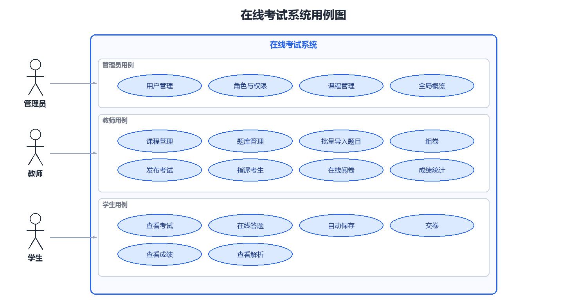
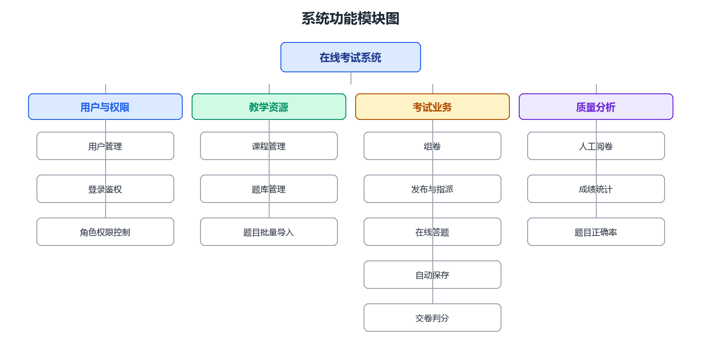
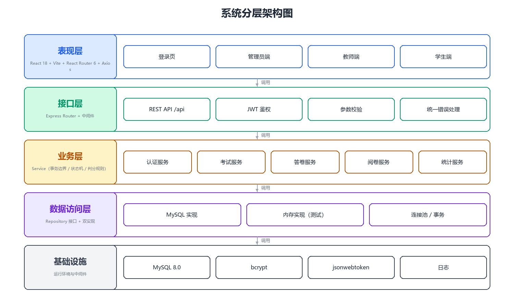
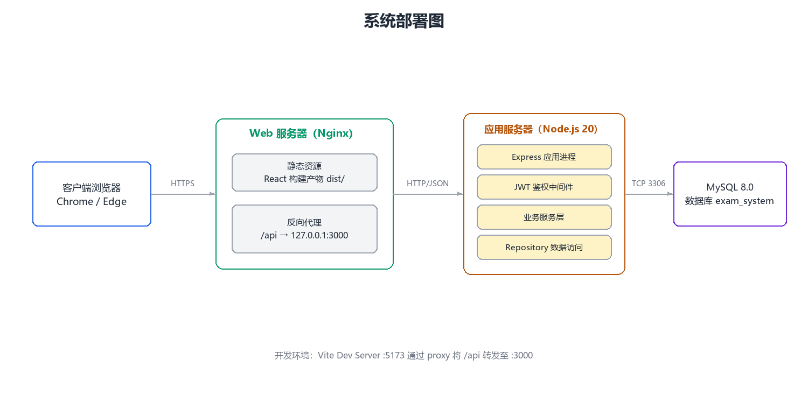
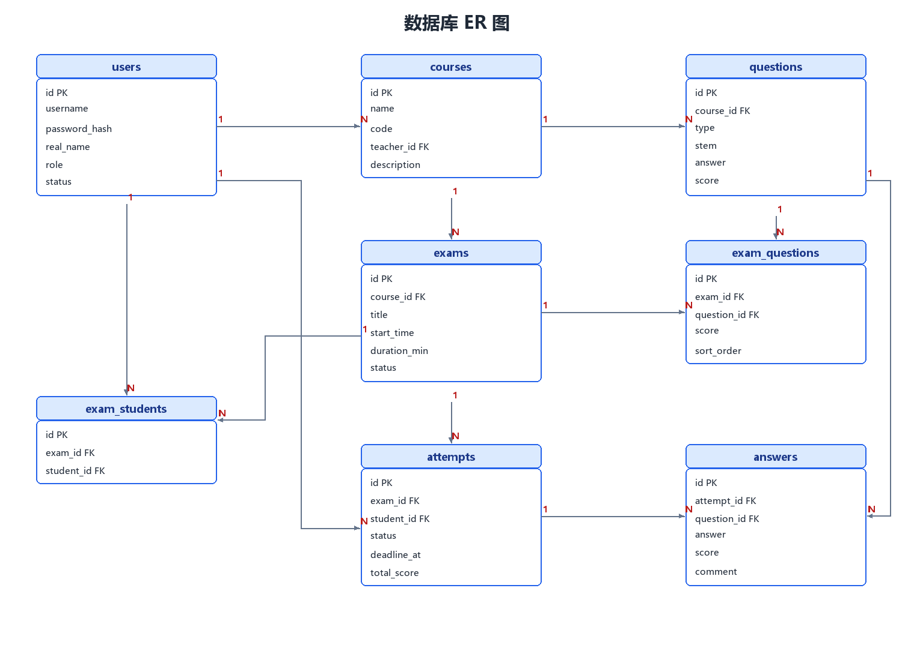
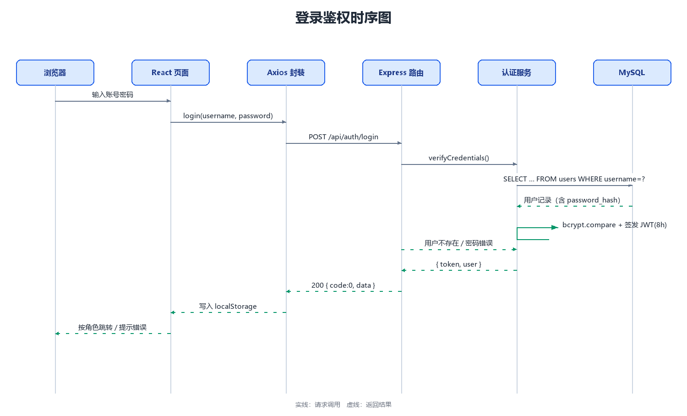
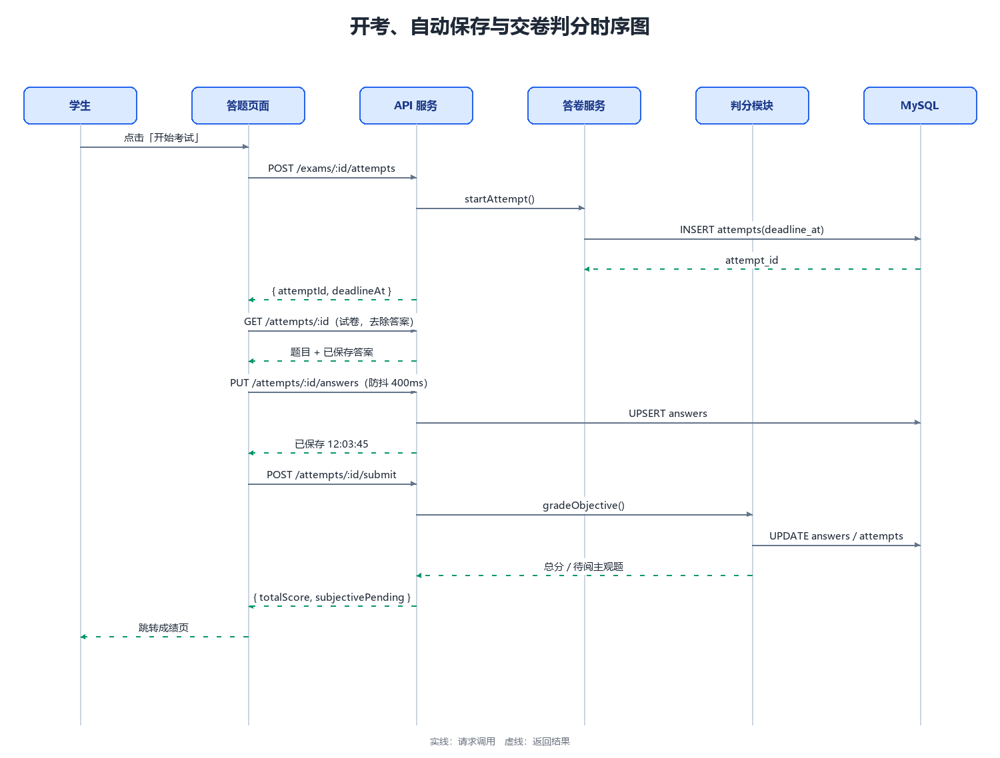
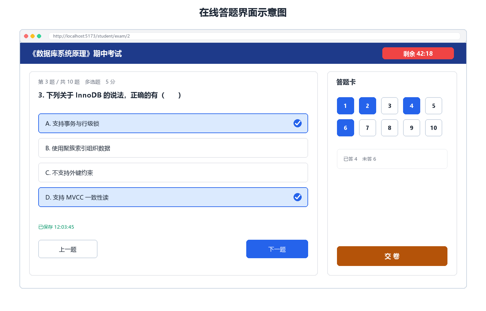
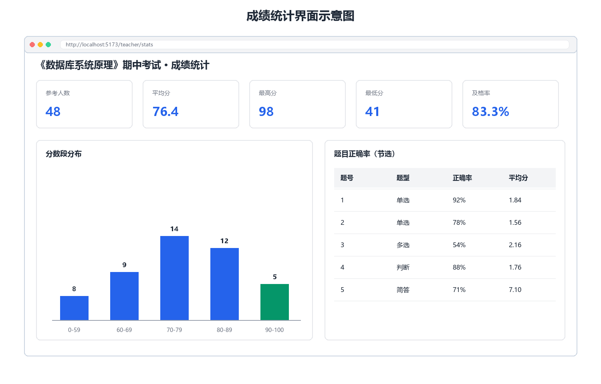

# 基于 React + Node.js 的在线考试系统设计与实现

**Design and Implementation of an Online Examination System Based on React and Node.js**

| 项 | 内容 |
|---|---|
| 论文题目 | 基于 React + Node.js 的在线考试系统设计与实现 |
| 专业 | __________________ |
| 学生姓名 | __________________ |
| 学号 | __________________ |
| 指导教师 | __________________ |
| 完成日期 | 2026 年 10 月 |

---

## 摘要

针对高校课程考核中长期存在的制卷周期长、阅卷尺度不一、成绩统计依赖人工二次转录等问题，本文设计并实现了一套面向单门课程与单个教学班规模的在线考试系统。系统前端采用 React 18 与 Vite 5 构建前后端分离的浏览器应用，后端以 Node.js 20 与 Express 4 提供 RESTful 服务，数据持久化使用 MySQL 8.0（InnoDB 引擎），并通过 JWT 与基于角色的访问控制实现管理员、教师、学生三类角色的权限隔离。系统覆盖建课、建题库、组卷、发布、在线答题、阅卷与成绩统计的完整闭环：客观题依据显式声明的判分口径自动判分，主观题由教师人工评分并保留评分责任链；答题过程以服务端计算的截止时间为唯一权威，配合单题级自动保存与超时自动交卷，保证作答不丢失、计时不可篡改。数据库设计为 8 张表并建立 17 个二级索引，以唯一键约束保证一人一卷，以事务与行锁保证交卷判分的一致性，接口按契约实现 36 个端点。测试采用 Jest 与 Supertest，在内存仓储上执行 217 条自动化用例，行覆盖率达到 93.6%，前端生产构建主入口脚本 gzip 体积为 100.40 KB。结果表明，该系统在单机部署条件下能够稳定支撑完整的考试业务流程，判分与统计口径可复核，具备教学演示与小型课程实际使用的可行性，并为同类轻量系统的工程化交付提供了一条可验证的实践路径。

**关键词**：在线考试系统；React；Node.js；MySQL；自动判分；JWT

## Abstract

To address the long paper-based examination cycle, inconsistent marking standards and manual transcription of scores in university course assessment, this thesis designs and implements an online examination system for a single course and a single teaching class. The client is a single-page application built with React 18 and Vite 5, the server provides RESTful services on Node.js 20 and Express 4, and data is persisted in MySQL 8.0 with the InnoDB engine. JSON Web Token authentication combined with role-based access control isolates the privileges of administrators, teachers and students. The system covers the whole loop of course creation, item bank construction, paper assembly, publication, online answering, marking and score analytics. Objective items are graded automatically according to an explicitly declared rule, while short-answer items are marked by teachers with the grader identity and marking time recorded. The answering process treats the server-computed deadline as the only authority, and single-question autosave together with timeout auto-submission guarantees that saved answers are never lost and that the timer cannot be tampered with on the client. The database consists of eight tables with seventeen secondary indexes, and thirty-six endpoints are implemented strictly following the contract. Testing is carried out with Jest and Supertest on an in-memory repository: 217 automated cases pass with a line coverage of 93.6%, and the gzipped main bundle of the production build is 100.40 KB. The results show that the system supports the complete examination workflow on a single machine, that grading and statistics are reproducible, and that it is feasible for teaching demonstration and for practical use in small courses.

**Keywords**: online examination system; React; Node.js; MySQL; automatic grading; JWT

---

## 目录

- 摘要
- Abstract
- 第 1 章 绪论
  - 1.1 研究背景与意义
  - 1.2 国内外研究现状
  - 1.3 研究内容
  - 1.4 论文组织结构
- 第 2 章 相关技术与理论基础
  - 2.1 React 与 Vite
  - 2.2 Node.js 与 Express
  - 2.3 MySQL 与 InnoDB
  - 2.4 JWT 与 RBAC
  - 2.5 REST 架构风格
  - 2.6 Jest 与 Supertest
  - 2.7 技术选型汇总
- 第 3 章 需求分析
  - 3.1 角色分析与用例建模
  - 3.2 功能需求
  - 3.3 非功能需求
  - 3.4 核心用例描述
  - 3.5 可行性分析
- 第 4 章 系统设计
  - 4.1 总体架构设计
  - 4.2 功能模块设计
  - 4.3 数据库设计
  - 4.4 接口设计
  - 4.5 关键流程设计
  - 4.6 安全设计
- 第 5 章 系统实现与测试
  - 5.1 开发环境与工程结构
  - 5.2 后端实现
  - 5.3 前端实现
  - 5.4 系统运行效果
  - 5.5 系统测试
- 第 6 章 总结与展望
  - 6.1 工作总结
  - 6.2 创新点
  - 6.3 不足
  - 6.4 展望
- 参考文献
- 致谢

---

# 第 1 章 绪论

## 1.1 研究背景与意义

### 1.1.1 研究背景

高校课程考核长期以纸质试卷与人工阅卷为主要形态。一次常规期末考试涉及命题、审题、排版、印刷、保管、监考、收卷、批阅、登分、统计等十余个环节，各环节串行推进，周期通常以周为单位。随着课程规模扩大与过程性评价（随堂测、单元测、期中测）的普及，纸质方式在成本、时效与数据沉淀三个维度上的矛盾日益突出，具体表现为七个方面：制卷周期长且成本高，任一环节返工即导致整体延期，临时增删题目几乎不可行；泄题风险集中于物理流转，试卷在命题人、审题人、印刷点、保管室与考场之间多次交接，任一环节失守即整场失效且事后难以定位责任环节；阅卷效率低且尺度不一，客观题依靠人工逐份比对，主观题由不同教师批阅而缺乏统一标定，批改痕迹不可追溯；成绩处理依赖人工二次转录，登分、核分、及格率与分数段统计均需人工录入并反复核对，错误难以自查；考试数据无法沉淀为教学资产，题目正确率与知识点薄弱项等诊断信息无从积累；时空约束强，缺考、缓考与跨校区考试的组织成本高；纸张消耗与归档压力与绿色校园、档案数字化的方向相悖。

与此同时，市场上已存在大量在线教学与考试平台，但其定位多为综合性教学平台，功能覆盖面广、模块耦合重、学习成本高，且相当比例以软件即服务（Software as a Service，SaaS）形式交付，学校与教师对数据的掌控力有限。对于一门课程、一个教学班规模的严肃考试场景，这类平台呈现出「功能过剩与关键能力不足并存」的特征：冗余模块很多，而「作答不丢、计时可信、判分口径透明、统计可解释」这些真正决定考试公平性的能力反而不够扎实。部分产品的答案仅暂存于浏览器本地，网络抖动或误刷新即导致已答内容丢失；部分产品的倒计时由客户端自行推算，刷新后可能重置，本地时钟亦可被修改；部分产品未在界面或文档中显式声明多选题「少选是否给部分分」等关键判分规则，成绩争议时缺少可查依据。

上述背景决定了本项目的定位：面向单门课程与单个教学班、可自建自运维、闭环完整、口径透明的轻量级在线考试系统。系统在毕业设计周期内完成从建课到成绩分析的全部环节，技术形态采用前后端分离架构与关系型数据库，工程上坚持「契约先行、接口可测、数据自主」三项原则。

### 1.1.2 研究意义

本课题的意义体现在三个层面。

在教学层面，系统把计时、判分与统计从人工环节转变为可审计的确定性流程。考试窗口与答卷截止时间由服务端一次算定并落库，客户端只做展示，学生刷新页面或更换设备均不会重置计时；判分规则以显式条款写入需求与测试用例，多选题「少选、错选、多选均不得分」不留解释空间；统计口径固定为「仅计入已交卷与已阅卷答卷」「按百分制折算的五段分布」，使平均分、及格率与分数段分布均可手工复现。这些约束直接对应考试公平性的三个可验证指标，即作答不丢失、计时不可篡改、成绩可复核。

在工程层面，系统演示了一条在有限工期内完成可验证交付的路径。需求阶段建立「需求—设计—接口—测试」的单向追踪链，36 个接口与 8 张数据表全部被需求引用，无孤立项；设计阶段冻结接口契约，前后端以文档而非代码对齐；实现阶段把数据访问抽象为仓储接口并提供 MySQL 与内存两套实现，使全部接口测试无需真实数据库即可运行，测试因此可在秒级完成并真实覆盖业务层；测试阶段以 217 条自动化用例与 93.6% 的行覆盖率作为交付证据。该路径对同类课程设计项目具有参考价值。

在数据层面，系统把一次考试转化为结构化数据资产。题目带有题型、分值、难度与知识点标签，答卷带有逐题作答、得分、评语与阅卷人，二者结合可计算单题正确率与得分率，为题库质量迭代与教学讲评提供依据。数据存放于自建数据库，不依赖第三方平台，便于校内合规审查与二次分析。

## 1.2 国内外研究现状

围绕在线考试系统的研究与工程实践可归纳为八条主线，本文在梳理各主线核心结论的基础上说明本系统的取位。

**其一，考试测量理论的工程化落地。** 经典测量理论（Classical Test Theory，CTT）与项目反应理论（Item Response Theory，IRT）为题库建设、难度标定与试卷等值提供了理论基础。工程实践中，该理论体系主要体现为「题目元数据化」：为每道题维护题型、分值、难度系数与知识点标签，使组卷从「凭经验挑题」转变为「按约束条件选题」，并使后续的题目质量分析成为可能。本系统在题库表中设置难度（1 至 5）与知识点字段，正是这一思路的轻量实现，其作用不在于精确标定能力参数，而在于使组卷与诊断具备可计算的输入。

**其二，计算机化考试与自适应测验。** 国外大规模标准化考试较早完成从纸笔到机考的迁移，并在自适应测验方向形成较成熟的选题与能力估计方法；国内则以固定试卷的规模化机考为主，重点在于并发承载与考务流程的电子化。二者的共同结论是：机考的价值不仅是节约纸张，更在于把计时、判分与统计从人工环节转为可审计的确定性流程。这一结论直接支撑了本系统「服务端权威计时」的设计决策。

**其三，开源学习管理系统的测验模块。** Moodle、Canvas 等平台以测验模块提供题库、随机组卷、自动判分与成绩簿，插件生态完善、教育场景覆盖广。但其架构偏重，插件钩子多、数据模型宽，二次开发门槛较高；且其设计面向课程过程性评价，对严肃考试所需的一人一卷、服务端权威计时与答卷状态机缺少现成约束，需大量定制。这一现状说明：通用平台的完备性与特定场景的约束强度之间存在张力，轻量系统在约束明确时反而更易做扎实。

**其四，国内智慧教学平台的普及路径。** 以超星学习通、雨课堂、学堂在线为代表的平台，在高校课堂互动、随堂练习与资源分发场景渗透率较高，优势在于与教学资源、课堂互动的深度耦合以及移动端体验；相对薄弱之处在于严肃考试的流程管控（如答卷恢复的确定性、判分规则的显式声明）与数据自主可控，且功能面广导致单点操作路径较长。国内平台的普及说明需求真实存在，但其功能重心与本课题的定位不同。

**其五，Web 考试系统的架构演进。** 技术形态上，考试系统经历了服务端渲染单体、前后端分离（单页应用加 RESTful 接口）、容器化与服务拆分三个阶段。演进动因主要是集中开考带来的瞬时并发：开考瞬间大量学生同时请求试卷并创建答卷，形成明显的写入尖峰。主流应对手段包括无状态服务（令牌鉴权，便于水平扩展）、读写分离、连接池化与接口层的幂等设计。本系统选择前后端分离加无状态令牌鉴权，并以开考幂等应对该尖峰，与该演进方向一致。

**其六，考试公平性与防作弊的边界认知。** 学界围绕身份核验、行为异常检测、题目乱序与等值组卷开展了大量研究，工程实践则普遍承认纯软件手段无法彻底防作弊。因此严肃系统的现实策略是可审计的基础约束：一人一卷防止换号重考，服务端计时防止修改本地时钟，题目乱序降低邻座抄袭收益，操作留痕便于事后追溯。本系统明确不实现摄像头监考与人脸识别，仅落地上述基础约束，并把这一能力边界写入需求文档与本文的不足部分，这本身即是需求分析的重要产出。

**其七，自动判分与主观题评阅的定位。** 客观题自动判分已完全工程化，其难点不在算法而在判分口径的显式化，例如多选题是否给予部分分。主观题评阅则经历了关键词匹配、文本相似度到预训练语言模型辅助评分的演进，但教育测量领域普遍要求人工复核，自动评分多定位为辅助排序与预评分而非替代教师。本系统据此把简答题严格划归人工阅卷，并在答题明细中保留阅卷人与阅卷时间字段，形成可追溯的评分责任链。

**其八，轻量化自建系统在教务场景的复苏。** 随着 React、Vue 与 Node.js、Spring Boot 生态成熟，越来越多院系选择小团队自建、单课程部署的轻量系统，以缩短交付周期并保持数据自主。这类项目的共同工程特征是契约先行、以接口集成测试兜底、存储层可替换。本系统的仓储双实现与「用例不少于 40 条、行覆盖率不低于 70%」的门禁即是对这一范式的遵循。

综合八条主线可得一个判断：现有产品在生态完备性与报表丰富度上占优，在严肃考试的流程管控与数据自主上偏弱，尚无一类产品同时做到闭环完整、轻量自建、口径透明与工程可验证。这一空白即为本课题的切入点。

**表 1-1 同类在线考试系统功能对比**

| 对比维度 | 综合教学平台 | 课堂互动工具 | 大规模开放课程平台 | 开源学习管理系统 | 本系统 |
|---|---|---|---|---|---|
| 定位与规模 | 全校乃至多校 | 随堂测验为主 | 开放课程 | 可自建，通用 | 单课程单教学班 |
| 组卷方式 | 手动加随机抽题 | 即时出题 | 手动为主 | 手动加随机题组 | 手动选题加逐题分值 |
| 作答可靠性 | 依赖网络，恢复不稳定 | 以课堂实时性优先 | 考试非核心场景 | 逐步保存，进程可续 | 单题即存，断线可恢复 |
| 计时权威性 | 客户端计时为主 | 弱化服务端校验 | 非核心能力 | 配置复杂 | 服务端截止时间为唯一权威 |
| 多选判分口径 | 可配置部分分 | 即时判分 | 支持 | 规则可配置 | 显式声明不给部分分 |
| 主观题阅卷 | 在线批阅 | 以客观题为主 | 支持互评 | 支持评分量规 | 人工评分并留痕 |
| 统计深度 | 报表丰富，偏管理视角 | 课堂数据为主 | 学习行为统计 | 成绩簿细致 | 平均分、及格率、五段分布、题目正确率 |
| 部署与数据自主 | SaaS 托管 | SaaS 托管 | 平台托管 | 完全自建 | 单机自建 |
| 二次开发难度 | 高（闭源） | 高（闭源） | 高（闭源） | 中高（插件复杂） | 低（自研、分层清晰） |

由表 1-1 可见，本系统在部署自主性、计时权威性与判分口径透明度三项上具备明确优势，在生态完备性与报表丰富度上则明显不及成熟平台。这一取舍与「单课程、单教学班、严肃考试」的定位相匹配。

## 1.3 研究内容

本课题的研究内容围绕「如何用一套轻量系统把考试的完整闭环做扎实」展开，具体包括五项。

第一，角色与权限模型的设计。系统面向管理员、教师、学生三类角色，需要同时处理纵向的角色权限（谁能调用哪类接口）与横向的数据归属（教师只能操作本人课程，学生只能访问本人答卷）。研究工作包括：建立三角色与八类功能的权限矩阵，将权限判定拆分为路由层的角色白名单与服务层的资源归属校验两级，并论证「默认拒绝、显式放行」的实现方式。

第二，数据模型与一致性约束的设计。考试业务存在四级引用链（考试、试卷题目、答卷、答题明细），且「一人一卷」「同卷同题不重复」「同一答卷每题一行」三条约束必须在并发下成立。研究工作包括：设计 8 张表的字段、类型、外键动作与索引，论证唯一键如何兼作业务约束与幂等基础，界定事务边界，并说明三处有意冗余（试卷总分、答卷三项得分、试卷题目分值）的一致性保障方式。

第三，答题可靠性机制的设计与实现。这是本系统与同类产品差异最集中的部分。研究工作包括：以服务端计算的截止时间替代客户端倒计时作为唯一权威；以单题级自动保存替代整卷提交，配合防抖、单题单请求与幂等写三层保护；以读时触发的惰性超时交卷替代定时任务，避免进程重启导致的漏判；并论证上述机制在刷新、断网、换设备与并发交卷四类场景下的行为。

第四，判分与统计口径的显式化与可验证化。研究工作包括：把四种题型的答案形状与判分规则写成可判定的条款（单选题与判断题精确匹配，多选题集合完全相等，简答题不计自动分）；把统计口径（样本范围、五段分布的折算方式、及格判定边界、单题正确率的分母）固化为服务层的常量与单一实现；并为每条规则设计断言，使口径不因实现演进而漂移。

第五，工程可验证性的保障。研究工作包括：以应用工厂加依赖注入的方式使业务逻辑可脱离数据库与网络被测试；以仓储接口加双实现使接口测试无需真实数据库；以契约驱动的方式使前后端并行开发；并以自动化用例数、行覆盖率与构建产物体积作为量化的交付证据。

## 1.4 论文组织结构

本文共六章，各章内容安排如下。

第 1 章绪论，阐述课题的研究背景与意义，梳理国内外研究现状的八条主线，说明研究内容与论文的组织结构。

第 2 章相关技术与理论基础，对 React 与 Vite、Node.js 与 Express、MySQL 与 InnoDB、JWT 与 RBAC、REST 架构风格、Jest 与 Supertest 六项技术分别说明其定义、选型理由以及在本系统中的具体作用，并给出选型汇总。

第 3 章需求分析，完成角色分析与用例建模，给出 38 条功能需求与 18 条非功能需求，详细描述开考、答题自动保存等核心用例，并从技术、经济、操作与进度四个维度论证可行性。

第 4 章系统设计，给出五层总体架构与部署形态，划分八个功能模块，完成 8 张表的结构设计与索引设计，列出 36 个接口的设计要点与错误码体系，并对登录鉴权、开考与交卷判分等关键流程给出时序设计，最后归纳安全设计。

第 5 章系统实现与测试，说明开发环境与工程结构，摘录后端分层装配、鉴权、判分、开考幂等与统计口径的关键代码，说明前端页面构成与倒计时、自动保存的实现方式，以文字描述系统运行效果，并给出测试环境、用例统计、覆盖率、典型用例与缺陷分析。

第 6 章总结与展望，总结全文工作，提炼三点创新，诚实说明六项不足，并给出后续演进方向。

---

# 第 2 章 相关技术与理论基础

本章对系统涉及的六项关键技术分别从「技术是什么」「为何选择它」「在本系统中承担什么作用」三个角度展开，并在末尾给出选型汇总。选型并非以技术新颖度为标准，而是以基线约束、工期约束与可验证性为标准：凡不能在一个毕业设计周期内被完整掌握并讲清的技术，即使更先进也不采用。

## 2.1 React 与 Vite

### 2.1.1 React

React 是由 Meta 维护的用于构建用户界面的 JavaScript 库。其核心思想是「界面是状态的函数」：开发者以组件为单位描述界面在某一状态下的样子，由框架负责在状态变化时计算最小更新集合。React 18 引入的并发渲染与自动批处理使高频状态更新的场景更为可控，函数组件配合 Hooks（`useState`、`useEffect`、`useMemo`、`useRef`）则把状态逻辑与副作用组织为可复用的单元。

选择 React 的理由有三点。其一，本系统前端最复杂的两个页面——组卷页与答题页——本质都是「状态驱动的表单」：组卷页需要动态增删题目并逐题改分，答题页需要同时维护当前题号、逐题作答、保存状态、倒计时与交卷状态。React 的单向数据流与不可变更新使这类派生状态的推导关系清晰，避免了双向绑定下难以追踪的隐式修改。其二，`useEffect` 的清理函数语义天然适配定时器与订阅的销毁，倒计时组件每 500 毫秒一次的定时器、自动保存的 400 毫秒防抖定时器都可以在依赖变化或组件卸载时被确定性地清除，这对「不允许内存泄漏与重复提交」的答题页是硬性要求。其三，基线已锁定 React 18，且项目不引入第三方 UI 组件库，表格、弹窗、确认框、倒计时等组件均需自研；在自研场景下，函数组件加自定义 Hook 能够让「倒计时」「防抖保存」这类横切逻辑各自收敛为一个可复用单元，符合高内聚的工程原则。

在本系统中，React 承担表现层的全部职责：`App.jsx` 以集中路由表注册全部页面并以角色守卫包裹，`src/pages` 下的 15 个页面文件覆盖登录、管理员三个页面、教师五个页面、学生四个页面与 403、404 两个公共页；`AuthContext` 以 Context 提供全局会话，`api/client.js` 以 Axios 拦截器统一注入令牌与错误提示；公共组件包括数据表格、模态框、确认框、倒计时、选项渲染、分数条与空状态等。答题页的状态机（加载、待开考、作答中、错误）与保存状态（空闲、保存中、已保存、保存失败）均以 React 状态表达，使界面与服务端状态保持单向同步。

### 2.1.2 Vite

Vite 是基于原生 ES 模块的现代前端构建工具。开发阶段它不打包源码，而是由浏览器按需请求模块、由开发服务器即时编译，因此冷启动时间与模块数量基本无关；生产阶段则使用 Rollup 打包，并通过 esbuild 完成依赖预构建。

选择 Vite 的理由有两点。其一，开发期的反馈速度直接影响调试效率。本系统答题页涉及倒计时、自动保存与交卷三条并发逻辑，需要反复修改与观察，Vite 的秒级冷启动与毫秒级热更新显著降低了这一成本。其二，配置面极小。Vite 只需在配置文件中声明一条代理规则，把浏览器的 `/api` 请求转发到后端 3000 端口，即可在开发期规避跨域配置；生产构建产物为纯静态文件，交由 Nginx 托管，代理逻辑不会残留到生产环境。

在本系统中，Vite 承担开发与构建两项职责：开发期提供 5173 端口的开发服务器与 `/api` 代理；生产构建将全部源码与样式打包为三个文件，共转换 128 个模块，主入口脚本 gzip 后为 100.40 KB，远低于「主入口脚本 gzip 不超过 500 KB」的非功能指标。

## 2.2 Node.js 与 Express

### 2.2.1 Node.js

Node.js 是基于 Chrome V8 引擎的 JavaScript 运行时，采用事件驱动与非阻塞 I/O 模型，以单线程事件循环处理并发请求，把等待 I/O 的时间让给其他任务。

选择 Node.js 的理由有三点。其一，前后端同语言降低了上下文切换成本。本项目的接口契约、字段命名与数据形状在前后端高度一致，同一名开发者可以在同一天内修改服务端判分逻辑与前端展示逻辑，这对工期紧张的单人项目是实质性收益。其二，JSON 是 Node.js 的原生数据形态，请求体解析与响应序列化几乎没有额外开销，与 RESTful 接口的 JSON 约定天然契合。其三，本系统的业务特征是「大量短请求、少量计算」：答题期间每个学生每几秒产生一次自动保存请求，交卷时产生一次判分计算。非阻塞 I/O 模型适合前者，而判分计算在数十题量级下耗时极短，不构成事件循环阻塞风险。

在本系统中，Node.js 20 及以上版本提供运行时能力：原生 `async/await` 使服务层的异步读写可以顺序书写，`crypto.randomUUID` 用于生成请求标识，`node --watch` 用于开发期热重载。运行时的版本要求写入 `package.json` 的 `engines` 字段，避免在低版本环境出现语法不兼容。

### 2.2.2 Express

Express 是 Node.js 上最广泛使用的 Web 框架，其核心是「中间件数组加路由」：每个中间件接收请求、响应与 `next` 函数，可选择终止请求或把控制权交给下一个中间件；路由则把方法与路径映射到处理函数。

选择 Express 的理由有三点。其一，本系统的横切关注点恰好可以表达为一条确定的中间件链：请求标识、请求体解析、跨域、鉴权、角色白名单、控制器、错误处理。Express 的线性执行模型让这条链的顺序在代码中一目了然，排查问题时无需理解框架内部的调度机制。其二，Express 不强制目录结构，分层依靠目录约定而非框架约束。本系统据此建立了「路由只装配、控制器只校验、服务只承载业务、仓储只做存取」的四层规则，并用依赖注入把各层串联，结构清晰且不引入额外概念。其三，未选择 NestJS 与 Koa 有明确理由：NestJS 的装饰器、模块与依赖注入容器虽然结构规整，但需要引入反射元数据与十余个包，其容器与本项目「应用工厂加显式注入」的手动装配是两套体系，会造成概念冗余；Koa 的洋葱模型更优雅，但中间件生态与错误处理范式与 Express 不完全等价，且基线已指定 Express。

在本系统中，Express 4 承担接口层职责：`routes/index.js` 装配 36 条路由并显式声明每条路由的角色白名单，`middlewares/` 下三个中间件分别负责请求标识、鉴权与角色授权、统一错误处理；`app.js` 以工厂函数形式装配依赖并返回应用实例，不监听端口，从而可被测试框架反复实例化。

## 2.3 MySQL 与 InnoDB

MySQL 是开源的关系型数据库管理系统。InnoDB 是其默认存储引擎，支持事务（ACID）、行级锁、外键约束与聚簇索引：表数据按主键组织为聚簇索引，二级索引的叶节点存储主键值，因此按主键查询只需一次索引查找；行级锁使并发写入的冲突面收敛到具体记录；外键约束把引用完整性交给数据库而非应用层。

选择 MySQL 8.0 与 InnoDB 的理由有四。其一，本系统的数据是强关系型的：考试、试卷题目、答卷与答题明细构成四级引用链，课程归属教师、题库归属课程、考试归属课程，这些关系若用文档型数据库表达，需要在应用层手工维护引用完整性，风险高且难以验证。其二，三条核心业务约束必须由数据库保证：一人一卷依赖答卷表上「考试与学生」的唯一键，同卷同题不重复依赖试卷题目表上的唯一键，单题单答案依赖答题明细表上「答卷与题目」的唯一键。这三条约束在并发下是正确性的一部分，而非性能优化。其三，MySQL 8.0 原生支持 JSON 类型，恰好满足选项与答案这两个「形状随题型变化」的字段需求：单选题答案为字符串，多选题答案为数组，简答题答案为文本，若拆表则退化为「一列多用」或实体属性值模型，可读性更差。其四，字符集 `utf8mb4` 与排序规则 `utf8mb4_general_ci` 保证中文题干、姓名与评语无乱码，且支持四字节字符。

在本系统中，MySQL 承担持久化职责：`schema.sql` 定义 8 张业务表、6 个唯一键与 17 个二级索引；连接池启用 `dateStrings` 使时间以字符串形式直出，启用 `decimalNumbers` 使分数以数值形式返回，关闭多语句以压缩注入面；组卷、交卷与阅卷三类多表写操作在显式事务内完成，交卷路径对答卷行加 `FOR UPDATE` 行锁，配合状态条件更新形成双重保护。

## 2.4 JWT 与 RBAC

JWT（JSON Web Token）是 RFC 7519 定义的一种紧凑的、自包含的令牌格式，由头部、载荷与签名三段以点号连接构成。服务端以密钥对前两段签名，客户端在后续请求的 `Authorization` 头中以 Bearer 方式回传，服务端验签即可确认令牌未被篡改，无需在服务端保存会话状态。RBAC（Role-Based Access Control）是基于角色的访问控制模型，其核心是把权限授予角色、再把角色授予用户，从而把「谁能做什么」的判断从用户个体收敛到少数几个角色。

选择 JWT 与 RBAC 的理由有三点。其一，前后端分离部署下，前端为静态产物、后端为独立服务，若采用服务端会话加 Cookie，需要处理跨端口与跨域的凭证传递，而 Bearer 令牌只需在请求拦截器中写入一个头部。其二，令牌自带角色声明，前端可在首屏渲染时据此决定导航项与路由守卫，无需额外请求；服务端则可据此完成粗粒度授权。其三，无状态使服务进程可水平扩展，无需引入共享会话存储。

本系统同时正视 JWT 的固有缺陷：令牌一旦签发，在有效期内无法主动吊销。若只看令牌，管理员禁用某账号后旧令牌仍可使用至过期。为此，鉴权中间件在验签之后增加一次用户回查，确认账号仍存在且状态为启用，通过后才把用户对象挂到请求上。这一取舍以「每个受保护请求多一次主键查询」换取「禁用即时生效」，在本系统规模下成本可忽略，并已由专门的测试用例锁定。

在本系统中，RBAC 实现为两级：路由层以角色白名单声明允许的角色，默认拒绝；服务层在读取资源后断言归属，教师只能操作本人课程下的资源，学生只能访问本人答卷。两级校验并存的原因是：路由白名单可能因配置疏忽而放宽，而归属校验直接依赖数据本身，难以被绕过。

## 2.5 REST 架构风格

REST（Representational State Transfer）是 Fielding 在博士论文中提出的分布式系统架构风格，其约束包括客户端服务器分离、无状态、可缓存、统一接口、分层系统与按需代码。工程实践中，REST 通常体现为「以资源为中心、以 HTTP 方法表达操作语义」的接口设计：查询用 GET、创建用 POST、更新用 PUT、删除用 DELETE，资源以复数名词命名，从属资源以父路径表达。

选择 REST 的理由有三点。其一，本系统的实体与资源高度对应，课程、题目、考试、答卷、答题明细均可直接映射为资源路径，接口命名不需要额外约定即可自解释。其二，状态迁移类操作无法用增删改查表达，REST 允许以「子资源加 POST」的方式建模，本系统的发布、指派、交卷三个动作分别建模为 `/exams/:id/publish`、`/exams/:id/assign`、`/attempts/:id/submit`，语义明确且不与资源路径冲突。其三，统一接口使前后端可以按契约并行开发，接口的请求参数、响应字段与错误码一旦冻结，双方即可独立推进。

在本系统中，REST 约束落地为四项具体约定：统一响应体，成功为 `{code, message, data}`，失败为 `{code, message}` 且不含 `data`；六个业务码与 HTTP 状态一一对应，不允许出现「HTTP 200 携带错误业务码」；分页响应固定四字段；时间格式统一为 `YYYY-MM-DD HH:mm:ss`。这些约定使前端拦截器可以用一段代码处理全部错误，也使接口测试可以按统一模式断言。

## 2.6 Jest 与 Supertest

Jest 是 JavaScript 生态中使用最广的测试框架，内置断言、测试替身、快照与覆盖率统计，支持通过配置设定覆盖率阈值并在不达标时以非零码退出。Supertest 是建立在 superagent 之上的 HTTP 断言库，可以直接对一个 Express 应用实例发起请求，无需显式监听端口。

选择 Jest 与 Supertest 的理由有三点。其一，Jest 自带覆盖率统计与阈值校验，能够直接满足「用例不少于 40 条、行覆盖率不低于 70%」的交付门禁，无需额外引入覆盖率工具链。其二，Supertest 与「应用工厂」的配合是自然的：应用工厂只装配依赖、不监听端口，测试直接以工厂返回的实例构造请求，因此可以并行创建多个互不干扰的实例，也不会占用端口。其三，本系统要求测试在无数据库环境下运行，Supertest 不关心数据来源，只要注入的仓储可用即可，这与仓储双实现的设计相互支撑。

在本系统中，Jest 与 Supertest 承担验证职责：10 个测试文件、217 条用例全部在内存仓储上运行，覆盖 36 个接口的正常流与异常流、六类业务规则以及三项安全约束；覆盖率统计排除启动入口、数据库脚本与 MySQL 仓储实现，使统计结果真实反映业务层与接口层的覆盖情况。

## 2.7 技术选型汇总

**表 2-1 关键技术选型与依据**

| 决策点 | 选型结论 | 主要理由 | 付出的代价 |
|---|---|---|---|
| 前端框架 | React 18 | 状态驱动表单与 Hook 复用契合答题页与组卷页 | 需自研表格、弹窗、倒计时等组件 |
| 构建工具 | Vite 5 | 秒级冷启动与毫秒级热更新，配置面极小 | 插件生态少于 Webpack |
| 后端运行时 | Node.js 20 | 前后端同语言，原生支持 JSON 与异步 | 单线程，CPU 密集计算需谨慎 |
| Web 框架 | Express 4 | 中间件链足以表达本项目分层，学习成本最低 | 结构靠目录约定，框架不强制 |
| 数据库 | MySQL 8.0 + InnoDB | 强关系模型、唯一约束、JSON 字段三者兼顾 | 高级分析函数能力弱于 PostgreSQL |
| 鉴权 | JWT（HS256）加用户回查 | 无状态可扩展，且能感知禁用与角色变更 | 每个请求多一次主键查询 |
| 接口风格 | REST | 资源模型与实体高度对应，动作型端点可建模 | 需自行约定统一响应与错误码 |
| 测试 | Jest 加 Supertest | 内置覆盖率，可直接测试应用实例 | 并发用例需注意共享仓储隔离 |

上表的每一行都在本项目中留下了可验证的痕迹：React 与 Vite 的产物体积、Express 的 36 条路由、MySQL 的 8 张表与 31 个索引对象、JWT 的 8 小时有效期与回查逻辑、REST 的 6 个业务码、Jest 的 217 条用例与 93.6% 行覆盖率。

---

# 第 3 章 需求分析

需求分析的目标是把「一次考试如何被完整支撑」分解为可分配、可实现、可验证的条目。本章依次给出角色与用例模型、功能需求、非功能需求、核心用例描述与可行性论证。全部需求共 56 条（功能需求 38 条、非功能需求 18 条），用例 38 个，每条需求均可追踪到具体设计单元、接口与测试用例，无孤立条目。

## 3.1 角色分析与用例建模

### 3.1.1 角色分析

系统面向三类直接用户与三类间接相关方。直接用户为管理员、教师与学生；间接相关方为部署运维者、论文评阅教师与教务管理部门。三类直接用户的职责、目标与关注的质量属性差异显著，需求设计必须分别对待。

**表 3-1 三类角色的职责与质量属性**

| 角色 | 系统中的定位 | 核心目标 | 关注的质量属性 | 主要痛点 |
|---|---|---|---|---|
| 管理员 admin | 账号与权限的治理者，全局数据的责任人 | 账号准确、权限可控、全局数据一屏可见 | 安全性、可靠性、可审计性 | 批量建号易错、删除被引用资源易产生孤儿数据、缺少全局视角 |
| 教师 teacher | 考试的组织者与评判者，内容生产频次最高 | 题库高效沉淀、按约束组卷、快速阅卷、拿到可解释的诊断数据 | 效率、正确性、口径一致性、数据隔离 | 逐题录入耗时、分值合计易错、阅卷需反复翻页、统计口径不清 |
| 学生 student | 考试的参与者，单位时间内压力最大 | 顺利进入考试、作答零丢失、成绩透明可复盘 | 可靠性、公平性、透明性、易用性 | 断线丢答案、倒计时不准、只知总分不知错因 |

管理员是唯一不能以学生身份答题的角色。这一限制并非疏漏，而是「考试记录归属于真实考生」的必然结果：若管理员可代答，答卷的学生归属将与实际操作者分离，成绩责任链断裂。教师的边界是「本人课程」：课程归属关系决定了题库、试卷、阅卷与统计四类数据的可见范围，任何跨课程的读写都必须被拒绝，且必须返回明确的错误而非空数据。学生的边界是「被指派且本人」：未被指派的考试不可见，他人的答卷不可读写。

### 3.1.2 权限矩阵

权限矩阵是需求阶段最重要的产出之一，它把「谁能做什么」固化为可逐格验证的表格，测试阶段据此为每个禁止格设计一条反向断言。

**表 3-2 角色权限矩阵**

| 功能 | 管理员 | 教师 | 学生 |
|---|:--:|:--:|:--:|
| 用户管理（增删改查、重置密码、禁用） | 允许 | 禁止 | 禁止 |
| 课程管理 | 全部 | 仅本人课程 | 只读全部 |
| 题库管理 | 全部 | 仅本人课程 | 禁止 |
| 组卷、发布、指派考生 | 允许 | 仅本人课程 | 禁止 |
| 在线答题与交卷 | 禁止 | 禁止 | 仅被指派且进行中 |
| 阅卷（主观题打分） | 允许 | 仅本人课程 | 禁止 |
| 成绩统计 | 全局 | 仅本人课程 | 仅本人成绩 |
| 查看试题答案与解析 | 允许 | 允许 | 仅交卷后 |

矩阵中的「禁止」格并非形式约束，而是安全需求的具体条目。例如「在线答题与交卷」一行中管理员的禁止格，直接对应后续接口设计中「开考接口仅允许学生角色」的实现；「查看答案与解析」一行中学生格的「仅交卷后」，对应接口设计中「答题中访问成绩接口返回状态冲突」的实现。矩阵与实现之间的这种一一对应，是需求可验证性的具体体现。

### 3.1.3 用例建模

系统共识别 38 个用例，分属八个功能域：用户与认证 8 个、课程管理 4 个、题库管理 5 个、组卷 4 个、考试发布与指派 6 个、在线答题 5 个、阅卷 2 个、统计 4 个。用例图以参与者与用例的关联关系呈现各角色的主要操作路径。



**图 3-1 系统用例图**

图 3-1 中三个参与者分别为管理员、教师与学生，用例按功能域聚集为八个分组。为避免连线交叉，图中仅绘制各角色的主要关联：管理员关联用户、课程、组卷、考试发布、阅卷与统计类用例；教师关联课程、题库、组卷、考试发布、阅卷与统计类用例；学生关联登录、课程浏览、可考列表、取卷、开考、答题、恢复、交卷、成绩与个人统计类用例。管理员对教师的教学类用例具备同等权限，完整边界以表 3-2 为准。图中未绘制包含与扩展关系，改以文字在用例描述中说明主流程的调用关系，例如开考用例在重复请求时复用原答卷，恢复答卷用例在超时情况下触发自动交卷。

**表 3-3 用例按功能域分布**

| 功能域 | 用例编号 | 数量 | 主要参与者 |
|---|---|---:|---|
| 用户与认证 | UC-01 至 UC-08 | 8 | 管理员、教师、学生 |
| 课程管理 | UC-09 至 UC-12 | 4 | 管理员、教师、学生（只读） |
| 题库管理 | UC-13 至 UC-17 | 5 | 教师、管理员 |
| 组卷 | UC-18 至 UC-21 | 4 | 教师、管理员 |
| 考试发布与指派 | UC-22 至 UC-27 | 6 | 教师、管理员、学生 |
| 在线答题 | UC-28 至 UC-32 | 5 | 学生 |
| 阅卷 | UC-33 至 UC-34 | 2 | 教师、管理员 |
| 统计 | UC-35 至 UC-38 | 4 | 管理员、教师、学生 |
| 合计 | — | 38 | — |

38 个用例覆盖全部 36 个接口。接口与用例并非严格一一对应：答题写保护由单独一条功能需求承载并在「答题与自动保存」用例的异常流中体现；取卷接口与答卷详情接口的职责边界在「恢复答卷」用例中说明。这种「用例数略多于接口数」的关系是正常的，因为一个接口可能承载多个用例的不同分支。

## 3.2 功能需求

功能需求按八个模块分组，编号连续不跳号，每条需求包含名称、描述、优先级与可判定的验收标准。优先级分为三级：P0 为必做，缺失即无法演示闭环；P1 为应做，缺失时闭环仍可跑通但需在不足中说明；P2 为可做，资源充足时实现。38 条需求中 P0 为 26 条、P1 为 10 条、P2 为 2 条。



**图 3-2 系统功能模块图**

图 3-2 以三层结构呈现功能划分：顶层为系统，第二层为八个功能域，第三层为各功能域下的具体功能点。八个功能域并非平行堆叠，而是构成一条有向的业务链：课程管理提供归属容器，题库管理向容器内沉淀题目，组卷把题目组织为试卷，考试发布与指派把试卷投递给具体考生，在线答题产生答卷，阅卷补全主观分，统计把答卷聚合为可解释的指标。这一链条决定了模块之间的依赖方向，也决定了开发顺序：任一环节缺失，后续环节都无法演示。

**表 3-4 功能需求清单**

| 编号 | 需求名称 | 优先级 | 承接接口 |
|---|---|---|---|
| FR-01 | 账号口令登录 | P0 | POST /auth/login |
| FR-02 | 获取当前登录用户信息 | P0 | GET /auth/me |
| FR-03 | 用户列表查询 | P0 | GET /users |
| FR-04 | 新增用户 | P0 | POST /users |
| FR-05 | 用户信息修改与口令重置 | P0 | PUT /users/:id |
| FR-06 | 删除用户 | P2 | DELETE /users/:id |
| FR-07 | 课程列表与角色范围过滤 | P0 | GET /courses |
| FR-08 | 创建课程 | P0 | POST /courses |
| FR-09 | 修改课程 | P1 | PUT /courses/:id |
| FR-10 | 删除课程与引用保护 | P1 | DELETE /courses/:id |
| FR-11 | 题目查询与多条件筛选 | P0 | GET /questions |
| FR-12 | 新增题目与答案校验 | P0 | POST /questions |
| FR-13 | 修改题目 | P1 | PUT /questions/:id |
| FR-14 | 删除题目 | P1 | DELETE /questions/:id |
| FR-15 | 题目批量导入 | P1 | POST /questions/import |
| FR-16 | 手动组卷 | P0 | POST /exams |
| FR-17 | 编辑草稿试卷 | P1 | PUT /exams/:id |
| FR-18 | 删除草稿试卷 | P2 | DELETE /exams/:id |
| FR-19 | 试卷详情查看 | P1 | GET /exams/:id |
| FR-20 | 考试列表查询 | P0 | GET /exams |
| FR-21 | 发布考试与发布前校验 | P0 | POST /exams/:id/publish |
| FR-22 | 指派考生（覆盖式） | P0 | POST /exams/:id/assign |
| FR-23 | 学生可考列表 | P0 | GET /exams/available |
| FR-24 | 考生试卷获取（答案不下发） | P0 | GET /exams/:id/paper |
| FR-25 | 开考（幂等创建答卷） | P0 | POST /exams/:id/attempts |
| FR-26 | 答卷详情与断线恢复 | P0 | GET /attempts/:id |
| FR-27 | 单题自动保存 | P0 | PUT /attempts/:id/answers |
| FR-28 | 答卷写保护 | P0 | PUT /attempts/:id/answers |
| FR-29 | 交卷与客观题自动判分 | P0 | POST /attempts/:id/submit |
| FR-30 | 超时自动交卷 | P0 | GET /attempts/:id、POST /attempts/:id/submit |
| FR-31 | 成绩与逐题解析查看 | P0 | GET /attempts/:id/result |
| FR-32 | 待阅列表 | P0 | GET /grading/pending |
| FR-33 | 阅卷答卷详情 | P0 | GET /grading/:attemptId |
| FR-34 | 主观题评分与总分重算 | P0 | POST /grading/:attemptId |
| FR-35 | 管理员全局概览 | P1 | GET /stats/overview |
| FR-36 | 考试统计列表 | P1 | GET /stats/exams |
| FR-37 | 单场考试统计分析 | P0 | GET /stats/exams/:id |
| FR-38 | 学生个人成绩统计 | P1 | GET /stats/students/:id |

表 3-4 中若干条目的需求描述值得展开说明，因为它们体现了「把模糊表述变为可判定断言」的过程。

关于用户列表查询（FR-03），需求没有停留在「支持分页与筛选」，而是进一步规定：返回体必须包含列表、总数、页码与每页条数四个字段；按角色过滤后列表项的角必须全部一致；关键字需同时模糊匹配登录名与真实姓名；每页条数缺省为 10、上限为 100，超过上限按 100 处理而不报错；列表项中不得出现口令散列。这些条款使测试可以直接转写为断言，也避免了「分页参数越界导致翻页抖动」这类体验问题。

关于新增题目（FR-12），需求把四种题型的答案形状写成了判定规则：单选题答案必须为 A 至 F 中的单个字母；多选题答案必须为不少于两个不重复字母的数组；判断题答案只能为真或假的两个取值；简答题答案必须为非空且不超过 500 字的字符串。选项方面，单选与多选必须提供不少于两项且键唯一的选项，判断与简答忽略选项并落库为空。这些规则同时约束了接口、数据库与判分逻辑三处，是「判分口径显式化」的第一道关口。

关于组卷（FR-16），需求明确规定试卷总分由服务端对各题分值求和得出，不接受前端传入的总分；题目顺序按提交数组顺序编号；同一题目不得重复加入；题目必须属于本场考试所属课程；任一分值必须大于零。这条需求拒绝了「前端算好总分再提交」的常见做法，理由是前端计算既可能出错也可能被篡改，而总分是后续及格率统计的分母，必须可信。

关于指派考生（FR-22），需求选择了覆盖式语义而非增量式：每次提交的名单即为该场考试的完整名单，服务端先清空原指派再写入新集合。这一选择消除了「以为取消了实则仍在」的歧义，代价是前端必须回填当前名单，但收益是语义唯一。

关于开考（FR-25），需求规定了截止时间的计算公式为「开考时刻加考试时长」与「考试结束时刻」的较小值，并规定重复开考返回原答卷而不报错。前者保证学生不能以个人时长突破考试窗口，后者把「继续答题」视为正常行为而非异常。

## 3.3 非功能需求

非功能需求共 18 条，按性能效率、信息安全、可靠性与数据一致性、易用性与可维护性、兼容性与可扩展性等类别组织。每条需求均给出可度量的指标与测量方法，测量方法即测试方法，避免出现「响应较快」「安全较好」这类无法验收的表述。

**表 3-5 非功能需求与度量指标**

| 编号 | 类别 | 需求名称 | 可度量指标 |
|---|---|---|---|
| NFR-01 | 性能效率 | 接口响应性能 | 200 并发下 P95 小于 500 毫秒、P99 小于 1000 毫秒、错误率小于 0.1% |
| NFR-02 | 性能效率 | 计算类操作性能 | 组卷 100 题小于 1 秒；单份 100 题判分小于 200 毫秒；千份答卷统计小于 1 秒 |
| NFR-03 | 性能效率 | 前端加载与交互 | 首屏可交互小于 2 秒；选项点击反馈小于 100 毫秒；主入口脚本 gzip 小于 500 KB |
| NFR-04 | 信息安全 | 身份认证强度 | HS256，载荷含用户标识、登录名与角色，有效期 8 小时，密钥缺失时启动失败 |
| NFR-05 | 信息安全 | 口令存储安全 | bcrypt 成本因子 10；全部响应中口令字段零命中 |
| NFR-06 | 信息安全 | SQL 注入防护 | 全部查询使用占位符；不少于 10 条注入串不产生越权数据与服务器错误 |
| NFR-07 | 信息安全 | 越权访问防护 | 不少于 20 条越权用例返回 401 或 403，通过率 100%，不返回业务数据 |
| NFR-08 | 信息安全 | 答案与解析保密 | 交卷前学生可见响应中答案与解析关键字零命中 |
| NFR-09 | 可靠性 | 自动保存可靠性 | 单题落库不超过 3 秒；失败提示明确；丢包 10% 下成功率不低于 99% |
| NFR-10 | 可靠性 | 断线恢复能力 | 已保存答案恢复率 100%；剩余时间与服务端偏差不超过 5 秒；刷新不重置截止时间 |
| NFR-11 | 可靠性 | 超时交卷确定性 | 到达截止时间后 1 分钟内任一请求触发交卷；重复调用不改变总分与交卷时间 |
| NFR-12 | 可靠性 | 事务一致性与并发安全 | 50 并发开考仅产生 1 份答卷；并发交卷总分唯一 |
| NFR-13 | 易用性 | 易用性 | 学生主链路不超过 5 步；错误提示全为中文；列表页具备加载、空、错误三态 |
| NFR-14 | 可维护性 | 可维护性 | 四层分层无跨层调用；单文件不超过 400 行；用例不少于 40 条、行覆盖率不低于 70% |
| NFR-15 | 兼容性 | 浏览器与分辨率兼容 | 两个浏览器各两个大版本、两种分辨率下五条主链路通过，控制台零报错 |
| NFR-16 | 可扩展性 | 可扩展性 | 新增题型仅需改答案校验与判分策略两处；服务无状态可扩展至多实例 |
| NFR-17 | 可观测性 | 可观测性 | 每请求具备唯一标识并回写响应头；服务器错误响应不含堆栈与 SQL |
| NFR-18 | 本地化 | 时间与本地化规范 | 时间统一格式；服务端时区固定；中文零乱码；响应类型为带字符集的 JSON |

表 3-5 中 NFR-08 与 NFR-10 是全系统最关键的两条约束。NFR-08 是否定性约束，要求「不得出现」而非「应当出现」，因此必须单独设计断言：以学生身份获取试卷与答卷详情，对整个响应文本检索答案与解析关键字，命中数必须为零。NFR-10 是复合约束，同时要求答案恢复率与计时偏差，测试时需要先保存多题答案、再重新拉取答卷、逐题比对，并比较客户端剩余秒数与服务端计算值的差。

非功能需求与功能需求并非并列关系，而是约束关系：认证强度约束登录与全部受保护接口；答案保密约束取卷与答卷详情；可靠性约束自动保存与超时交卷；性能指标则是纯度量型需求，需独立压测而非通过功能用例验证。明确这一关系可以避免测试设计的重复与遗漏。

## 3.4 核心用例描述

38 个用例中有 11 个被展开为详细描述，包含前置条件、主流程、异常流、后置条件与业务规则。本节摘取其中两个最能体现系统设计难点的用例。

开考用例是「一人一卷」与「服务端计时」两条约束的交汇点。学生可能在网络不稳定时重复点击开始按钮，也可能在两台设备上同时进入，系统必须保证无论请求多少次，只产生一份答卷，且截止时间一旦确定不再变更。

**表 3-6 用例 UC-27 开考**

| 项 | 内容 |
|---|---|
| 参与者 | 学生 |
| 前置条件 | 已登录；存在该考试对本人的指派记录；考试已发布；服务端时间位于考试窗口内 |
| 主流程 | 1) 前端二次确认并提示开始后计时不可暂停；2) 调用开考接口；3) 服务端校验角色、指派、状态与时间窗；4) 查询本人答卷，存在则直接返回；5) 计算截止时间为「当前时间加时长」与「考试结束时间」的较小值并落库；6) 返回答卷标识、截止时间与剩余秒数；7) 前端跳转答题页 |
| 异常流 | 未被指派返回无权限；未发布返回状态冲突；早于开始或晚于结束返回状态冲突并提示窗口时间；重复或并发开考由唯一键兜底后回读原答卷；截止时间已早于当前时间则立即按超时处理；已交卷则返回答卷状态并由前端跳转结果页 |
| 后置条件 | 新增或复用一份答卷，状态为作答中，截止时间不可变更 |
| 业务规则 | 一人一卷；截止时间一经写入不再修改，即使教师随后修改时长；计时权威在服务端 |

开考的幂等实现分为两段：正常路径先按「考试与学生」查询，存在即复用；并发路径依赖数据库唯一键，后到的插入失败后捕获唯一键冲突并回读。两段合起来保证「同一学生同场考试恒返回同一答卷标识」，这也是接口在首次开考返回创建成功、重复开考返回成功的原因。控制器据服务层返回的创建标记决定状态码，而非自行猜测。

超时自动交卷用例体现了「服务端权威」的另一面：系统不能依赖客户端在倒计时归零时发起请求，因为浏览器可能已被关闭，网络可能已断开。

**表 3-7 用例 UC-31 超时自动交卷**

| 项 | 内容 |
|---|---|
| 参与者 | 学生（被动）、系统（触发方） |
| 前置条件 | 答卷存在且状态为作答中；服务端当前时间不早于截止时间 |
| 主流程 | 1) 服务端处理任何涉及该答卷的请求时先比较当前时间与截止时间；2) 若已超时且仍为作答中，按已保存答案执行与手动交卷相同的判分流程；3) 交卷时间记为截止时间而非当前时刻；4) 状态置为已交卷并返回；5) 前端提示已自动交卷并跳转结果页 |
| 异常流 | 并发触发时以状态条件更新保证仅一次生效，另一次读取既有结果；服务器时钟回拨时以统一时钟源为准；答卷无任何已保存答案时仍然交卷，客观题得分为零 |
| 后置条件 | 答卷进入已交卷状态，可查询结果，不再接受答案写入 |
| 业务规则 | 超时判定唯一依据是服务端时间与截止时间；客户端倒计时仅作展示；超时交卷与手动交卷对外表现一致，仅交卷时间取值不同 |

该用例采用「读时触发」的惰性机制而非定时任务，理由是定时任务在进程重启后会丢失，且需要额外的租约与补偿逻辑；惰性机制虽然使「最后一名学生的成绩在其下次访问时才落定」，但实现简单且永不漏判。这一取舍在测试阶段暴露过一个真实缺陷：早期实现统一以当前时刻写入交卷时间，导致超时答卷的提交时间落在考试窗口之外，与需求规定的「交卷时间等于截止时间」不符。缺陷已在测试阶段修复并由三条用例锁定，详见第 5 章。

## 3.5 可行性分析

可行性分析从技术、经济、操作与进度四个维度展开，目的是在开发前识别不可行项，而非在交付后解释失败。

**表 3-8 可行性分析**

| 维度 | 分析要点 | 结论 |
|---|---|---|
| 技术可行性 | 所选技术均为成熟且文档充分的方案；团队已具备 JavaScript 全栈能力；难点集中在计时与并发，均有成熟的工程解法（服务端时间、唯一键、行锁、条件更新） | 可行 |
| 经济可行性 | 全部依赖为开源软件，无授权费用；部署仅需一台普通服务器；无需采购监考硬件、短信或邮件服务 | 可行 |
| 操作可行性 | 三类角色的操作路径与既有习惯一致：教师按「建课、建题、组卷、发布、阅卷」推进，学生按「进考场、答题、交卷、看成绩」推进；界面为桌面端常规布局，无需专门培训 | 可行 |
| 进度可行性 | 38 条功能需求中 P0 为 26 条，可在主干开发阶段完成；P1 与 P2 可增量交付；测试与文档工作可与开发并行 | 可行，需严格控制范围 |

技术可行性中最需要论证的是并发开考与并发交卷。前者通过数据库唯一键加冲突回读解决，后者通过行锁加状态条件更新解决，两者都不引入分布式锁或消息队列，因此不增加部署复杂度。经济可行性中最需要说明的是「不使用云服务」：系统不发送短信与邮件，不做对象存储，全部数据落在一台机器的 MySQL 中，成本仅为服务器与带宽。操作可行性中最需要说明的是「不追求移动端适配」：答题界面按桌面端设计，避免在有限工期内同时处理响应式布局与考试逻辑。进度可行性中最需要说明的是范围裁剪原则：任何无法在工期内完成的需求，要么降级为 P2 并在不足中说明，要么直接划出范围，绝不以「已实现」的措辞写入文档。

范围之外的功能在需求阶段即被明确列出，包括防作弊硬件（摄像头监考、切屏检测、人脸识别）、移动端与小程序、离线考试、多租户、消息推送、主观题自动评分与富文本公式编辑。明确「不做什么」与明确「做什么」同等重要：它使评审者能够准确判断系统的能力边界，也避免了答辩时对未实现功能的误读。

---

# 第 4 章 系统设计

系统设计承接需求，把 56 条需求落实为架构、模块、数据与接口四个层面的具体决策。本章先给出总体架构与部署形态，再划分功能模块，随后完成数据模型与接口的设计，最后针对登录、开考、自动保存、交卷判分与阅卷五个关键流程给出时序级设计，并归纳安全设计。设计的核心原则有五条：高内聚低耦合、契约先行、可测试性、安全默认、服务端权威。

## 4.1 总体架构设计

### 4.1.1 分层架构

系统采用五层架构，依赖方向严格自上而下，同层内按模块水平切分。



**图 4-1 系统分层架构图**

图 4-1 中，表现层为运行在浏览器中的单页应用，包含登录与角色守卫、三类角色的工作台页面以及前端公共层（接口客户端、会话上下文、倒计时组件）；接口层为 Express 路由与中间件链，负责 HTTP 语义、参数校验、鉴权授权与统一错误封装；业务层为八个服务，承载业务规则、状态机、权限归属判定、判分与统计口径；数据访问层为仓储接口及其 MySQL 与内存两套实现；基础设施层为数据库、连接池、密码散列、令牌、校验工具、日志与测试框架。箭头方向表示调用与数据流向，不存在反向依赖。

**表 4-1 各层职责与禁止事项**

| 层次 | 组成 | 职责 | 禁止事项 |
|---|---|---|---|
| 表现层 | 页面、组件、上下文、接口封装 | 渲染、交互、客户端校验、令牌注入、倒计时展示 | 不得硬编码模拟数据；不得在交卷前展示答案 |
| 接口层 | 路由、中间件、控制器 | HTTP 语义、参数校验、鉴权与授权、统一响应 | 不得写业务规则；不得直接访问数据库 |
| 业务层 | 八个服务 | 业务规则、状态机、归属判定、判分与统计 | 不得引用请求与响应对象；不得拼接 SQL |
| 数据访问层 | 仓储接口与双实现 | 单表与联表的原子读写、事务内语句执行 | 不得含业务分支；不得跨仓储直接调用 |
| 基础设施层 | 数据库、工具库、配置、日志、测试 | 通用能力供给 | 不得反向依赖上层 |

分层规则的可执行化约定是：业务层只引入仓储接口与工具模块，接口层只引入业务服务与工具模块，路由层只引入控制器与中间件。因此一次请求的调用栈恒为「路由、中间件、控制器、服务、仓储、连接池」，既不会出现反向调用，也不会出现跨层跳跃。这一约定在代码审查中被逐文件核对，是「可维护性」需求的具体落地。

架构中有五个关键决策值得说明。

第一，不使用对象关系映射框架，而以仓储接口加双实现替代。理由是：本系统的统计接口需要分桶聚合与多表左连接，用映射框架表达要么退化为原生 SQL，要么拆成多次查询在应用层拼装，前者失去框架意义，后者使口径分散；而测试环境需要一个不依赖数据库的实现，映射框架无法提供。双实现的价值在于测试与生产共用同一套服务代码，覆盖率因此真实反映业务逻辑。

第二，应用以工厂函数装配而非全局单例。工厂只装配依赖并返回应用实例，不监听端口、不连接数据库，因此测试可以反复实例化互不干扰的实例，也可以注入固定时钟，使「超时自动交卷」这类依赖当前时间的用例具备确定性。

第三，错误以业务错误对象抛出，由统一中间件捕获。业务错误对象一次性绑定 HTTP 状态与业务码，从根本上排除了「业务码表示状态冲突而 HTTP 返回成功」的可能；未预期异常统一包装为服务器内部错误，堆栈只写日志不回传。

第四，响应对象采用白名单拼装。每个模块提供序列化函数，按调用者视角裁剪字段：学生视角的试卷题目只包含题号、题序、分值、题型、题干与选项，不含答案与解析；教师视角额外包含答案、解析、难度与知识点。泄露面因此收敛到少数几个函数，便于审查与测试。

第五，时间以字符串贯穿全链路。连接池开启字符串日期模式，使数据库时间直接以「年-月-日 时:分:秒」返回；计算型时间由时间工具统一格式化。这样既避免了时区漂移，也使前端无需做任何转换。

### 4.1.2 部署架构

系统采用单机部署，前端静态产物由 Nginx 托管，接口由 Node 服务提供，数据库与备份位于同一台机器。



**图 4-2 系统部署图**

图 4-2 中，客户端为三类角色的浏览器；服务器内部由 Nginx 承担静态资源服务与接口反向代理，Node 运行时由进程管理工具托管，应用工厂负责装配仓储与服务，环境变量提供数据库与令牌密钥配置，日志文件记录访问与错误；数据层为 MySQL 实例与每日全量备份目录；开发与测试环境独立于生产，测试通过进程内调用应用工厂完成，不占用端口也不连接数据库。

**表 4-2 部署组件与端口**

| 组件 | 版本 | 端口 | 部署形态 | 说明 |
|---|---|---|---|---|
| Nginx | 1.24 | 80 与 443 | 系统服务 | 静态托管与接口反向代理，限制请求体大小 |
| Node 服务 | 20 及以上 | 3000（仅本机） | 进程管理工具托管 | 启动入口读取配置并装配仓储 |
| MySQL | 8.0 | 3306（仅本机） | 系统服务 | 字符集 `utf8mb4`，引擎 InnoDB |
| 开发服务器 | Vite 5 | 5173 | 仅开发 | 将接口请求代理到 3000 端口 |

选择单机部署的理由与系统定位一致：单场考试考生不超过 200 人，单课程题目不超过 2000 道，单场试卷题目不超过 100 道，系统总用户不超过 5000 人。按每名学生每 3 秒一次自动保存估算，100 人同时在线约产生 33 次每秒的写入请求；单次查询平均耗时 2 毫秒，10 条数据库连接的理论吞吐远高于该量级，真正的尖峰出现在交卷瞬间，而 100 人在一分钟内交卷也仅约 1.7 次每秒的事务写入。因此无需引入缓存、消息队列或读写分离，这些组件在本规模下属于过度设计。可扩展方向在设计中被保留：服务无状态，可横向扩展；统计查询可迁移至只读库；试卷结构与场次统计预留了缓存接入点；容器化只需增加构建文件。这些方向在本文第 6 章作为展望说明。

## 4.2 功能模块设计

系统按资源域划分为八个模块，每个模块对应一个路由前缀、一个业务服务与一组仓储方法。

**表 4-3 功能模块划分**

| 模块 | 路由前缀 | 业务服务 | 主要仓储 | 职责边界 |
|---|---|---|---|---|
| 认证 | `/api/auth` | 认证服务 | 用户仓储 | 登录、令牌签发、当前用户 |
| 用户 | `/api/users` | 用户服务 | 用户仓储 | 用户增删改查、重置口令、禁用 |
| 课程 | `/api/courses` | 课程服务 | 课程、题库、考试仓储 | 课程增删改查、归属校验、删除前置检查 |
| 题库 | `/api/questions` | 题库服务 | 题库、考试仓储 | 题目增删改查、答案形状校验、批量导入 |
| 考试 | `/api/exams` | 考试服务 | 考试、题库、答卷仓储 | 组卷、发布、指派、可考列表、试卷裁剪 |
| 答题 | `/api/attempts` | 答题服务 | 答卷、答题明细、考试仓储 | 开考幂等、自动保存、断线恢复、交卷编排 |
| 阅卷 | `/api/grading` | 阅卷服务 | 阅卷、答题明细、答卷仓储 | 待阅列表、答卷详情、打分与总分重算 |
| 统计 | `/api/stats` | 统计服务 | 统计仓储 | 概览计数、场次摘要、分布与正确率、个人成绩 |

模块划分遵循「一个模块只对一类资源负责」的原则。判断标准是：若两个模块需要频繁读写对方的内部状态，则说明划分错误。以交卷为例，答题服务在交卷时需要判分，判分逻辑集中在阅卷服务的判分函数中，二者通过显式方法调用协作，而不共享可变状态。这一安排使「判分规则只有一处实现」，任何对判分口径的修改都不会遗漏调用点。

模块之间的依赖方向由业务链决定，不允许出现环。课程模块依赖题库与考试仓储，是为了在删除课程前检查引用；题库模块依赖考试仓储，是为了在删除或修改题目答案前检查该题是否已被试卷引用。这两个反向检查是必要的，因为数据库外键只能表达引用存在，无法表达「存在引用时应返回状态冲突而非数据库错误」。若不做前置检查，外键冲突会以服务器内部错误的形式暴露，既不符合契约也泄露了表结构信息。

## 4.3 数据库设计

### 4.3.1 表结构设计

数据库名为 `exam_system`，字符集 `utf8mb4`，排序规则 `utf8mb4_general_ci`，引擎 InnoDB。主键统一为无符号长整型自增，时间统一为日期时间类型，布尔用单字节整数表示，分数用定点小数表示。

**表 4-4 数据表清单与依赖顺序**

| 序号 | 表名 | 中文名 | 作用 | 依赖 |
|---|---|---|---|---|
| 1 | `users` | 用户表 | 三类角色账号与口令散列 | 无 |
| 2 | `courses` | 课程表 | 课程与任课教师 | 用户 |
| 3 | `questions` | 题库表 | 四种题型的题目与标准答案 | 课程、用户 |
| 4 | `exams` | 考试表 | 考试窗口、时长、总分、状态 | 课程、用户 |
| 5 | `exam_questions` | 试卷题目表 | 组卷结果，题序与本卷分值 | 考试、题库 |
| 6 | `exam_students` | 考生指派表 | 谁可以参加哪场考试 | 考试、用户 |
| 7 | `attempts` | 答卷表 | 一次作答记录，一人一卷 | 考试、用户 |
| 8 | `answers` | 答题明细表 | 逐题作答、得分与评语 | 答卷、题库、用户 |

建表顺序必须与表 4-4 一致，因为后建表引用先建表；删表顺序相反。八张表分为两类：主数据表（用户、课程、题库、考试）被引用时禁止删除，由数据库的 restrict 动作与业务层的前置检查双重保护；明细表（试卷题目、指派、答题明细）随父记录级联删除，因为它们离开父记录后没有独立意义。

用户表是全系统的身份源头，其设计要点在于口令字段与状态字段。

**表 4-5 用户表结构**

| 字段 | 类型 | 约束 | 说明 |
|---|---|---|---|
| id | 无符号长整型 | 主键、自增 | 用户标识 |
| username | 变长字符串 50 | 唯一、非空 | 登录名，学号或工号 |
| password_hash | 变长字符串 100 | 非空 | bcrypt 散列，成本因子 10，长度 60 字符 |
| real_name | 变长字符串 50 | 非空 | 真实姓名，用于列表与阅卷页展示 |
| role | 枚举 | 非空 | 管理员、教师、学生 |
| email | 变长字符串 100 | 可空 | 仅展示 |
| status | 单字节整数 | 默认 1 | 1 启用、0 禁用 |
| created_at | 日期时间 | 默认当前时间 | 创建时间 |

口令字段长度设为 100 是为了容纳 bcrypt 散列的 60 个字符并留出余量；不使用更短的长度是为了给未来提升成本因子或更换算法留出空间。状态字段与令牌机制的关系需要特别说明：JWT 无状态，若仅依赖令牌，禁用账号后旧令牌在有效期内仍可用，因此鉴权中间件每次请求回查用户状态，使禁用即时生效。

答卷表是业务的核心，它同时承载「一人一卷」「服务端计时」与「三项得分」三组信息。

**表 4-6 答卷表结构**

| 字段 | 类型 | 约束 | 说明 |
|---|---|---|---|
| id | 无符号长整型 | 主键、自增 | 答卷标识 |
| exam_id | 无符号长整型 | 外键指向考试、非空 | 所属考试 |
| student_id | 无符号长整型 | 外键指向用户、非空 | 考生 |
| started_at | 日期时间 | 非空 | 开考时间，由服务端写入 |
| submitted_at | 日期时间 | 可空 | 交卷时间，超时交卷时取截止时间 |
| deadline_at | 日期时间 | 非空 | 截止时间，取「开考加时长」与「考试结束」的较小值 |
| status | 枚举 | 默认作答中 | 作答中、已交卷、已阅卷 |
| objective_score | 定点小数 | 默认 0 | 客观题得分 |
| subjective_score | 定点小数 | 默认 0 | 主观题得分 |
| total_score | 定点小数 | 默认 0 | 总分 |
| 唯一键 | （exam_id, student_id） | — | 一人一卷 |

三个分数字段是冗余字段，其值可由答题明细求和得到。保留冗余的理由是：成绩列表、统计聚合与及格判定都需频繁读取总分，若每次聚合答题明细，一份二十题的答卷乘以上百份样本将产生数千行扫描，代价过高。冗余的一致性由「只在交卷与阅卷两个事务内重算并写回」保证，且以答题明细为唯一事实来源，必要时可全量重算修复。

答题明细表承担逐题作答、得分与阅卷留痕三项职责。

**表 4-7 答题明细表结构**

| 字段 | 类型 | 约束 | 说明 |
|---|---|---|---|
| id | 无符号长整型 | 主键、自增 | 明细标识 |
| attempt_id | 无符号长整型 | 外键指向答卷、级联删除 | 所属答卷 |
| question_id | 无符号长整型 | 外键指向题库、禁删 | 题目 |
| answer | JSON | 可空 | 学生作答，形状随题型变化，空表示未作答 |
| score | 定点小数 | 默认 0 | 本题得分 |
| comment | 变长字符串 500 | 可空 | 教师评语，仅主观题 |
| graded_by | 无符号长整型 | 可空，外键，置空删除 | 阅卷人 |
| graded_at | 日期时间 | 可空 | 阅卷时间，空值即「待阅」 |
| 唯一键 | （attempt_id, question_id） | — | 一份答卷中每题一行 |

答题明细表的唯一键是自动保存幂等的基础：保存接口以「插入或更新」语义写入，重复保存同一题不会产生新行，因此前端重试与网络重放都不会造成数据膨胀。阅卷时间字段既记录时间，又兼作「是否已评」的判据，待阅列表据此统计每份答卷未评的简答题数量，避免了额外的状态字段。

### 4.3.2 实体关系



**图 4-3 数据库 ER 图**

图 4-3 呈现八个实体与十四条关系。用户与课程是一对多，一名教师可任多门课，一门课只有一位任课教师；课程与题库、课程与考试分别是一对多，题库与考试均按课程隔离；考试与题库通过试卷题目表构成多对多，连接表额外携带本卷分值与题序；考试与用户通过考生指派表构成多对多，决定谁可以参加；考试与答卷是一对多，但受唯一键约束退化为「每名学生至多一份」；答卷与答题明细是一对多，一份答卷包含多题作答；题库与答题明细是一对多，一道题会出现在多份答卷中，这是题目正确率统计的数据基础；用户与答题明细通过阅卷人字段构成一对多，用于审计。

十四条关系中，十二条是显式外键，另两条以唯一键形式表达的派生关系分别是「一人一卷」（答卷表的考试与学生组合唯一）与「同卷同题不重复」（试卷题目表的考试与题目组合唯一）。这两条派生关系不做成外键，是因为它们约束的是组合而非单个引用，唯一键正是表达组合约束的标准手段。

### 4.3.3 索引与查询设计

全部索引对象共 31 个，包括 8 个主键、6 个唯一键与 17 个二级索引。二级索引均按真实查询的过滤前缀设计，无冗余。

用户表在登录名上建唯一索引，兼作登录查询与创建查重；在角色与状态上建复合索引，服务按角色筛选的列表查询与角色计数。课程表在课程代码上建唯一索引，在任课教师上建普通索引，后者既是教师端列表的主查询路径，也满足外键列必须有索引的要求。题库表在「课程与题型」「课程与难度」上建两个复合索引，二者共享首列，可被「仅按课程」的查询复用；在创建人上建索引以满足外键检查。考试表在「课程与状态」上建索引服务教师端列表，在「状态与开始时间」上建索引服务学生端按发布态与时间窗过滤。试卷题目表在「考试与题序」上建索引以消除排序时的文件排序，在题目上建索引用于删除或改题前的引用检查。答卷表在「考试与状态」上建索引服务场次统计与待阅列表，在「学生与交卷时间」上建索引服务个人成绩的倒序查询，在「状态与截止时间」上建索引服务超时扫描。答题明细表在「答卷与阅卷时间」上建索引服务待阅数量统计，在题目上建索引服务按题聚合的正确率统计。

索引设计中有两处有意的取舍。其一，不为考试标题与题干建立全文索引，原因是关键字检索仅用于演示级模糊匹配，千级数据量下全表扫描耗时可接受，而引入全文索引会带来分词配置与最小词长调优成本，收益不匹配。其二，模糊匹配统一使用前置通配符，无法利用索引，这一限制被记入不足部分，并给出了数据量上升后的替代方案。

在范式选择上，系统总体遵循第三范式，业务表之间以标识符引用而不冗余姓名与课程名，避免改名导致更新异常。三处有意的反范式已在前文说明，即试卷总分、答卷三项得分与试卷题目分值，三者的共同特征是「读取频繁、计算恒定、可由明细重算」，因此适合物化存储并以事务保证一致。

### 4.3.4 事务与一致性

系统只在四个写场景使用显式事务：组卷或改卷、发布、交卷判分、阅卷汇总。其余单语句写操作依赖存储引擎的单语句原子性。

组卷事务内先锁定考试行，再写入考试主记录、删除旧题目集合并批量写入新题目集合，保证总分等于各题分值之和且同卷同题唯一。发布事务以带状态谓词的条件更新收口，更新影响行数为零即判定并发冲突，返回状态冲突。交卷事务内先对答卷行加排他锁，再读取逐题作答与标准答案，批量写入客观题得分，汇总三项分数并更新答卷状态；加锁的理由是「倒计时自动交卷」与「手动点击交卷」可能并发到达，若不加锁两个事务都可能读到作答中状态并各自判分，导致交卷时间被覆盖。阅卷事务同样先加锁，再逐题更新得分、评语与阅卷人，最后全量重算主观分与总分。

交卷路径除行锁外还有第二道保护：更新答卷状态时附带「状态为作答中」的谓词，影响行数为零则改为读取既有结果返回。行锁与条件更新并存看似冗余，实则针对两种不同的失败模式：行锁防止并发事务同时判分，条件更新防止漏锁或锁范围不当导致的重复写入。这一「双重保险」是并发设计中最值得保留的细节。

## 4.4 接口设计

### 4.4.1 接口组织

系统共 36 个接口，按资源域分为八组，全部遵循 REST 风格与统一响应约定。

**表 4-8 接口分组与数量**

| 分组 | 接口数 | 路径示例 | 权限要点 |
|---|---:|---|---|
| 认证 | 2 | `/auth/login`、`/auth/me` | 登录接口公开，其余需令牌 |
| 用户 | 4 | `/users`、`/users/:id` | 仅管理员 |
| 课程 | 4 | `/courses`、`/courses/:id` | 全部可读，教师仅改本人课程 |
| 题库 | 5 | `/questions`、`/questions/import` | 教师与管理员，按课程归属过滤 |
| 考试 | 10 | `/exams`、`/exams/:id/publish`、`/exams/available` | 管理类限教师与管理员，学生类限学生 |
| 答题与交卷 | 4 | `/attempts/:id`、`/attempts/:id/submit` | 学生本人，教师可读课程内答卷 |
| 阅卷 | 3 | `/grading/pending`、`/grading/:attemptId` | 教师与管理员 |
| 统计 | 4 | `/stats/overview`、`/stats/exams/:id` | 概览仅管理员，其余按归属 |
| 合计 | 36 | — | — |

路由注册顺序是接口实现中最容易被忽视的细节。Express 按注册顺序匹配路径，若把参数路径写在具体路径之前，`/exams/available` 会被解析为标识符为 `available` 的详情请求，从而返回参数错误。因此实现中必须先把 `/exams/available`、`/exams/:id/paper`、`/exams/:id/attempts`、`/questions/import`、`/grading/pending` 等具体路径注册完毕，再注册同前缀的参数路径。这一约束在接口契约中以专门小节标注，并在测试中以「可考列表返回 200 而非 400」的断言间接锁定。

### 4.4.2 关键接口设计

**表 4-9 关键接口设计要点**

| 接口 | 请求要点 | 响应要点 | 关键约束 |
|---|---|---|---|
| 登录 | 登录名与口令 | 令牌与用户对象 | 账号不存在与口令错误返回同一提示，防账号枚举 |
| 组卷 | 标题、课程、时间窗、时长、及格线、题目与分值数组 | 考试详情 | 总分由服务端求和；题目须属本课程且不重复 |
| 发布 | 无请求体 | 状态与统计 | 四项校验：有题、总分大于零、及格线不超总分、开始早于结束 |
| 指派 | 学生标识数组 | 指派人数 | 覆盖式语义；非学生或不存在的标识整体拒绝 |
| 可考列表 | 无参数 | 考试列表与答卷状态 | 仅返回已发布且被指派的考试 |
| 取卷 | 路径参数 | 试卷与答卷对象 | 不含答案与解析；未开考时答卷为空 |
| 开考 | 路径参数 | 答卷标识、截止时间、剩余秒数 | 幂等；截止时间取两值较小者 |
| 答卷详情 | 路径参数 | 题目、已保存答案、剩余秒数 | 超时先自动交卷再返回；学生视角无答案 |
| 自动保存 | 题目标识与作答 | 保存时间 | 单题插入或更新；已交卷或超时返回状态冲突 |
| 交卷 | 路径参数 | 总分、客观分、待阅题数 | 客观题自动判分；重复交卷返回既有结果 |
| 成绩详情 | 路径参数 | 逐题得分、正确答案、解析、评语、是否及格 | 未交卷返回状态冲突；交卷后才下发答案 |
| 阅卷打分 | 题目与分数数组 | 重算后的分数 | 仅可评简答题；分数不越界；总分全量重算 |

表 4-9 中「交卷」接口的响应字段有一处需要说明的实现取向：待阅题数字段在需求中被描述为布尔值，而实现返回的是未评简答题的数量。该差异在测试阶段被登记为缺陷，评估结论是整数信息量更大且前端已按真值判断，因此保留实现并在契约中澄清类型。这类「需求与实现的细微偏差」若不显式登记，会在论文与答辩中成为质疑点，因此本文如实说明，而不以「完全一致」概括。

### 4.4.3 统一响应与错误码

成功响应的数据体包含业务码、提示与数据三部分，业务码为零表示成功；失败响应只含业务码与提示，不含数据字段，避免前端误读半成品数据。分页响应的数据体固定包含列表、总数、页码与每页条数四个字段。

**表 4-10 业务码与触发场景**

| 业务码 | HTTP 状态 | 语义 | 典型触发场景 |
|---|---|---|---|
| 40001 | 400 | 参数错误 | 必填缺失、类型不符、枚举越界、答案形状非法、分值越界、时间格式错误 |
| 40101 | 401 | 未登录或令牌失效 | 缺少鉴权头、签名不符、令牌过期、账号被禁用或已删除 |
| 40301 | 403 | 无权限 | 角色不被允许、教师操作他人课程、学生访问他人答卷 |
| 40401 | 404 | 资源不存在 | 标识不存在、资源已删除、未命中任何路由 |
| 40901 | 409 | 状态冲突 | 非草稿改卷、重复发布、交卷后写答案、未交卷查成绩、删除被引用资源 |
| 50001 | 500 | 服务器内部错误 | 未捕获异常、数据库连接失败、非唯一键的数据库错误 |

六个业务码与六个 HTTP 状态严格一对一，这一设计使前端拦截器可以用一段逻辑处理全部错误：遇未登录码清除令牌并跳转登录页，遇无权限码提示并禁止重试，遇状态冲突码提示当前状态并刷新数据，遇服务器错误码展示请求标识以便排查。错误提示全部为中文且指向具体原因，例如「考试已结束，答卷已自动提交」「同一题目不能重复加入试卷」「得分必须在零与本题分值之间」。

## 4.5 关键流程设计

### 4.5.1 登录鉴权流程



**图 4-4 登录鉴权时序图**

图 4-4 的上半部分为登录流程：浏览器提交登录名与口令，前端做非空校验后发起请求；服务端按登录名查询用户，用散列比对函数校验口令；用户不存在、口令错误与账号禁用三种情况分别返回未登录或禁用提示，前两者使用同一提示以避免账号枚举；校验通过后以用户标识、登录名与角色构造载荷，用对称算法签发有效期八小时的令牌，返回令牌与脱敏后的用户对象；前端写入本地存储并挂载会话上下文，按角色跳转对应工作台。

图 4-4 的下半部分为受保护请求的鉴权链路：前端拦截器为每个请求注入鉴权头；中间件解析 Bearer 前缀并验签，校验失败统一返回未登录；验签通过后按用户标识回查用户，确认账号存在且状态为启用，同时以数据库中的角色覆盖令牌中的角色；随后进入角色白名单校验，角色不在允许集合内返回无权限，否则放行至控制器。回查这一步是「无状态令牌」与「禁用即时生效」之间的折中，代价是每个受保护请求多一次主键查询，收益是管理员禁用账号后旧令牌立刻失效。

登录流程中有两处刻意的设计。其一，登录接口不区分角色：三类角色共用同一端点，令牌中的角色决定前端跳转目标，服务端不返回「你是教师」这类差异化响应，避免暴露账号类型。其二，账号禁用返回无权限而非未登录，语义上「有身份但无权限」比「未登录」更准确，且前端不应清除令牌，因为用户需要联系管理员而非重新登录。

### 4.5.2 开考与交卷判分流程



**图 4-5 开考与交卷判分时序图**

图 4-5 覆盖从进入考试到成绩落定的主链路。学生打开可考列表后，服务端查询已发布且被指派的考试，并左连接本人答卷以给出答卷状态；学生点击开始考试，服务端依次校验考试存在、状态已发布、本人被指派、当前时间位于窗口内，随后查询是否已有答卷，存在则复用并按需触发超时交卷，不存在则计算截止时间并创建答卷，同时为每道题补齐空的答题明细行。补齐明细行的目的是让「取答卷」只需一次左连接，无需处理缺行，也使「未作答」与「作答为空」在统计时口径一致。

交卷环节分为手动与超时两条路径，二者汇聚到同一段判分逻辑。判分时先对答卷行加锁，再取出本卷题目（题型、标准答案、本卷分值）与学生作答，在内存中按题号建立映射；随后逐题比较，单选题与判断题要求严格相等，多选题要求集合完全相等，简答题跳过；客观题得分写回答题明细，汇总后更新答卷的三项分数与状态。整个过程幂等：函数入口处判断状态，非作答中直接返回当前答卷，因此重复交卷、超时交卷与手动交卷并发到达时只有第一次生效。

判分口径的实现细节值得强调三点。其一，得分取的是本卷分值而非题库建议分值，因为同一道题在不同试卷中可以有不同分值。其二，多选题只做集合比较，因此选项顺序不影响结果，长度不等时直接短路，避免无意义遍历。其三，未作答的题目按零分计入，且必须有答题明细行，否则待阅数量统计会漏题。

超时交卷的触发点是「读时」而非「定时」：答卷详情、成绩详情与保存接口在进入业务逻辑前都会比较当前时间与截止时间，一旦超时即先完成交卷再返回结果。这种惰性机制的收益是实现简单且永不漏判，代价是最后一名学生的成绩在其下次访问时才落定；该代价被记入不足部分，并给出了增加轻量扫描任务或队列补偿的改进方向。

### 4.5.3 自动保存流程

自动保存是答题期间唯一的高频写接口，设计上有三层保护。第一层是前端防抖：选项变更后延迟约 400 毫秒发起请求，连续输入或多选连续勾选被合并为一次；同时维护一个「待保存集合」，保存过程中若又有变更，则在新一轮保存中继续提交，避免竞态导致丢写。第二层是单题单请求：请求体只携带一个题目标识与一个作答，请求体小，且与答题明细表的唯一键精确对应。第三层是幂等写：服务端以「插入或更新」语义写入，同一题重复保存只更新内容不新增行。

服务端在写入前做四道校验，顺序经过刻意安排：先判归属，非本人答卷返回无权限，早于任何写操作；再判状态，已交卷返回状态冲突；再判超时，已超时则先自动交卷再返回状态冲突；最后判题目归属，题目必须属于本场试卷，否则返回参数错误。最后一层校验的必要性在于：若不校验，学生可以向他人试卷的题目写入答案，虽不影响本人成绩，但会污染答题明细并使题目正确率的分母失真。

作答形状的归一化也在这一环节完成：多选题的空数组归一为空值，简答题的空字符串归一为空值，从而使「清空作答」与「从未作答」在库中同形。这一处理减少了后续判分与统计的分支判断。

### 4.5.4 阅卷与总分重算流程

阅卷流程从待阅列表开始。列表查询以「答卷未评的简答题数量大于零」为条件，返回答卷标识、学生姓名、交卷时间与待阅题数。这一口径与「状态为已交卷的答卷数」不同：一份答卷可能已评三道简答、还剩一道，此时它仍应出现在列表中且待阅题数为一。因此待阅判据采用阅卷时间为空，而非答卷状态。

进入单份答卷后，服务端返回题干、参考答案、学生作答、本题满分、已有得分与评语，并标记哪些题需要人工评分。教师逐题填写分数与评语后提交，服务端校验答卷已交卷、题目为简答题、分数在零与本题满分之间且不超过两位小数、单次提交不超过五十项；校验通过后在事务内加锁、逐题写入得分与评语、记录阅卷人与阅卷时间，再全量扫描本卷答题明细重算客观分、主观分与总分，最后把状态置为已阅卷。

重算采用全量扫描而非增量累加，是这一流程最关键的决策。即便教师本次只提交了一道题的分数，服务端也会把整卷重新计算一遍。这样做的收益是：无论教师分几次提交、无论是否重复提交同一结果，总分都不会漂移；即便历史数据存在脏值，一次提交即可修正。代价是每次提交多扫描一遍本卷明细，在数十题量级下耗时可忽略。

## 4.6 安全设计

安全设计遵循「默认拒绝、显式放行」与「服务端权威」两条原则，覆盖口令、令牌、越权、注入、脚本注入、答案保密与日志审计七个方面。

**表 4-11 安全措施与验证方式**

| 安全目标 | 措施 | 验证方式 |
|---|---|---|
| 口令保密 | bcrypt 加盐散列，成本因子 10；响应与日志均不含明文与散列 | 响应全文检索口令字段零命中；散列前缀与成本因子断言 |
| 令牌可信 | 对称签名，显式限定算法；密钥自环境变量读取，缺失即启动失败；不放入地址栏 | 伪造签名与过期令牌均返回未登录；仓库中检索硬编码密钥零命中 |
| 纵向越权 | 每条路由声明角色白名单，默认拒绝 | 三类角色交叉调用的反向用例全部返回无权限 |
| 横向越权 | 服务层读取资源后断言归属，覆盖课程、题目、考试、答卷、成绩五类资源 | 第二教师与第二学生的越权用例全部返回无权限 |
| SQL 注入 | 全部查询使用占位符；排序字段走白名单映射；模糊匹配的通配符由参数携带 | 注入串用例返回空结果且不产生服务器错误，数据表完好 |
| 脚本注入 | 题干、选项、解析均为纯文本，前端不渲染 HTML，不使用危险属性注入 | 源码检索危险渲染接口零命中 |
| 答案保密 | 序列化白名单按视角裁剪；成绩接口设状态门槛；试卷与答卷接口禁用缓存 | 交卷前响应检索答案与解析关键字零命中；前端答题页不引用答案组件 |
| 可追溯 | 请求标识回写响应头；错误日志含标识与业务码；评分与交卷留痕 | 响应头存在标识；500 响应体不含堆栈与 SQL |

答案保密是本系统最核心的安全点，其设计需要覆盖七条路径。学生取卷时，序列化函数仅输出题号、题序、分值、题型、题干与选项；学生查看答卷详情时，同样不含答案，另附本人已保存的作答；成绩接口设状态门槛，作答中返回状态冲突，仅已交卷或已阅卷才返回正确答案与解析；试卷详情接口仅对教师与管理员开放；统计接口只返回聚合的正确率，不返回答案；试卷与答卷接口禁用浏览器缓存，防止学生翻看历史响应；前端代码不含任何答案数据，全部来自接口。

安全设计中还有三处需要如实说明的取舍。其一，令牌存放于浏览器本地存储，无法防御跨站脚本读取，本项目的缓解措施是不引入第三方脚本、不使用危险渲染接口，使脚本注入面极小；更彻底的方案是改用仅限 HTTP 的 Cookie 并配合跨站请求伪造防护，但会引入跨域凭证配置成本。其二，登录接口未做失败次数限制与限流，理论上可被在线暴力尝试，改进方向是按地址与账号双维度限流。其三，口令散列成本因子固定为 10，对离线爆破的抵抗有限，生产环境应提升至 12 并增加失败计数。这三项均被记入不足部分，而非以「已实现完善的安全体系」概括。

---

# 第 5 章 系统实现与测试

本章说明系统的实现细节与测试结论。实现部分按后端、前端、运行效果三节展开，后端节摘录五段关键代码，涵盖应用装配、鉴权、判分、自动保存与交卷；前端节摘录两段关键代码，涵盖倒计时与自动保存。测试部分给出测试环境、用例统计、覆盖率、典型用例与缺陷分析，全部数据取自真实执行输出。

## 5.1 开发环境与工程结构

**表 5-1 开发环境与依赖版本**

| 类别 | 项 | 版本或取值 | 用途 |
|---|---|---|---|
| 运行时 | Node.js | 20 及以上（实测 24.14.1） | 服务端运行时，原生异步与唯一标识生成 |
| 包管理 | npm | 11.11.0 | 依赖安装与脚本执行 |
| 后端框架 | Express | 4.22.3 | 路由与中间件链 |
| 数据库驱动 | mysql2 | 3.11.5 | 连接池与参数化查询 |
| 令牌 | jsonwebtoken | 9.0.3 | 对称签名令牌签发与校验 |
| 口令 | bcryptjs | 2.4.3 | 口令散列，成本因子 10 |
| 配置 | dotenv | 16.4.5 | 读取环境变量 |
| 跨域 | cors | 2.8.5 | 开发期跨端口访问 |
| 测试 | jest / supertest | 29.7.0 / 7.3.1 | 单元与接口测试、覆盖率统计 |
| 前端框架 | React | 18.3.1 | 单页应用 |
| 构建 | Vite | 5.4.21 | 开发服务器与生产构建 |
| 路由 | React Router | 6 | 前端路由与角色守卫 |
| 请求 | Axios | 1.x | 接口调用与拦截器 |

工程结构遵循「按职责分层、按资源分模块」的原则。后端根目录下，`src` 包含应用工厂、启动入口、配置、数据库脚本、仓储、服务、控制器、路由、中间件与工具十个部分，`tests` 包含十个测试文件与一个测试基座；前端根目录下，`src` 包含入口、路由、接口封装、会话上下文、组件、页面、自定义 Hook、工具与样式八个部分。后端共 6 个仓储、59 个仓储方法、8 个业务服务、8 个控制器与 3 个中间件；前端共 15 个页面文件、15 个公共组件与 8 个接口模块。

后端提供七个脚本：启动、内存模式启动、开发模式启动、全量测试、带覆盖率测试、建库建表与写入种子数据。其中内存模式启动脚本在答辩现场具有实际价值：即使本机没有数据库服务，执行该脚本仍可启动完整系统并自动写入演示数据，接口行为与数据库模式完全一致。

## 5.2 后端实现

### 5.2.1 分层装配与调用链

后端的分层不是靠框架强制，而是靠目录约定与依赖注入实现。一次请求的调用栈恒定为「应用中间件、路由、鉴权、授权、控制器、服务、仓储、连接池」，不存在反向或跨层调用。这一结构由应用工厂统一装配。

```js
// src/app.js —— 应用工厂：只装配依赖，不监听端口
function createApp({ repos, config, clock = () => new Date() }) {
  if (!repos) throw new Error('createApp 需要注入 repos');
  if (!config) throw new Error('createApp 需要注入 config');

  const app = express();
  app.disable('x-powered-by');
  app.use(requestId);
  app.use(cors());
  app.use(express.json({ limit: config.bodyLimit || '1mb' }));
  app.use('/api', createApiRouter({ repos, config, clock }));

  // 未命中任何路由
  app.use((req, res) => {
    res.status(404).json({ code: 40401, message: '资源不存在' });
  });
  app.use(errorHandler);
  return app;
}
```

这段代码有四个设计意图。第一，依赖以参数注入而非模块内单例，测试可以注入内存仓储、固定时钟与假配置，无需任何模块级打桩。第二，不监听端口，测试框架直接以返回的实例发请求，既不占用端口，也可以并行创建多个互不干扰的实例。第三，中间件顺序固定为「请求标识、跨域、请求体解析、业务路由、未命中处理、错误处理」，因此未命中路径与异常路径的响应体都是统一格式，测试可以对二者同时断言。第四，`clock` 的默认值是系统时间，测试注入可前后拨动的时钟后，「超时自动交卷」这类依赖当前时间的用例无需真实等待即可确定性执行。

控制器被压缩到三件事：从路径、请求体与查询串取值并校验，调用服务，用成功或创建包装响应。异步异常统一由包装函数转交错误中间件，因此代码中看不到逐层的异常捕获样板。这一安排使「参数校验」与「业务规则」的边界清晰：控制器只回答「请求是否合法」，服务只回答「这个操作是否被允许、结果是什么」。

### 5.2.2 鉴权与角色授权

鉴权中间件承担三件事：解析鉴权头、验签、回查用户状态。其实现如下。

```js
// src/middlewares/auth.js —— 校验令牌并回查用户状态
function createAuthenticate({ repos, config }) {
  return asyncHandler(async (req, res, next) => {
    const header = req.headers.authorization;
    if (typeof header !== 'string' || !/^Bearer\s+\S+/i.test(header)) {
      throw ApiError.unauthorized('未登录或登录已过期');
    }
    const token = header.replace(/^Bearer\s+/i, '').trim();
    const payload = verifyToken(token, config.jwtSecret);
    const user = await repos.users.findById(Number(payload.sub));
    if (!user || Number(user.status) !== 1) {
      throw ApiError.unauthorized('账号状态异常，请重新登录');
    }
    req.user = user;
    next();
  });
}
```

回查是这段代码与「纯无状态鉴权」的唯一分歧点。若只验签，管理员禁用账号后旧令牌在八小时内仍然有效；回查一次用户后，禁用即时生效，且数据库中的角色会覆盖令牌中的角色，避免「令牌说自己是教师、数据库已改为学生」的不一致。代价是每个受保护请求多一次主键查询，在聚簇索引下成本可忽略。角色授权由另一个中间件完成，它以角色白名单为参数，不在白名单内即返回无权限，实现上只有四行。两级校验的分工是：路由层拦截「角色不对」，服务层拦截「资源不属于你」，前者是声明式的，后者依赖数据，难以被配置疏漏绕过。

### 5.2.3 判分规则的唯一实现

判分是本系统业务正确性的核心。全部判分逻辑收敛在一个函数中，四种题型的分支在同一处判定。

```js
// src/utils/answer.js —— 客观题判分：单选/判断精确匹配，多选集合完全一致
function isAnswerCorrect(type, correctAnswer, studentAnswer) {
  if (studentAnswer === null || studentAnswer === undefined) return false;
  if (type === 'multiple') {
    if (!Array.isArray(correctAnswer) || !Array.isArray(studentAnswer)) return false;
    const correctSet = new Set(correctAnswer);
    const studentSet = new Set(studentAnswer);
    if (correctSet.size !== studentSet.size) return false;
    for (const item of correctSet) {
      if (!studentSet.has(item)) return false;
    }
    return true;
  }
  if (type === 'single' || type === 'judge') {
    return typeof studentAnswer === 'string' && studentAnswer === correctAnswer;
  }
  return false;
}
```

多选题的判定用集合比较而非数组比较，因此作答顺序不影响结果；长度不等时立即返回假，避免无意义的遍历。少选、多选与错选三种情况分别由长度不等、集合差非空与两者共同覆盖，均返回零分，不设部分分。判分函数只回答「对不对」，具体得分由调用方乘以本卷分值，这一分工使「对不对」与「值多少分」两个问题解耦，便于分别测试。

答案的形状校验在题库写入与学生作答两个入口分别执行：题库入口按题型校验选项数量、键的唯一性、答案是否落在选项集合内、简答题答案长度；作答入口按题型校验作答形状，并把空的多选数组与空字符串归一为空值。归一化的意义在于：清空作答与从未作答在库中同形，后续判分与统计无需区分两种空。

### 5.2.4 自动保存与写保护

自动保存接口是答题期间唯一的写入口，它在写入前完成四道校验，顺序经过刻意安排。

```js
// src/services/attempt.js —— 单题自动保存：先判归属，再判状态与超时，最后判题目归属
async saveAnswer(currentUser, id, questionId, answer) {
  const attempt = await requireAttempt(id);
  if (attempt.studentId !== currentUser.id) {
    throw ApiError.forbidden('无权限操作该答卷');
  }
  const exam = await requireExam(attempt.examId);
  const now = clock();

  if (attempt.status !== 'in_progress') {
    throw ApiError.conflict('答卷已提交，不能继续作答');
  }
  if (isAfter(now, attempt.deadlineAt)) {
    await finalizeAttempt({ repos, attempt, exam, clock, submittedAt: attempt.deadlineAt });
    throw ApiError.conflict('考试已结束，答卷已自动提交');
  }

  const questions = await repos.exams.getQuestions(exam.id);
  const question = questions.find((item) => item.questionId === questionId);
  if (!question) throw ApiError.badRequest('参数错误：该题目不属于本场考试');

  const normalized = validateStudentAnswer(question.type, answer, question.options);
  await repos.answers.upsert({
    attemptId: attempt.id,
    questionId,
    answer: normalized
  });
  return { questionId, savedAt: formatDateTime(now) };
}
```

四道校验的顺序体现了安全优先：归属判定在任何写操作之前，保证他人答卷不可写；状态判定在超时判定之前，因为已交卷的答卷无需再判断超时；超时判定不简单拒绝，而是先自动交卷再返回状态冲突，这样学生刷新页面时看到的是「已交卷并有成绩」而非「保存失败但答卷仍在进行中」的悬空状态；题目归属判定在写入之前，防止以合法答卷标识写入无关题目。

写入采用「插入或更新」语义，依赖答题明细表的唯一键，因此同一题反复保存只更新内容不新增行，接口天然幂等。返回值携带保存时刻，前端据此展示「已保存 时:分:秒」。这一字段在刷新后为空，因为答卷详情接口未返回最近保存时间，该差异被登记为缺陷并在下文说明。

### 5.2.5 交卷判分与幂等

交卷是状态机的唯一迁移点，它同时承担自动判分、超时记账与幂等三重职责。

```js
// src/services/attempt.js —— 判分并落库，入口的状态守卫保证幂等
async function finalizeAttempt({ repos, attempt, exam, clock, submittedAt }) {
  if (attempt.status !== 'in_progress') return attempt;

  const questions = await repos.exams.getQuestions(exam.id);
  await repos.answers.ensureRows(
    attempt.id,
    questions.map((question) => question.questionId)
  );
  const answers = await repos.answers.listByAttempt(attempt.id);
  const answerMap = new Map(answers.map((row) => [row.questionId, row]));

  let objectiveScore = 0;
  for (const question of questions) {
    if (question.type === 'short') continue;
    const row = answerMap.get(question.questionId);
    const studentAnswer = row ? row.answer : null;
    const score = isAnswerCorrect(question.type, question.answer, studentAnswer)
      ? round2(question.score)
      : 0;
    await repos.answers.updateScore(attempt.id, question.questionId, score);
    objectiveScore += score;
  }

  const hasShort = questions.some((question) => question.type === 'short');
  return repos.attempts.update(attempt.id, {
    status: hasShort ? 'submitted' : 'graded',
    submittedAt: formatDateTime(submittedAt || clock()),
    objectiveScore: round2(objectiveScore),
    subjectiveScore: 0,
    totalScore: round2(objectiveScore)
  });
}
```

函数首行的状态守卫是幂等的核心：重复交卷、超时交卷与手动交卷可能并发到达，只有第一次能从作答中状态迁移出去，后续调用直接返回当前答卷，因此总分与交卷时间恒定。判分前先为每道题补齐答题明细行，使未作答的题目也有记录，避免待阅统计漏题。逐题得分取本卷分值而非题库建议分值，符合「组卷可覆盖建议分值」的设计。交卷时间由调用方传入：手动交卷传当前时刻，超时交卷传截止时间，从而保证超时答卷的成绩归属仍落在考试窗口之内。

这段代码保留了一处与需求不一致的行为：当试卷不含简答题时，交卷后状态直接置为已阅卷而非已交卷。需求文档规定交卷后状态应为已交卷，由统计口径统一纳入；实现则把「自动判分完成」等同于「已阅卷」。该差异被测试阶段登记为中等严重级缺陷，评估后的处置是按现状保留并修订文档表述，理由是既有测试已将该行为锁定，且分数与统计结果不受影响。本文如实记录这一取舍，而不宣称实现与需求完全一致。

### 5.2.6 统计口径的实现

统计服务把五段分布定义为模块级常量，五个区间依次为不及格、及格、中等、良好与优秀，最后一段的上界为正无穷，因此满分落入最后一段。分桶前先把得分按试卷总分折算为百分制，并对超过满分的异常值截断为 100，再逐段比较取第一个满足「比值小于上界」的区间。

汇总指标在一次遍历中算清：样本数为已交卷与已阅卷答卷的数量，平均分为得分之和除以样本数，最高分与最低分取极值，及格率为及格人数除以样本数再乘百。三处口径必须强调：样本范围只含已交卷与已阅卷，进行中的答卷既不进分母也不进分布，避免正在考试的学生拉低平均分；及格判定为总分大于或等于及格线，等于及格线算及格；分母为零时及格率返回零而非非数值，避免前端渲染出无意义的符号。

单题正确率的计算采用「该题平均得分除以该题本卷满分」，而非「答对人数除以作答人数」。这一选择使简答题也能参与正确率列，代价是客观题的口径等价于答对率，而简答题的口径实际是得分率。前端因此把列名写作「正确率与得分率」并在说明区解释，避免读者误解。该口径的量纲（百分数）与需求文档中「取值零到一」的表述存在差异，已登记为低严重级偏差。

## 5.3 前端实现

### 5.3.1 页面构成与路由

前端共 15 个页面文件，全部由路由表覆盖，不存在无路由引用的页面。

**表 5-2 前端页面与路由**

| 角色 | 页面 | 路由 | 主要功能 |
|---|---|---|---|
| 公共 | 登录页 | `/login` | 账号口令登录、按角色跳转、回跳地址处理 |
| 公共 | 无权页 | `/403` | 无权限提示与返回 |
| 公共 | 未找到页 | 通配 | 路径不存在提示 |
| 管理员 | 全局概览 | `/admin/overview` | 七项计数与快捷入口 |
| 管理员 | 用户管理 | `/admin/users` | 分页检索、新建、修改、重置口令、禁用、删除 |
| 管理员 | 课程管理 | `/admin/courses` | 课程增删改查与教师归属 |
| 教师 | 题库管理 | `/teacher/questions` | 多条件筛选、四种题型编辑、批量导入 |
| 教师 | 考试列表 | `/teacher/exams` | 状态过滤、发布、指派、进入统计 |
| 教师 | 组卷页 | `/teacher/exams/new` | 选题、逐题改分、时间窗与及格线设置 |
| 教师 | 阅卷页 | `/teacher/grading` | 待阅列表、逐题打分与评语 |
| 教师 | 统计页 | `/teacher/stats` | 场次摘要、分数段分布、逐题正确率 |
| 学生 | 我的考试 | `/student/exams` | 可考列表与答卷状态 |
| 学生 | 答题页 | `/student/exam/:examId` | 开考、作答、自动保存、倒计时、交卷 |
| 学生 | 成绩页 | `/student/result/:attemptId` | 逐题得分、正确答案、解析与评语 |
| 学生 | 我的成绩 | `/student/scores` | 历次成绩与平均分 |

路由守卫分两层：外层要求登录，未登录跳转登录页并携带回跳地址；内层按角色白名单判断，角色不符跳转无权页。管理员同时被允许进入教师页面，因为权限矩阵中管理员对教学类功能具备同等权限；学生页面仅允许学生进入。守卫只用于改善体验，真正的安全边界在服务端，这一点在设计中已明确。

页面之上是 15 个公共组件，包括布局、路由守卫、数据表格（含分页）、模态框、确认框、倒计时、选项渲染、题目表单弹窗、分数条、徽章、空状态、加载态、表单字段、页头与浮动提示。由于项目不引入第三方组件库，这些组件全部自研，自研的收益是样式与交互完全可控，代价是需要自行处理键盘可达性、焦点管理等细节，后者被记入不足部分。

### 5.3.2 倒计时的实现

倒计时组件以服务端下发的剩余秒数换算出的时间戳为基准，每 500 毫秒重新计算一次剩余值，而不是简单地每秒递减。这一做法的目的是抵御浏览器在后台标签页对定时器的节流：若采用递减，标签页被挂起一段时间后回来，显示值会明显偏大；若每次都用「截止时间减当前时间」重算，则无论页面是否被挂起，显示值都与真实剩余时间一致。

```jsx
// src/components/Countdown.jsx —— 以截止时间戳为基准重算，归零时触发一次回调
export default function Countdown({ deadline, onExpire, warnSeconds = 300, label = '剩余时间' }) {
  const calcRemaining = () => Math.max(0, Math.ceil((deadline - Date.now()) / 1000));
  const [remaining, setRemaining] = useState(calcRemaining);
  const expiredRef = useRef(false);
  const callbackRef = useRef(onExpire);

  useEffect(() => {
    callbackRef.current = onExpire;
  }, [onExpire]);

  useEffect(() => {
    expiredRef.current = false;
    const tick = () => {
      const value = calcRemaining();
      setRemaining(value);
      if (value <= 0 && !expiredRef.current) {
        expiredRef.current = true;
        callbackRef.current?.();
      }
    };
    tick();
    const timer = window.setInterval(tick, 500);
    return () => window.clearInterval(timer);
    // eslint-disable-next-line react-hooks/exhaustive-deps
  }, [deadline]);

  const warning = remaining > 0 && remaining <= warnSeconds;
  // 省略渲染部分：剩余时间标签、格式化后的时钟文本、最后五分钟的告警样式
}
```

这段代码有三个细节。第一，截止时间变化时重置过期标记并重建定时器，因此断线恢复后以新的截止时间重新计时，而不会沿用旧值。第二，过期回调只触发一次，由引用变量守卫，避免倒计时归零后每 500 毫秒重复发起交卷。第三，回调通过引用保存，因此父组件重新渲染导致回调函数身份变化时不会重建定时器，避免定时器抖动。组件在剩余时间进入最后五分钟时切换告警样式，视觉上提示学生尽快完成。

倒计时的权威性仍在服务端：组件只负责展示与触发，交卷是否被接受由服务端依据自己的时钟判定。若学生修改本机时间，显示值会变化，但服务端判定不变，超时后仍会以截止时间记账。

### 5.3.3 自动保存的实现

答题页维护三类状态：界面状态（当前题号、逐题作答）、保存状态（空闲、保存中、已保存、失败）与服务端状态（答卷标识、截止时间）。自动保存的关键在于把「频繁变更」合并为「有限次请求」，同时不丢失最后一次变更。

```jsx
// src/pages/student/ExamPage.jsx —— 变更即入待保存集合并启动 400 毫秒防抖
const handleAnswerChange = (questionId, value) => {
  if (submittingRef.current) return;
  const next = { ...answersRef.current, [questionId]: value };
  answersRef.current = next;
  setAnswers(next);
  dirtyRef.current.add(questionId);
  setSaveStatus('saving');
  window.clearTimeout(saveTimerRef.current);
  // 防抖 400ms：连续输入只触发一次保存，切题时定时器仍会执行
  saveTimerRef.current = window.setTimeout(() => {
    flushSaveRef.current?.();
  }, 400);
};
```

```jsx
// src/pages/student/ExamPage.jsx —— 逐题提交待保存集合，保存期间的新变更留待下一轮
const flushSave = useCallback(async () => {
  if (submittingRef.current) return;
  if (!attemptIdRef.current || dirtyRef.current.size === 0) return;
  if (inflightRef.current) {
    pendingFlushRef.current = true;
    return;
  }
  inflightRef.current = true;
  setSaveStatus('saving');
  let batch = [];
  try {
    let guard = 0;
    while (dirtyRef.current.size > 0 && guard < 20) {
      guard += 1;
      batch = Array.from(dirtyRef.current);
      dirtyRef.current.clear();
      const snapshot = batch.map((questionId) => {
        const answer = serializeAnswer(questionId, answersRef.current[questionId]);
        return { questionId, answer, signature: JSON.stringify(answer) };
      });
      for (const item of snapshot) {
        const res = await saveAnswer(attemptIdRef.current, {
          questionId: item.questionId,
          answer: item.answer
        });
        batch = batch.filter((id) => id !== item.questionId);
        if (res && res.savedAt) {
          savedAtRef.current = res.savedAt;
          setSavedAt(res.savedAt);
        }
        const currentSignature = JSON.stringify(serializeAnswer(item.questionId, answersRef.current[item.questionId]));
        if (currentSignature !== item.signature) {
          dirtyRef.current.add(item.questionId);
        }
      }
    }
    if (dirtyRef.current.size === 0) setSaveStatus('saved');
  } catch (err) {
    batch.forEach((questionId) => dirtyRef.current.add(questionId));
    setSaveStatus('error');
  } finally {
    inflightRef.current = false;
    if (pendingFlushRef.current) {
      pendingFlushRef.current = false;
      if (dirtyRef.current.size > 0) {
        window.setTimeout(() => flushSaveRef.current?.(), 50);
      }
    }
  }
}, []);
```

这段代码解决了三个并发问题。其一，重复请求：以「正在保存」标记保证同一时刻只有一轮保存，新的变更只置一个待刷新标记，待当前轮结束后再启动一轮。其二，丢写：每轮开始前对当前作答做快照并记录签名，请求返回后若发现作答已被再次修改，则把该题重新加入待保存集合，保证最后一次修改一定被提交。其三，失败重试：异常时把整批题号放回待保存集合，并把状态置为失败，界面显式提示「保存失败」，而非静默丢弃。

交卷前还有一次补存：把待保存集合中的题目逐题提交，任一失败都不阻塞交卷，因为服务端会以已保存答案判分。这一处理体现「交卷优先」的价值取向：宁可牺牲最后一题的零点几秒，也不让学生在交卷环节被卡住。

### 5.3.4 前端与后端的状态同步

前端不保存权威状态，刷新后一切从服务端重建。答题页初始化时先取试卷，若已有进行中的答卷则取答卷详情，用返回的逐题已保存答案回填作答、用剩余秒数换算截止时间戳、用答卷状态决定是留在答题页还是跳转成绩页。这一流程使「刷新页面不丢答案、不重置计时」成为服务端状态的必然结果，而非前端缓存的效果。

接口客户端以拦截器统一处理凭证与错误：请求拦截器注入鉴权头；响应拦截器解包统一响应体，业务码非零时抛出携带业务码与中文提示的异常；遇未登录码清除令牌并跳转登录页且携带回跳地址；其余错误统一以浮动提示展示后端返回的中文消息。因此业务代码只需关注成功分支，错误提示的一致性由一处保证。

## 5.4 系统运行效果

系统在单机环境下以内存模式启动后，管理员、教师与学生三类角色分别进入各自工作台。以下以界面构成为线索描述运行效果。



**图 5-1 在线答题界面示意图**

图 5-1 为在线答题界面。页面顶部为固定信息栏，左侧显示考试标题与所属课程，中部为倒计时组件，显示「剩余时间」标签与「时:分:秒」格式的时钟，进入最后五分钟时数字与边框转为告警色；右侧为「交卷」按钮，点击后弹出确认框，列出已作答与未作答的题目数量。信息栏下方为进度条，显示当前题号与总题数，并以颜色区分已作答与未作答。主体区域左侧为题目导航面板，按题号排列方块，已作答为实心、当前题为描边、未作答为空心，点击可跳转。右侧为题目区，顶部为题型徽章与本题分值，中部为题干文本，下部为作答控件：单选题与判断题渲染为可点击的选项卡，选中项高亮并显示序号标签；多选题渲染为带勾选标记的选项卡，并在下方以提示文字说明「少选、错选、多选均不得分」；简答题渲染为多行文本框，右下角显示字数计数与五百字上限。题目区底部为「上一题」与「下一题」按钮，以及保存状态提示，显示「保存中」「已保存 时:分:秒」或「保存失败，点击重试」三种状态之一。整页无答案与解析的任何痕迹，符合「交卷前不下发答案」的约束。



**图 5-2 成绩统计界面示意图**

图 5-2 为教师端的成绩统计界面。页面顶部为筛选区，包含考试选择下拉框与刷新按钮。其下为四张指标卡，分别显示参考人数、平均分、最高分与最低分，及格率以独立卡片展示并附百分号。中部左侧为分数段分布区，以五条水平条形呈现五个区间的答卷数量，条形长度按数量比例缩放，右侧标注数量；右侧为逐题分析表，列为题号、题干摘要、题型、正确率与平均得分，正确率以分数条加百分比的形式呈现，简答题行的列名以「得分率」标注。底部为说明区，用一段文字解释统计口径，包括样本范围仅含已交卷与已阅卷答卷、分数段按百分制折算、及格判定为总分不低于及格线。当某场考试尚无答卷时，页面显示空状态提示而非空白表格，指标卡显示零值。学生端的成绩页结构类似但以个人为单位：顶部为总分、试卷总分、及格线与是否及格的徽章，中部为逐题卡片，每题显示我的作答、正确答案、本题得分、满分、解析与教师评语，未作答的题目以「未作答」标注并计零分。

系统运行中可观察到的行为特征有四点。其一，作答后约半秒内出现「保存中」再到「已保存」的状态迁移，若断开网络则转为「保存失败」。其二，刷新页面后所有已保存答案原样回填，倒计时从服务端返回的剩余秒数继续，截止时间不变。其三，倒计时归零后页面提示「考试时间已到，系统正在自动交卷」，随后跳转成绩页。其四，教师在阅卷页提交分数后，总分立即重算并更新，学生在成绩页刷新即可看到评语。

## 5.5 系统测试

### 5.5.1 测试环境与策略

**表 5-3 测试环境**

| 项 | 内容 |
|---|---|
| 操作系统 | Windows（版本 10.0.26200） |
| 运行时 | Node.js 24.14.1、npm 11.11.0 |
| 测试框架 | Jest 29.7.0（串行执行）、supertest 7.3.1 |
| 数据存储 | 内存仓储加种子数据，无需数据库 |
| 时钟控制 | 注入假时钟，超时用例不依赖真实等待 |
| 前端构建 | Vite 5.4.21、React 18.3.1 |
| 执行目录 | 后端 `code/server`、前端 `code/web` |

测试采用五层策略：单元与组件层验证判分函数、校验工具与服务规则；接口集成层按契约验证 36 个接口的正常流与异常流；业务规则层验证判分边界、超时交卷、幂等、阅卷越界与统计口径；前端构建层验证全量页面可编译并核对产物体积；静态审查层以关键字检索与目录检查验证答案保密、口令保密、无硬编码模拟数据与分层结构。

测试数据策略有三条约定。其一，每个用例通过测试基座建立独立的内存仓储并从种子数据初始化，避免用例之间相互污染；令牌由真实登录接口获取，不使用手工伪造的令牌，伪造令牌用例除外。其二，时间通过注入时钟与快进方法控制，超时类用例不依赖真实等待，因此不存在偶发失败。其三，统计类用例通过仓储直接构造已交卷样本，用于锁定五段分布与及格率的算法，构造方式在用例注释中说明。

需要说明测试的边界：本轮执行未连接真实数据库，事务边界、唯一键冲突与参数化查询仅通过代码审查验证；性能压测、浏览器兼容矩阵与易用性人工走查未执行。这四项在结论中被列为残留风险，而非以「通过」表述。

### 5.5.2 用例统计

计划用例共 86 条，按模块分布与执行结果如下。

**表 5-4 计划用例执行统计**

| 模块 | 计划 | 通过 | 部分通过 | 失败 | 未执行 |
|---|---:|---:|---:|---:|---:|
| 用户与认证 | 12 | 12 | 0 | 0 | 0 |
| 课程 | 5 | 5 | 0 | 0 | 0 |
| 题库 | 8 | 8 | 0 | 0 | 0 |
| 组卷 | 5 | 5 | 0 | 0 | 0 |
| 考试发布与指派 | 12 | 12 | 0 | 0 | 0 |
| 在线答题与交卷 | 15 | 15 | 0 | 0 | 0 |
| 阅卷 | 6 | 6 | 0 | 0 | 0 |
| 统计 | 5 | 5 | 0 | 0 | 0 |
| 非功能 | 18 | 8 | 6 | 0 | 4 |
| 合计 | 86 | 76 | 6 | 0 | 4 |

执行率为 95.35%，严格通过率为 88.37%，含部分通过的通过率为 95.35%，失败率为零，阻塞项为零。未执行的四条用例分别对应接口响应性能、计算类操作耗时、易用性人工走查与浏览器兼容矩阵，原因均为环境不具备相应工具或需人工在实机执行。

自动化用例共 217 条，分为三个层级：既有八个套件 119 条覆盖各资源域的基本流程；接口集成套件 63 条覆盖 36 个接口的正常流与异常流；业务规则套件 35 条覆盖判分边界、超时交卷、开考幂等、交卷幂等、阅卷越界、统计口径与发布校验。三个层级合计 10 个套件、217 条用例，全部通过，通过率 100%，总耗时约 64 秒。

### 5.5.3 覆盖率

**表 5-5 代码覆盖率统计**

| 范围 | 语句 | 分支 | 函数 | 行 |
|---|---:|---:|---:|---:|
| 全部统计文件 | 90.91% | 77.41% | 94.14% | 93.60% |
| 控制器 | 98.43% | 89.58% | 100% | 98.41% |
| 中间件 | 86.48% | 74.19% | 100% | 88.88% |
| 业务服务 | 92.72% | 82.59% | 99.12% | 94.62% |
| 路由 | 100% | 100% | 100% | 100% |
| 内存仓储 | 93.37% | 76.08% | 93.03% | 95.73% |
| 工具函数 | 78.89% | 70.15% | 85% | 85.55% |

四项覆盖率均超过质量门禁设定的阈值（行与语句不低于 70%，函数不低于 65%，分支不低于 60%），其中行覆盖率达到 93.60%，语句覆盖率达到 90.91%。覆盖率统计范围显式排除了启动入口、数据库建表与种子脚本以及 MySQL 仓储实现，理由是测试环境不加载这些文件，强行统计只会制造虚低的数字。

未覆盖的代码集中在三处：错误中间件中未被构造的服务器异常分支，时间工具中非法时间格式的分支，以及判分与校验工具中的极端长度分支。这三处都不影响主链路，补测方式明确，被列为低风险残留项。

### 5.5.4 典型用例

**表 5-6 典型用例与断言要点**

| 用例 | 场景 | 关键断言 | 结果 |
|---|---|---|---|
| 多选判分矩阵 | 标准答案为两项的多选题 | 全对与顺序不同均得满分；少选、多选、错选均为零分 | 通过 |
| 开考幂等 | 连续两次与二十并发开考 | 返回同一答卷标识；该组合仅一条答卷记录 | 通过 |
| 超时自动交卷 | 时钟快进至截止之后读取答卷 | 状态转为已交卷；剩余秒数为零；总分按已保存答案计算 | 通过（修复后） |
| 重复交卷幂等 | 连续交卷十次 | 总分不变；交卷时间不变；状态稳定 | 通过 |
| 阅卷越界 | 提交超过本题满分的分数 | 返回参数错误；状态与分数均未改变 | 通过 |
| 统计五段分布 | 十份满分一百、得分五十五至一百的答卷 | 分布为一段一、二段二、三段二、四段二、五段三；平均分 77.5；及格率 90 | 通过 |
| 统计样本口径 | 一份已交卷与一份进行中 | 样本数为一并仅计入前者；空场次返回零值而不报错 | 通过 |
| 答案保密 | 学生取卷与查看答卷详情 | 响应全文检索答案与解析关键字零命中 | 通过 |
| 越权矩阵 | 学生调管理接口、第二教师访问他人课程、第二学生访问他人答卷 | 全部返回无权限；不返回任何业务数据 | 通过 |
| 注入防护 | 关键字与登录名注入 SQL 片段 | 返回空结果或未登录；无服务器错误；数据表完好 | 通过 |

表 5-6 中「统计五段分布」一条最能体现「口径可复现」：十份答卷得分按五十五、六十、六十五、七十、七十五、八十、八十五、九十、九十五、一百构造，按百分制折算后落入五段的数量依次为一、二、二、二、三，平均分为七十七点五，及格线为六十时及格率九十。这组数字可手工验算，因此该用例同时是口径文档与回归测试。

### 5.5.5 缺陷分析

测试阶段共登记缺陷 8 条，其中中等严重级 2 条、低严重级 6 条，无致命与严重级缺陷；已闭环 7 条，闭环率 87.5%。

**表 5-7 缺陷清单与处置**

| 编号 | 严重级 | 现象 | 根因 | 处置与结论 |
|---|---|---|---|---|
| D-01 | 中 | 超时自动交卷的交卷时间记为触发时刻而非截止时间 | 判分函数统一以当前时刻写入交卷时间，四个调用点均未传截止时间 | 已修复（净增 11 行），三条超时用例由失败转通过，全量回归通过 |
| D-02 | 中 | 不含简答题的试卷交卷后状态直接为已阅卷 | 实现把「自动判分完成」等同于「已阅卷」 | 评估后按现状保留，作为已知问题登记，建议修订需求表述 |
| D-03 | 低 | 学生可考列表未开考时状态返回 `none` | 服务层硬编码该取值，前端亦按此渲染 | 评估后保留，建议契约登记该枚举值 |
| D-04 | 低 | 待阅题数字段返回整数而非布尔 | 契约未定义类型，实现选择返回计数 | 评估后保留，整数信息量更大 |
| D-05 | 低 | 单题正确率量纲为百分数而非零到一 | 复用了百分数工具函数 | 评估后保留，建议统一口径 |
| D-06 | 低 | 禁用账号登录返回无权限而非未登录 | 登录服务抛出禁止访问错误 | 评估后保留，基线未规定该状态码 |
| D-07 | 低 | 考试服务单文件超过四百行 | 组卷校验与学生端取卷逻辑集中于同一文件 | 未闭环，登记为技术债，建议拆分 |
| D-08 | 低 | 答题页刷新后「已保存时间」为空 | 前端读取的字段后端未返回 | 未闭环，答案恢复不受影响，需前后端协商 |

缺陷分析可得三点结论。

第一，唯一的中等级代码缺陷出在「时间记账」而非「判分算法」。这并非偶然：判分算法是纯函数，输入输出确定，易于测试；而时间记账涉及「谁在什么时刻调用了哪个分支」，属于跨函数的协作正确性，只有当测试用例同时断言状态、分数与时间三个维度时才会暴露。该缺陷的修复方式是给判分函数增加一个可选的交卷时间参数，超时分支传入截止时间，改动仅十一行，却使「成绩归属与考试窗口一致」这一需求真正落地。

第二，八条缺陷中有六条的实质是「需求文档与实现的表述差异」，而非功能错误。这类差异的根源在于需求阶段使用了「布尔值」「零到一」等看似明确却未被契约强制的措辞，而实现在信息量更大的选项上做了选择。处置方式有两种：改实现以贴合文档，或改文档以贴合实现。本项目对其中五条选择了后者并登记理由，对一条（D-02）保留待裁定。这一经验说明：接口契约不仅要规定字段名，还应规定字段的类型、量纲与枚举取值，否则「实现正确但表述不符」将反复出现。

第三，未闭环的一条是纯技术债（单文件超长），不阻塞功能验收，但会影响长期可维护性。测试报告对此的判定是「有条件通过」，而非「全部通过」，这一措辞的差异体现了质量判定的诚实性。

综合三层结果可得总体结论：36 个接口在正常流与异常流下均按契约返回，未发现越权数据泄露；判分口径、一人一卷、重复开考与交卷幂等、超时自动交卷、阅卷总分重算、统计五段分布六类业务规则均有用例锁定；217 条自动化用例全部通过，行覆盖率 93.6%，前端生产构建成功且主入口脚本 gzip 体积为 100.40 KB、转换模块 128 个；性能与浏览器兼容两类非功能指标未取得实测数据，需求与实现存在六处口径差异。据此判定为有条件通过，并把未完成项列入下一章的不足部分。

---

# 第 6 章 总结与展望

## 6.1 工作总结

本文完成了一套面向单门课程与单个教学班规模的在线考试系统的需求分析、设计、实现与测试，主要工作可归纳为五个方面。

第一，完成了需求建模与可验证化。识别管理员、教师、学生三类角色与八个功能域，建立 38 个用例与三角色八功能的权限矩阵；把功能需求拆解为 38 条、非功能需求拆解为 18 条，每条均给出可判定的验收标准或可度量的指标；建立「需求、设计、接口、测试」的单向追踪链，使 56 条需求全部可追踪，36 个接口与 8 张数据表全部被引用，无孤立项。需求阶段的一项关键工作是把模糊表述转为判定规则，例如把「支持分页筛选」细化为字段、默认值、上限与越界处理，把「支持四种题型」细化为每种题型的答案形状与选项约束。

第二，完成了架构与数据模型设计。系统采用表现层、接口层、业务层、数据访问层与基础设施层的五层架构，依赖方向严格自上而下，业务层不引用请求响应对象，接口层不写业务规则；数据访问抽象为仓储接口并提供 MySQL 与内存两套实现，使测试与生产共用同一套服务代码；数据库设计为 8 张表、6 个唯一键与 17 个二级索引，以唯一键承载「一人一卷」「同卷同题不重复」「一题一行」三条业务约束；只在组卷、发布、交卷与阅卷四个写场景使用显式事务，交卷路径以行锁加状态条件更新形成双重保护。

第三，完成了系统实现。后端实现 36 个接口、8 个业务服务、6 个仓储与 3 个中间件，全部查询使用参数化占位符；判分逻辑收敛为单一函数，四种题型的判定规则集中在一处；开考实现两段幂等，正常路径复用原答卷，并发路径依赖唯一键冲突回读；交卷实现状态守卫式幂等，超时交卷以截止时间记账。前端实现 15 个页面与 15 个公共组件，以角色守卫控制访问，以拦截器统一注入令牌与处理错误；答题页实现以截止时间戳为基准的倒计时与带防抖、快照比对、失败重回队列的自动保存。

第四，完成了测试与质量验证。在内存仓储上执行 10 个套件、217 条自动化用例，全部通过，行覆盖率 93.6%，四项覆盖率指标均超过门禁阈值；按契约设计 86 条计划用例，执行率 95.35%，失败率为零；前端生产构建成功，主入口脚本 gzip 体积 100.40 KB。测试阶段发现并修复了一条中等级缺陷（超时交卷的时间记账），登记六条需求与实现的口径差异，闭环率 87.5%。

第五，如实界定了系统边界。防作弊硬件、移动端、离线考试、多租户、消息推送、主观题自动评分与富文本公式编辑被明确划出范围；性能压测、浏览器兼容矩阵与真实数据库联调未执行，被列为残留风险而非以「通过」表述。这种「把不做的说清楚」的写法，使系统的能力边界可被评审者准确判断。

## 6.2 创新点

本系统的创新不在于引入新技术，而在于把三条常被忽视的工程约束真正落到了实现与测试中。

**创新点一：以服务端截止时间为唯一权威的计时模型，并以幂等收口超时交卷。** 常见做法是客户端倒计时加服务端宽松校验，刷新即重置、改本地时钟即延长。本系统在开考时一次性计算截止时间并落库，取「开考加时长」与「考试结束」的较小值，此后不再变更；所有涉及答卷的请求在进入业务逻辑前都比较当前时间与截止时间，超时即先完成交卷再返回结果；交卷时间在超时路径上取截止时间而非触发时刻，使成绩归属始终落在考试窗口内。该模型同时具备幂等性：判分函数入口的状态守卫保证重复交卷、超时交卷与手动交卷并发到达时只有一次生效，总分与交卷时间恒定。测试以时钟注入的方式覆盖了读取触发、写入触发、无答案、未到期、重复触发与截止后手动交卷六种情形，并用一条真实缺陷（交卷时间记为触发时刻）证明了「时间记账」必须被显式断言。

**创新点二：单题级自动保存与断线现场恢复的组合机制。** 常见做法是整卷定时提交或本地暂存，前者在网络抖动时丢失整批，后者在换设备后无法恢复。本系统以「单题单请求、插入或更新、防抖合并、快照比对」四层机制实现保存：每次作答变更只提交一个题目标识与一个作答，与答题明细表的唯一键精确对应，因此天然幂等；前端在 400 毫秒防抖窗口内合并连续变更，并在每轮保存后比对作答签名，若保存期间作答又被修改则把该题重新入队，保证最后一次修改一定提交；保存失败时整批题号回到待保存集合并显式提示，不静默丢失。恢复时前端不依赖任何本地缓存，而是重新拉取答卷详情，以服务端返回的逐题已保存答案与剩余秒数重建界面，因此刷新、关闭重开与换设备三种情形下的行为一致。该机制的可验证指标是「已保存答案恢复率 100%、剩余时间偏差不超过 5 秒、刷新不重置截止时间」，三者均有用例覆盖。

**创新点三：判分与统计口径的显式化、单一实现与用例锁定。** 常见做法是把判分规则散落在业务代码中，把统计口径写在文档里，二者随时间漂移。本系统做三件事：其一，把判分规则写成可判定条款，单选题与判断题精确匹配，多选题集合完全相等且不设部分分，简答题不计自动分，并在答题界面以提示文字向学生显式声明；其二，把判分收敛为单一函数、把五段分布收敛为模块级常量，任何口径调整只有一处修改点；其三，把口径写成断言，多选判分用「全对、顺序不同、少选、多选、错选」五个用例锁定，统计用「十份答卷分布为一段一、二段二、三段二、四段二、五段三，平均分 77.5，及格率 90」这一可手算的样本锁定。这一做法的价值在争议场景中尤为明显：当学生对多选题得分提出异议时，系统能给出与需求、实现、测试三方一致的规则依据，而非依赖教师解释。

## 6.3 不足

本系统存在六项明确不足，均已在测试与实现文档中登记，此处如实说明。

第一，未实现任何主动防作弊机制。系统只有一人一卷、服务端时限与题目乱序字段三项基础约束，没有切屏检测、摄像头监考、人脸识别或设备指纹。乱序字段虽已持久化且接口按契约返回，但发卷逻辑尚未按答卷种子打乱题序，属于「字段预留、功能未落地」。这意味着系统适用于可信环境下的课程测验，不适用于高风险的大规模选拔性考试。

第二，性能指标缺乏实测数据。接口响应性能与计算类操作耗时两项非功能需求未执行压测，原因是测试环境未安装压测工具；因此本文不能声称系统满足「两百并发下 P95 小于 500 毫秒」的指标，只能给出连接池与查询路径上的设计论证。浏览器兼容矩阵与易用性人工走查同样未执行，前端只验证了生产构建成功与源码静态检查。

第三，未连接真实数据库进行联调。全部测试运行在内存仓储上，因此事务边界、唯一键冲突的错误码、参数化查询的实际行为只能通过代码审查验证；内存实现未复刻「考试与学生组合唯一」的数据库约束，并发开考的保护依赖服务层「先查后建」的顺序，理论上弱于数据库唯一索引。生产环境上线前必须完成一次真实数据库联调。

第四，超时交卷采用读时触发的惰性机制，存在「成绩不落定」的窗口。若学生开考后关闭页面且不再访问，其答卷会一直停留在作答中状态，直到学生本人或教师访问相关接口才完成交卷。这一设计换取了「永不漏判」与实现简单，但使「考试结束后立即出全量成绩」无法保证，也不利于教务侧的批量归档。

第五，阅卷写入未包裹在单一事务中。阅卷逐题更新得分与评语后再更新答卷总分，若中途发生网络中断或进程异常，可能出现「部分题已评分、总分未重算」的中间状态。虽然全量重算的设计使再次提交即可修正，且前置校验已阻止越界写入，但严格意义上仍不满足「多表写操作原子完成」的可靠性要求。

第六，工程细节存在若干技术债。考试服务单文件超过项目自设的四百行阈值，影响可读性与后续维护；登录接口未做失败次数限制与限流，口令散列成本因子固定为 10，对离线爆破的抵抗有限；令牌存放于浏览器本地存储，无法防御跨站脚本读取；前端未引入单元测试与端到端测试，组件回归依赖人工；需求文档与实现在状态枚举、字段类型与量纲上存在六处表述差异，虽已逐条登记，但文档与代码尚未完全对齐。

## 6.4 展望

针对上述不足，后续工作可从五个方向推进。

其一，补齐考试纪律相关能力。在前端监听页面可见性变化与失焦事件，把切屏次数与时间点上报服务端并落库为独立的事件表，作为事后复核依据；实现按答卷标识为种子的确定性洗牌，使同一答卷多次进入题序稳定、不同答卷题序不同；在条件允许时引入摄像头抓拍或人脸比对，但需同步评估隐私合规成本。

其二，完善时间与状态的兜底机制。增加轻量调度任务，周期性扫描「状态为作答中且截止时间已过」的答卷并批量交卷，与现有的读时触发形成双保险；调度任务需具备幂等性与断点续跑能力，避免进程重启导致重复处理。同时把阅卷写入包裹进显式事务，消除部分写入的中间态。

其三，补齐性能与兼容性的实测数据。引入压测工具，按两百并发持续五分钟的负载测量接口的 P95 与 P99，按百题试卷与千份答卷的规模测量组卷、判分与统计的耗时；在 Chrome 与 Edge 各两个大版本、两种分辨率下走查登录、答题、交卷、阅卷与统计五条主链路，并记录控制台报错数。只有取得数据，性能与兼容性需求才能从「设计论证」升级为「验收结论」。

其四，提升统计的可解释性与数据的可利用性。当前统计为实时聚合，答卷量上升后耗时会线性增长，可考虑把场次统计物化到独立表并在交卷与阅卷完成时增量更新，或引入缓存并按事件失效；在指标上可增加区分度、知识点得分率与班级对比，使统计从「结果呈现」走向「教学诊断」；在导出上可提供结构化文件，便于教务二次分析。

其五，改善工程可维护性与安全强度。拆分超长的考试服务，把组卷校验与学生端取卷逻辑分离为独立模块；为登录接口增加按地址与账号双维度的失败计数与限流；把口令散列成本因子提升至 12，并引入令牌版本号以支持主动吊销；为前端引入单元测试，优先覆盖倒计时、自动保存与路由守卫三个高风险组件；建立文档与代码的一致性检查，把用例数、覆盖率与错误码等关键数字纳入构建脚本自动生成，避免手写文档过期。

从更长的视角看，本系统的价值在于验证了一条路径：在有限资源下，把「计时可信、作答不丢、口径透明」三件小事做到可验证，比堆叠功能更能决定一套考试系统是否被信任。这一判断对后续的课程平台建设具有参考意义。

---

# 参考文献

[1] 王珊, 萨师煊. 数据库系统概论[M]. 5版. 北京: 高等教育出版社, 2014.

[2] 张海藩, 牟永敏. 软件工程导论[M]. 6版. 北京: 清华大学出版社, 2013.

[3] 全国信息技术标准化技术委员会. GB/T 8567—2006 计算机软件文档编制规范[S]. 北京: 中国标准出版社, 2006.

[4] 全国信息技术标准化技术委员会. GB/T 25000.51—2016 系统与软件工程 系统与软件质量要求和评价(SQuaRE) 第51部分: 就绪可用软件产品(RUSP)的质量要求和测试细则[S]. 北京: 中国标准出版社, 2016.

[5] ISO/IEC/IEEE. 29148:2018 Systems and software engineering — Life cycle processes — Requirements engineering[S]. Geneva: ISO, 2018.

[6] Fielding R T. Architectural Styles and the Design of Network-based Software Architectures[D]. Irvine: University of California, Irvine, 2000.

[7] Gamma E, Helm R, Johnson R, et al. Design Patterns: Elements of Reusable Object-Oriented Software[M]. Boston: Addison-Wesley, 1994.

[8] Fowler M. Patterns of Enterprise Application Architecture[M]. Boston: Addison-Wesley, 2002.

[9] Kleppmann M. Designing Data-Intensive Applications[M]. Sebastopol: O'Reilly Media, 2017.

[10] Date C J. An Introduction to Database Systems[M]. 8th ed. Boston: Addison-Wesley, 2003.

[11] Sommerville I. Software Engineering[M]. 10th ed. Boston: Pearson, 2015.

[12] Pressman R S, Maxim B R. Software Engineering: A Practitioner's Approach[M]. 8th ed. New York: McGraw-Hill, 2014.

[13] Jones M, Bradley J, Sakimura N. JSON Web Token (JWT): RFC 7519[S]. Internet Engineering Task Force, 2015.

[14] Provos N, Mazières D. A Future-Adaptable Password Scheme[C]//Proceedings of the 1999 USENIX Annual Technical Conference. Monterey: USENIX Association, 1999.

[15] Grassi P A, Garcia M E, Fenton J L. Digital Identity Guidelines: NIST Special Publication 800-63B[S]. Gaithersburg: National Institute of Standards and Technology, 2017.

[16] OWASP Foundation. OWASP Top 10: 2021[EB/OL]. https://owasp.org/Top10/, 2021.

[17] Meta Open Source. React Documentation[EB/OL]. https://react.dev/.

[18] Vite Team. Vite Documentation[EB/OL]. https://vitejs.dev/.

[19] OpenJS Foundation. Node.js Documentation[EB/OL]. https://nodejs.org/docs/.

[20] OpenJS Foundation. Express Documentation[EB/OL]. https://expressjs.com/.

[21] Oracle Corporation. MySQL 8.0 Reference Manual[EB/OL]. https://dev.mysql.com/doc/refman/8.0/en/.

[22] Jest Team. Jest Documentation[EB/OL]. https://jestjs.io/.

[23] VisionMedia. Supertest: Super-agent driven library for testing Node.js HTTP servers[EB/OL]. https://github.com/ladjs/supertest.

[24] Beck K. Test-Driven Development: By Example[M]. Boston: Addison-Wesley, 2002.

[25] Meszaros G. xUnit Test Patterns: Refactoring Test Code[M]. Upper Saddle River: Addison-Wesley, 2007.

---

# 致谢

本课题从选题、需求梳理到系统实现与论文撰写，历时数月。在此向所有给予帮助的人表示感谢。

首先感谢我的指导教师。从选题方向的确定、需求范围的裁剪，到架构方案的讨论与论文结构的调整，老师都给予了耐心而具体的指导。特别是在「系统应当做到什么程度才算完成」这一问题上，老师强调「把做过的事说清楚、把没做的事说明白」，这一要求直接影响了本文的写法：不夸大功能，不回避不足，所有数字都取自真实执行结果。这种对工程诚实性的坚持，是本次毕业设计最重要的收获。

感谢在开题与中期检查中提出意见的各位老师。关于系统定位应当聚焦单门课程、关于非功能需求必须给出可度量指标、关于测试应当以接口契约为主要依据，这些建议使课题避免了「贪大求全却难以验证」的常见问题。

感谢同组同学在需求评审与演示环节提出的问题。关于「多选题少选是否给分」的追问促使把判分口径写入需求与测试用例；关于「刷新页面倒计时是否会重置」的质疑促使改用服务端截止时间作为唯一权威。许多设计细节的完善，源于这些看似尖锐的提问。

感谢开源社区。React、Vite、Express、MySQL、Jest 等项目的文档与示例代码为本项目的技术选型与问题排查提供了直接帮助，本文的参考文献中列出了其中主要部分。

最后感谢家人一直以来的理解与支持。毕业设计期间时间安排紧张，他们的包容使我能够专注于课题。

由于本人水平有限，文中难免存在疏漏与不足，恳请各位老师批评指正。

